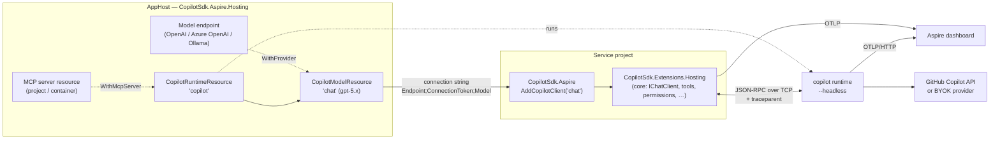

# Copilot SDK for Aspire: design

Status: **Preview — implemented, not yet published to NuGet** · Targets: Aspire 13.x,
`GitHub.Copilot.SDK` 1.0.x. The hosting package targets `net8.0`; the client
package targets `net10.0` and `net8.0`.

This document describes the Aspire integration for the
[GitHub Copilot SDK for .NET](https://github.com/github/copilot-sdk/tree/main/dotnet).
It is deliberately **thin and orchestration-focused**. Everything an application
does with Copilot (agents, `IChatClient`, tools, identity, permissions, testing)
lives in the [core .NET integration](../../dotnet-core/docs/design.md). This
package set only:

- **runs, secures, and wires** the Copilot runtime as an AppHost resource, and
  connects other Aspire resources (MCP servers, BYOK model endpoints) to it; and
- **connects** service projects to it with Aspire's client-integration
  conventions, delegating to the core package.

This mirrors how Aspire layers on libraries elsewhere: `Aspire.Npgsql` on
`Npgsql`, `Aspire.OpenAI` on `OpenAI`.

---

## 1. Goals and non-goals

### Goals

1. **One line to run Copilot in a distributed app.** `builder.AddCopilot("copilot")`
   in the AppHost starts a Copilot runtime locally with zero install, shows it on
   the dashboard, and wires it into referencing projects.
2. **One line to consume it.** `builder.AddCopilotClient("chat")` in a service
   applies the connection string and Aspire's health and telemetry defaults,
   then returns the core `ICopilotBuilder`. Plain core `AddCopilot()` also
   works, since core reads connection strings itself.
3. **End-to-end traces on the dashboard.** App request → Copilot turn → model
   call → tool callback in the app, as one distributed trace.
4. **Aspire-native wiring.** MCP servers and BYOK model endpoints modeled in the
   AppHost are connected by reference, not copied into configuration.
5. **Secure, deployable runtime.** Secrets as parameters, a generated connection
   token, internal-only ingress, and persisted session state.

### Non-goals

- Any application-level API (agents, tools, `IChatClient`, permissions). Those
  belong to core so non-Aspire apps get them too.
- Re-implementing the Copilot runtime or protocol.

---

## 2. What lives where

| Concern | Core (`dotnet-core`) | Aspire (`dotnet-aspire`) |
| --- | --- | --- |
| Runtime process | SDK-managed runtime for single apps, or connect to `Endpoint` | Runs the runtime as a resource (executable / container / existing) |
| Connection settings | `Copilot:Endpoint`, `Copilot:ConnectionToken`, or a connection string | Produces the connection string |
| GitHub service token | `Copilot:GitHubToken` | Secret parameter injected into the **runtime** |
| `IChatClient`, conversations, tools | ✅ | — (uses core) |
| Per-user identity, permissions, approvals | ✅ | — |
| MCP servers | `Copilot:McpServers` configuration | `WithMcpServer(resource)` produces that configuration |
| BYOK provider | `Copilot:Provider` or connection string keys | `WithProvider(resource)` produces the connection string keys |
| Health checks | `AddHealthChecks().AddCopilot()` (opt-in) | AppHost health check on the resource; the client package turns core's on by default |
| Telemetry | MEAI GenAI telemetry on `IChatClient` | Runtime OTLP wiring to the dashboard; the client package enables the MEAI source by default |
| Testing | Fake `IChatClient` | `Aspire.Hosting.Testing` against the real runtime resource |

---

## 3. Architecture



| Package (working name) | Used in | Depends on |
| --- | --- | --- |
| `CopilotSdk.Aspire.Hosting` | AppHost | `Aspire.Hosting`, `GitHub.Copilot.SDK` (bundled runtime, health pings) |
| `CopilotSdk.Aspire` | Service projects | `CopilotSdk.Extensions.Hosting` (core), `OpenTelemetry.Extensions.Hosting` |

> **Naming.** The `Aspire.*` NuGet prefix is reserved by Microsoft, so the
> working prefix is `CopilotSdk.Aspire`, aligned with core's `CopilotSdk.*`.
> Following Aspire convention, extension methods live in the `Aspire.Hosting`
> (AppHost) and `Microsoft.Extensions.Hosting` (client) namespaces.

---

## 4. Hosting integration (AppHost)

### 4.1 The happy path

```csharp
var builder = DistributedApplication.CreateBuilder(args);

var copilot = builder.AddCopilot("copilot");          // Copilot runtime, headless
var chat    = copilot.AddModel("chat", "gpt-5.4");     // model selection as a resource

builder.AddProject<Projects.Api>("api")
       .WithReference(chat)
       .WaitFor(chat);

builder.Build().Run();
```

That is all a developer writes to get a running, authenticated (via the
developer's signed-in Copilot user), observable runtime during `aspire run`.
Plain `WithReference(runtime)` or `WithReference(model)` is enough: MCP server
and reasoning-effort settings are injected into every referencing resource
automatically, so there is no separate `WithCopilot` call.

### 4.2 Resource model

```csharp
public sealed class CopilotRuntimeResource : ExecutableResource, IResourceWithConnectionString
{
    public EndpointReference PrimaryEndpoint { get; }            // "tcp"
    public ParameterResource ConnectionTokenParameter { get; }   // generated secret
    public ParameterResource? GitHubTokenParameter { get; }      // optional secret
    public IResource? InnerResource { get; }                     // the container or connection string after a swap
    public IReadOnlyList<CopilotModelResource> Models { get; }
    public ReferenceExpression ConnectionStringExpression { get; }
    // Endpoint=tcp://{host}:{port};ConnectionToken={token}
}

public sealed class CopilotModelResource : Resource, IResourceWithParent<CopilotRuntimeResource>, IResourceWithConnectionString
{
    public string Model { get; }
    public string? ReasoningEffort { get; }
    public CopilotProviderReference? Provider { get; }
    // {runtime connection string};Model={model}[;Provider=...;ProviderEndpoint=...;ProviderKey=...;WireApi=...]
}
```

`CopilotModelResource` mirrors `AddOpenAI(...).AddModel(...)`: projects
reference *the model they use*, and the client integration picks up endpoint
and model from one connection string. Referencing the runtime directly
(`WithReference(copilot)`) is also supported when an app selects models itself.

`RunAsContainer()` and `AsExisting(...)` swap the running resource for a
`CopilotContainerResource` or a connection string with the same name. The
runtime resource delegates its annotations to the swapped-in resource, so
builder calls made before or after the swap still apply.

### 4.3 How the runtime runs

| Mode | When | What runs |
| --- | --- | --- |
| **Executable** (default for `aspire run`) | Local development | `--headless --host 127.0.0.1 --port {endpoint}`. The executable is resolved from `COPILOT_CLI_PATH`, then the `copilot-runtime` that `GitHub.Copilot.SDK` places in the AppHost output (`runtimes/{rid}/native/copilot-runtime`), then `copilot` on `PATH`. `WithCliPath(path)` overrides it. No CLI install needed. |
| **Container** (`RunAsContainer()`, and always in publish mode) | CI, Linux parity, deployment | Built from a Dockerfile shipped with the package (Debian slim + the checksum-verified CLI release the SDK pins), unless `WithImage(...)` selects a prebuilt image. Binds `0.0.0.0:3000` inside the container, internal-only endpoint. |
| **Existing** | Shared or remotely managed runtime | `AddCopilot("copilot").AsExisting(endpoint, token)`, or plain `builder.AddConnectionString("copilot")`. Nothing is started. |
| **Client-managed** (no resource) | Single-service apps | No AppHost resource; core starts the SDK-managed runtime itself. |

All modes surface the same connection string, so service code never changes.

### 4.4 Authentication and secrets

```csharp
var token = builder.AddParameter("github-token", secret: true);

var copilot = builder.AddCopilot("copilot")
    .WithGitHubToken(token);     // → COPILOT_GITHUB_TOKEN on the runtime
```

- **Executable mode without a token** uses the developer's signed-in Copilot
  user: zero-config local development.
- **Container mode** requires a token. Unless `WithGitHubToken` is called,
  `RunAsContainer` adds a `{name}-github-token` secret parameter, which the
  dashboard prompts for and publish emits as a deployment secret.
- A **connection token** is always generated (`{name}-connection-token`) and
  passed to the runtime as `COPILOT_CONNECTION_TOKEN` and to clients through the
  connection string. `WithConnectionToken(parameter)` replaces it.
- Per-user tokens are a *session* concern handled by core
  ([runtime and identity](../../dotnet-core/docs/design.md#8-runtime-and-identity)),
  not a runtime setting.

### 4.5 Storage and runtime settings

```csharp
copilot.WithDataVolume();                       // named volume at COPILOT_HOME (container mode)
copilot.WithDataBindMount("./.copilot-data");   // bind mount (container) or COPILOT_HOME (executable)
copilot.WithHomeDirectory("./.copilot-home");   // COPILOT_HOME for executable mode
copilot.WithLogLevel(CopilotLogLevel.Debug);    // --log-level
```

Session state lives under `COPILOT_HOME`; persisting it is what lets
conversation resume survive restarts. Executable mode defaults `COPILOT_HOME` to
an AppHost-scoped directory under the local application data folder (not the
developer's `~/.copilot`), so Aspire runs don't mix with interactive CLI
sessions.

### 4.6 Observability wiring

The runtime exports OTLP over **HTTP** only, so `AddCopilot` applies
`WithOtlpExporter(OtlpProtocol.HttpProtobuf)` and sets
`COPILOT_OTEL_ENABLED=true` only when Aspire supplies an OTLP endpoint (the
dashboard is running). Because the SDK propagates `traceparent` on
create/resume/send and restores it on tool callbacks, the dashboard shows one
trace spanning the API request, the Copilot turn, model calls, and tool
execution back in the app. `WithMessageContentCapture()` opts in to
`OTEL_INSTRUMENTATION_GENAI_CAPTURE_MESSAGE_CONTENT` (off by default).

### 4.7 Health

The AppHost health check connects with the SDK and calls `PingAsync` and
`GetAuthStatusAsync`. It is Unhealthy until the runtime answers and is signed
in (or every model uses a BYOK provider), so `WaitFor(copilot)` means "ready to
serve prompts". Dashboard properties and commands (list models, list sessions)
are deferred.

### 4.8 MCP servers as resources

```csharp
var docs = builder.AddProject<Projects.DocsMcp>("docs-mcp");

var copilot = builder.AddCopilot("copilot")
    .WithMcpServer(docs, path: "/mcp", tools: ["search_docs", "get_page"]);
```

`WithMcpServer` makes the runtime wait for the server and flows
`Copilot__McpServers__docs-mcp__Type=http`, `__Url` (resolved for the
**runtime's** network, because the runtime, not the app, makes the MCP calls),
and `__Tools__{i}` to every resource referencing this runtime or its models.
Core exposes only listed tools
([core §7](../../dotnet-core/docs/design.md#7-permissions)); with no `tools`,
the app must list them in `Copilot:McpServers:{server}:Tools` itself. Stdio MCP
servers stay configuration-only.

### 4.9 Models: reasoning effort and BYOK

```csharp
var openai = builder.AddConnectionString("openai");   // Endpoint=https://...;Key=...

var chat = copilot.AddModel("chat", "gpt-5.4")
                  .WithReasoningEffort("high")
                  .WithProvider(openai, wireApi: CopilotWireApi.Responses);
```

- `WithReasoningEffort` flows as the `Copilot__ReasoningEffort` environment
  variable to resources that reference the model.
- `WithProvider(provider, wireApi?, type?)` reads the resource's `Uri` or
  `Endpoint` and `Key` connection properties (or connection string keys) and
  adds `Provider=...;ProviderEndpoint=...;ProviderKey=...;WireApi=...` to the
  model connection string, which core turns into `SessionConfig.Provider`. The
  type is inferred as `azure` for Azure OpenAI and Foundry resources, otherwise
  `openai`. Keyless (Microsoft Entra ID) providers are not supported yet.

### 4.10 AppHost API summary

```csharp
IResourceBuilder<CopilotRuntimeResource> AddCopilot(this IDistributedApplicationBuilder builder, [ResourceName] string name, int? port = null);
IResourceBuilder<CopilotModelResource>   AddModel(this IResourceBuilder<CopilotRuntimeResource> builder, [ResourceName] string name, string model);

// runtime
RunAsContainer(Action<IResourceBuilder<CopilotContainerResource>>? configure = null)
AsExisting(IResourceBuilder<ParameterResource> endpoint, IResourceBuilder<ParameterResource> connectionToken)
WithCliPath(string path) · WithHomeDirectory(string path) · WithLogLevel(CopilotLogLevel level)
WithGitHubToken(IResourceBuilder<ParameterResource> token)
WithConnectionToken(IResourceBuilder<ParameterResource> token)
WithDataVolume(string? name = null) · WithDataBindMount(string source)
WithMcpServer(IResourceBuilder<IResourceWithEndpoints> server, string path = "/mcp", string[]? tools = null, string? endpointName = null)
WithMessageContentCapture(bool enabled = true)

// model
WithReasoningEffort(string effort)
WithProvider(IResourceBuilder<IResourceWithConnectionString> provider, CopilotWireApi? wireApi = null, string? type = null)
```

---

## 5. Client integration (service projects)

The client package is a thin adapter: it points core at an Aspire connection
string, turns on health checks and telemetry by Aspire convention, and returns
the core builder. Everything after that is the core API.

### 5.1 Usage

```csharp
var builder = WebApplication.CreateBuilder(args);
builder.AddServiceDefaults();

builder.AddCopilotClient("chat", o =>               // Aspire: connection string, health, telemetry
        o.Instructions = "You help customers with their orders.")
    .WithTools<OrderTools>();                       // core API from here on
```

### 5.2 API

```csharp
ICopilotBuilder AddCopilotClient(this IHostApplicationBuilder builder, string connectionName,
    Action<CopilotOptions>? configure = null, Action<CopilotClientSettings>? configureSettings = null);

ICopilotBuilder AddKeyedCopilotClient(this IHostApplicationBuilder builder, string connectionName,
    Action<CopilotOptions>? configure = null, Action<CopilotClientSettings>? configureSettings = null);
```

They call core's `AddCopilot()` / `AddCopilot(connectionName)` with
`ConnectionName` set, and then:

| Step | Behavior |
| --- | --- |
| Connection string | Core reads `ConnectionStrings:{connectionName}` (`Endpoint`, `ConnectionToken`, `Model`, `Provider`, `ProviderEndpoint`, `ProviderKey`, `WireApi`) ([core §3.3](../../dotnet-core/docs/design.md#33-configuration)). MCP servers and reasoning effort arrive as `Copilot__*` environment variables. |
| Settings | Binds `Aspire:Copilot:Client` and `Aspire:Copilot:Client:{connectionName}` into `CopilotClientSettings` (`DisableHealthChecks`, `DisableTracing`, `DisableMetrics`, `HealthCheckTimeout`), then `configureSettings`. |
| Health | Registers core's health check as `copilot_{connectionName}` (tag `ready`) unless disabled. |
| Telemetry | Adds the `Experimental.Microsoft.Extensions.AI` source and meter to OpenTelemetry unless disabled, so `AddServiceDefaults()` exports them. |
| Validation | A missing connection string (and no `Copilot:Endpoint`) fails startup validation with a hint to call `WithReference`. |

Configuration in `Copilot:*` (instructions, agents, and so on) still applies on
top, exactly as in a non-Aspire app.

**Keyed clients share one runtime.** Every agent uses one `CopilotClient`; when
the default agent has no endpoint, it takes the one from the keyed client's
connection string. Keyed clients pointing at different runtimes are not
supported.

### 5.3 Connection string format

```
Endpoint=tcp://localhost:52431;ConnectionToken=<secret>;Model=gpt-5.4
  [;Provider=azure;ProviderEndpoint=https://...;ProviderKey=<secret>;WireApi=responses]
```

Keys are case-insensitive and versioned additively; unknown keys are ignored
with a warning so AppHost and service package versions can drift.

---

## 6. Testing

Application behavior is tested by faking `IChatClient`
([core §11](../../dotnet-core/docs/design.md#11-testing-and-other-frameworks)).
Distributed-app tests use `Aspire.Hosting.Testing` as usual, against the real
runtime resource.

Hosting unit tests verify the resource model: environment, arguments, endpoints,
connection string expressions, container and existing swaps, and reference
wiring.

---

## 7. Deployment

In publish mode the runtime always runs as a container (bundled Dockerfile or
`WithImage`) with an internal-only TCP endpoint, the GitHub token and connection
token as secrets, and `COPILOT_HOME` on a volume when `WithDataVolume()` is
used.

Guidance: one runtime per trust boundary; per-user tokens for multi-user
services; scale-out needs sticky session routing or shared session storage.

---

## 8. Repository layout

```
dotnet-aspire/
├── README.md
├── docs/design.md                         # this document
├── CopilotSdk.Aspire.slnx                 # references ../dotnet-core/src projects
├── src/
│   ├── CopilotSdk.Aspire.Hosting/         # resources, Dockerfile, health check
│   └── CopilotSdk.Aspire/                 # client integration over core
└── tests/
    ├── CopilotSdk.Aspire.Hosting.Tests/
    └── CopilotSdk.Aspire.Tests/
```

A sample AppHost (runtime, model, MCP server, and API) is still to come.

---

## 9. Open questions

1. **Package prefix.** `CopilotSdk.Aspire.*` vs. targeting the Aspire Community
   Toolkit (`CommunityToolkit.Aspire.Hosting.GitHub.Copilot`) from day one.
2. **Multiple runtimes.** Keyed clients share one runtime today. Should a
   service be able to connect to several?

---

## 10. Phasing

| Phase | Scope | Status |
| --- | --- | --- |
| **1. Run and connect** | `AddCopilot` (executable, container, existing), `AddModel`, secrets, connection string, OTLP wiring, AppHost health check; `AddCopilotClient` over core. | ✅ Done; sample AppHost to come |
| **2. Aspire-native wiring** | `WithMcpServer(resource)`, `WithProvider(resource)`, `WithReasoningEffort`. | ✅ Done |
| **3. Dashboard and publish** | Dashboard properties and commands, publish/azd validation, keyless providers, documentation chapters. | Planned |
