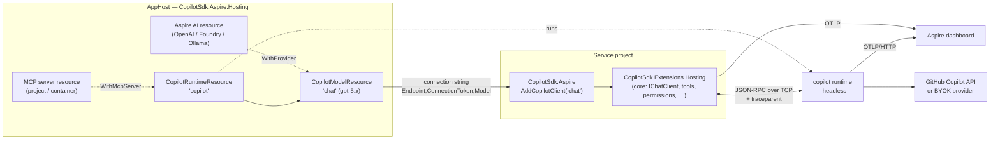

# Copilot SDK for Aspire: design

Status: **Draft** · Targets: Aspire 13.x, .NET 10, `GitHub.Copilot.SDK` 1.0.x.

This document proposes the Aspire integration for the
[GitHub Copilot SDK for .NET](https://github.com/github/copilot-sdk/tree/main/dotnet).
It is deliberately **thin and orchestration-focused**. Everything an application
does with Copilot (agents, `IChatClient`, tools, identity, governance, testing)
lives in the [core .NET integration](../../dotnet-core/docs/design.md). This
package set only:

- **models, runs, secures, and deploys** the Copilot runtime as an AppHost
  resource, and wires other Aspire resources (MCP servers, BYOK model
  deployments) into it; and
- **connects** service projects to it with Aspire's client-integration
  conventions, delegating to the core packages.

This mirrors how Aspire layers on libraries elsewhere: `Aspire.Npgsql` on
`Npgsql`, `Aspire.OpenAI` on `OpenAI`.

---

## 1. Goals and non-goals

### Goals

1. **One line to run Copilot in a distributed app.** `builder.AddCopilot("copilot")`
   in the AppHost starts a Copilot runtime locally with zero install, shows it on
   the dashboard, and wires it into referencing projects.
2. **One line to consume it.** `builder.AddCopilotClient("chat")` in a service
   applies the connection string and Aspire's health and telemetry defaults,
   then returns the core `ICopilotBuilder`. Plain core `AddCopilot()` also
   works, since core reads connection strings itself.
3. **End-to-end traces on the dashboard.** App request → Copilot turn → model
   call → tool callback in the app, as one distributed trace.
4. **Aspire-native wiring.** MCP servers and BYOK model deployments modeled in
   the AppHost are connected by reference, not copied into configuration.
5. **Secure, deployable runtime.** Secrets as parameters, a generated connection
   token, internal-only ingress, and persisted session state on `aspire publish`
   / `azd up`.

### Non-goals

- Any application-level API (agents, tools, `IChatClient`, permissions). Those
  belong to core so non-Aspire apps get them too.
- Re-implementing the Copilot runtime or protocol.

---

## 2. What lives where

| Concern | Core (`dotnet-core`) | Aspire (`dotnet-aspire`) |
| --- | --- | --- |
| Runtime process | Managed stdio runtime for single apps, or connect to `Endpoint` | Runs the runtime as a resource (executable / container / existing) |
| Connection settings | `Copilot:Endpoint`, `Copilot:ConnectionToken`, or a connection string | Produces the connection string |
| GitHub service token | `Copilot:GitHubToken` | Secret parameter injected into the **runtime** |
| `IChatClient`, conversations, tools | ✅ | — (uses core) |
| Per-user identity, permissions, approvals, audit | ✅ | — |
| MCP servers | `Copilot:McpServers` configuration | `WithMcpServer(resource)` produces that configuration |
| BYOK provider | `Copilot:Provider` configuration | `WithProvider(resource)` produces that configuration |
| Health checks | `AddHealthChecks().AddCopilot()` (opt-in) | AppHost health check on the resource; the client package turns core's on by default |
| Telemetry | MEAI GenAI telemetry on `IChatClient` | Runtime OTLP wiring to the dashboard; the client package enables the MEAI source by default |
| Testing | Fake `IChatClient` | `Aspire.Hosting.Testing` against the real runtime resource |
| Deployment | — | Container, secrets, volume, internal ingress |

---

## 3. Architecture



| Package (working name) | Used in | Depends on |
| --- | --- | --- |
| `CopilotSdk.Aspire.Hosting` | AppHost | `Aspire.Hosting`, `GitHub.Copilot.SDK` (bundled runtime, health pings) |
| `CopilotSdk.Aspire` | Service projects | `CopilotSdk.Extensions.Hosting` (core) |

> **Naming.** The `Aspire.*` NuGet prefix is reserved by Microsoft, so the
> working prefix is `CopilotSdk.Aspire`, aligned with core's `CopilotSdk.*`.
> Following Aspire convention, extension methods live in the `Aspire.Hosting`
> (AppHost) and `Microsoft.Extensions.Hosting` (client) namespaces. If upstreamed
> to the Aspire Community Toolkit, the packages would become
> `CommunityToolkit.Aspire.Hosting.GitHub.Copilot` and
> `CommunityToolkit.Aspire.GitHub.Copilot`.

---

## 4. Hosting integration (AppHost)

### 4.1 The happy path

```csharp
var builder = DistributedApplication.CreateBuilder(args);

var copilot = builder.AddCopilot("copilot");          // Copilot runtime, headless
var chat    = copilot.AddModel("chat", "gpt-5.4");     // model selection as a resource

builder.AddProject<Projects.Api>("api")
       .WithReference(chat)
       .WaitFor(chat);

builder.Build().Run();
```

That is all a developer writes to get a running, authenticated (via the
developer's logged-in Copilot user), observable runtime during `aspire run`.

### 4.2 Resource model

```csharp
public sealed class CopilotRuntimeResource(string name)
    : Resource(name), IResourceWithConnectionString, IResourceWithEnvironment,
      IResourceWithEndpoints, IResourceWithWaitSupport
{
    public EndpointReference PrimaryEndpoint { get; }            // "tcp"
    public ParameterResource ConnectionTokenParameter { get; }   // generated secret
    public ParameterResource? GitHubTokenParameter { get; }      // optional secret
    public ReferenceExpression ConnectionStringExpression { get; }
    // Endpoint=tcp://{host}:{port};ConnectionToken={token}
}

public sealed class CopilotModelResource(string name, string model, CopilotRuntimeResource parent)
    : Resource(name), IResourceWithParent<CopilotRuntimeResource>, IResourceWithConnectionString
{
    public string Model { get; }
    // {parent connection string};Model={model}[;Provider=...]
}
```

`CopilotModelResource` mirrors `AddOpenAI(...).AddModel(...)` and
`AddAzureAIFoundry(...).AddDeployment(...)`: projects reference *the model they
use*, and the client integration picks up endpoint and model from one connection
string. Referencing the runtime directly (`WithReference(copilot)`) is also
supported when an app selects models itself.

### 4.3 How the runtime runs

The runtime has no official container image, but the `GitHub.Copilot.SDK`
package already downloads and checksum-verifies a pinned `copilot-runtime` for
the build RID. The hosting package takes advantage of that:

| Mode | When | What runs |
| --- | --- | --- |
| **Executable** (default for `aspire run`) | Local development | The SDK-bundled `copilot-runtime` from the AppHost output, started as an Aspire executable resource with `--headless --host 127.0.0.1 --port {endpoint}`. No CLI install. `WithCliPath(path)` or `COPILOT_CLI_PATH` overrides it. |
| **Container** (`.RunAsContainer()`, and always for publish) | CI, Linux parity, deployment | A Dockerfile shipped with the package (Debian slim + checksum-verified CLI release, same version the SDK pins) via `WithDockerfile`, or `.WithImage(...)` for a prebuilt image in your registry. Binds `0.0.0.0` inside the container. |
| **Existing** | Shared or remotely managed runtime | Standard Aspire: `builder.AddConnectionString("copilot")`, or `AddCopilot("copilot").AsExisting(endpoint, token)`. Nothing is started. |
| **Client-managed** (no resource) | Single-service apps that don't need a shared runtime | No AppHost resource; the client integration falls back to the SDK default (stdio child process). Still gets lifecycle, health, telemetry, and `IChatClient`. |

All modes surface the same connection string, so service code never changes.

### 4.4 Authentication and secrets

```csharp
var token = builder.AddParameter("github-token", secret: true);

var copilot = builder.AddCopilot("copilot")
    .WithGitHubToken(token);     // → COPILOT_GITHUB_TOKEN on the runtime
```

- **Executable mode without a token** uses the developer's logged-in Copilot
  user: zero-config local development.
- **Container and publish modes** require a token. If none is supplied,
  `AddCopilot` creates a `{name}-github-token` secret parameter so the dashboard
  prompts for it (Aspire interactive parameters) and `aspire publish` emits it as
  a deployment secret. Credentials never appear in code or `appsettings.json`.
- A **connection token** is always generated
  (`CreateDefaultPasswordParameter`) and passed to the runtime as
  `COPILOT_CONNECTION_TOKEN` and to clients through the connection string. The
  endpoint is internal-only (`isExternal: false`) when published.
- Per-user tokens are a *session* concern handled by the core integration
  ([per-user identity](../../dotnet-core/docs/design.md#8-identity)), not a
  runtime setting.

### 4.5 Storage

```csharp
copilot.WithDataVolume();                       // named volume at COPILOT_HOME (container)
copilot.WithDataBindMount("./.copilot-data");
copilot.WithLifetime(ContainerLifetime.Persistent);
```

Session state lives under `COPILOT_HOME`; persisting it is what lets
conversation resume survive restarts. Executable mode defaults `COPILOT_HOME` to
an AppHost-scoped directory (not the developer's `~/.copilot`) so Aspire runs
don't mix with interactive CLI sessions; `WithHomeDirectory(path)` overrides it.

### 4.6 Observability wiring

The runtime exports OTLP over **HTTP** only (`http/json` or `http/protobuf`), so
`AddCopilot` applies `WithOtlpExporter(OtlpProtocol.HttpProtobuf)` and sets
`COPILOT_OTEL_ENABLED=true`. Because the SDK propagates `traceparent` on
create/resume/send and restores it on tool callbacks, the dashboard shows one
trace spanning the API request, the Copilot turn, model calls, and tool execution
back in the app. `WithMessageContentCapture()` opts in to
`OTEL_INSTRUMENTATION_GENAI_CAPTURE_MESSAGE_CONTENT` (off by default).

### 4.7 Health, dashboard state, and commands

- **Health check** (on by default): connects with the SDK and calls `PingAsync`
  and `GetAuthStatusAsync`. Unhealthy until authenticated, so `WaitFor(copilot)`
  means "ready to serve prompts".
- **Dashboard properties**: runtime version, auth status and login, active
  session count, available models (`ListModelsAsync`).
- **Dashboard commands** (`WithCommand`): *List models*, *List sessions*,
  *Delete idle sessions*, *Check authentication*. Destructive commands require
  confirmation.

### 4.8 MCP servers as resources

Aspire already models MCP servers as projects or containers. Let the AppHost
connect them to Copilot instead of copying URLs into configuration:

```csharp
var docs = builder.AddProject<Projects.DocsMcp>("docs-mcp");

var copilot = builder.AddCopilot("copilot")
    .WithMcpServer(docs, path: "/mcp", tools: ["search_docs", "get_page"]);
```

`WithMcpServer` adds a wait dependency and flows
`Copilot__McpServers__docs-mcp__Url` (resolved for the **runtime's** network
context, because the runtime, not the app, makes the MCP calls) plus the
allow-listed tools to every project referencing this runtime or its models.
Stdio MCP servers stay configuration-only (they run in the runtime's process
space). Only the server's listed tools are allowed
([core §7](../../dotnet-core/docs/design.md#7-permissions)).

### 4.9 BYOK through existing Aspire AI resources

```csharp
var foundry = builder.AddAzureAIFoundry("foundry");
var gpt     = foundry.AddDeployment("gpt", "gpt-5.2-codex", "2026-01-01", "OpenAI");

var chat = copilot.AddModel("chat", "gpt-5.2-codex")
                  .WithProvider(gpt, wireApi: CopilotWireApi.Responses);
```

`WithProvider` composes the referenced resource's endpoint and key into the model
connection string (`Provider=azure;ProviderEndpoint=...;ProviderKey=...`), which
the client turns into `SessionConfig.Provider`. Supported sources: OpenAI,
Azure OpenAI / Foundry, Ollama (Community Toolkit), and any
`IResourceWithConnectionString` exposing an OpenAI-compatible endpoint. "Use
Copilot's agent runtime with my own model" becomes a one-liner, while sessions
still run in the Copilot runtime.

### 4.10 AppHost API summary

```csharp
IResourceBuilder<CopilotRuntimeResource> AddCopilot(this IDistributedApplicationBuilder builder, [ResourceName] string name, int? port = null);
IResourceBuilder<CopilotModelResource>   AddModel(this IResourceBuilder<CopilotRuntimeResource> builder, [ResourceName] string name, string model);

// runtime
RunAsContainer(Action<IResourceBuilder<CopilotContainerResource>>? configure = null)
AsExisting(IResourceBuilder<ParameterResource> endpoint, IResourceBuilder<ParameterResource> connectionToken)
WithCliPath(string path) · WithHomeDirectory(string path) · WithLogLevel(CopilotLogLevel level)
WithGitHubToken(IResourceBuilder<ParameterResource> token)
WithConnectionToken(IResourceBuilder<ParameterResource> token)
WithDataVolume(string? name = null) · WithDataBindMount(string source)
WithMcpServer(IResourceBuilder<IResourceWithEndpoints> server, string path = "/mcp", string[]? tools = null)
WithMessageContentCapture(bool enabled = true)

// model
WithReasoningEffort(string effort)
WithProvider(IResourceBuilder<IResourceWithConnectionString> provider, CopilotWireApi? wireApi = null)
```

---

## 5. Client integration (service projects)

The client package is a thin adapter: it turns an Aspire connection string into
core options, turns on health checks and telemetry by Aspire convention, and
returns the core builder. Everything after that is the core API.

### 5.1 Usage

```csharp
var builder = WebApplication.CreateBuilder(args);
builder.AddServiceDefaults();

builder.AddCopilotClient("chat", o =>               // Aspire: connection string, health, telemetry
        o.Instructions = "You help customers with their orders.")
    .WithTools<OrderTools>();                       // core API from here on
```

### 5.2 API

```csharp
ICopilotBuilder AddCopilotClient(this IHostApplicationBuilder builder, string connectionName,
    Action<CopilotOptions>? configure = null, Action<CopilotClientSettings>? configureSettings = null);

ICopilotBuilder AddKeyedCopilotClient(this IHostApplicationBuilder builder, string connectionName,
    Action<CopilotOptions>? configure = null, Action<CopilotClientSettings>? configureSettings = null);
```

It calls core's `AddCopilot()` / `AddCopilot(name)` with `ConnectionName` set, and then:

| Step | Behavior |
| --- | --- |
| Connection string | Parses `ConnectionStrings:{connectionName}` (`Endpoint`, `ConnectionToken`, `Model`, `Provider*`, `McpServers*`) into `Copilot:Endpoint`, `Copilot:ConnectionToken`, `Copilot:Model`, `Copilot:Provider`, and `Copilot:McpServers`. Uses core's parser, so core alone can also read it ([core §3.5](../../dotnet-core/docs/design.md#35-using-core-with-or-without-aspire)); this package adds Aspire settings and defaults. |
| Settings | Binds `Aspire:Copilot:Client` and `Aspire:Copilot:Client:{connectionName}` (`DisableHealthChecks`, `DisableTracing`, `DisableMetrics`, `HealthCheckTimeout`), per Aspire precedence rules. |
| Health | Registers core's health check as `copilot_{connectionName}` (tag `ready`) unless disabled. |
| Telemetry | Adds the MEAI GenAI source and meter to OpenTelemetry unless disabled, so `AddServiceDefaults()` exports them. |
| Defaults | `Mode = Empty` (shared runtime); a missing connection string fails at startup with an actionable message. |

Configuration in `Copilot:*` (instructions, agents, and so on) still applies on
top, exactly as in a non-Aspire app.

### 5.3 Connection string format

```
Endpoint=tcp://localhost:52431;ConnectionToken=<secret>;Model=gpt-5.4
  [;Provider=azure;ProviderEndpoint=https://...;ProviderKey=<secret>;WireApi=responses]
  [;McpServers=docs-mcp]   (URLs and tools flow as Copilot__McpServers__* environment variables)
```

Keys are case-insensitive and versioned additively; unknown keys are ignored
with a warning so AppHost and service package versions can drift.

---

## 6. Testing

Application behavior is tested by faking `IChatClient`
([core §11](../../dotnet-core/docs/design.md#11-testing-and-other-frameworks)).
Distributed-app tests use `Aspire.Hosting.Testing` as usual, against the real
runtime resource (or a local BYOK model through `WithProvider`). A dedicated
test-runtime package is deferred until core has a scripted runtime.

Hosting unit tests verify the resource model: environment, arguments, endpoints,
connection string expression, manifest/publish output, and health check wiring.

---

## 7. Deployment

`aspire publish` / `azd up` produce:

- A container for the runtime (bundled Dockerfile or `WithImage`) with
  internal-only ingress on its TCP port.
- Secrets for the GitHub token and the generated connection token.
- A persistent volume (for example, Azure Files on Container Apps) for
  `COPILOT_HOME` when `WithDataVolume()` is used.
- OTLP wired to the target's telemetry backend.

Documentation guidance: one runtime per trust boundary; `Mode = Empty` plus
per-user tokens for multi-user services; scale-out needs sticky session routing
or shared session storage (link to the SDK scaling guide).

---

## 8. Proposed repository layout

```
dotnet-aspire/
├── README.md
├── docs/design.md                         # this document
├── CopilotSdk.Aspire.slnx                 # references ../dotnet-core/src projects
├── src/
│   ├── CopilotSdk.Aspire.Hosting/         # resources, Dockerfile, health check, commands
│   └── CopilotSdk.Aspire/                 # connection string → core options, service defaults
├── samples/
│   ├── CopilotSample.AppHost/             # runtime + model + MCP server + API (+ BYOK variant)
│   ├── CopilotSample.ServiceDefaults/
│   ├── CopilotSample.Api/                 # reuses the core SupportApi shape
│   └── CopilotSample.DocsMcp/             # tiny HTTP MCP server
└── tests/
    ├── CopilotSdk.Aspire.Hosting.Tests/
    ├── CopilotSdk.Aspire.Tests/
    └── CopilotSdk.Aspire.EndToEnd.Tests/
```

CI: a job scoped to `dotnet-aspire/**` **and** `dotnet-core/**`, since Aspire
builds on core.

---

## 9. Open questions

1. **Package prefix.** `CopilotSdk.Aspire.*` vs. targeting the Aspire Community
   Toolkit from day one.
2. **Default run mode.** Bundled-runtime executable (fast, no Docker) vs.
   container (Linux parity, matches publish). Proposal: executable for run,
   container for publish.
3. **MCP URL resolution.** Confirm the Aspire 13 API for resolving an endpoint
   in the *runtime's* network context when the value is delivered to a different
   resource (the app).
4. **Connection string scope.** Should MCP and provider details travel in the
   connection string or as separate `Copilot__*` environment variables? Proposal:
   endpoint/token/model in the connection string, the rest as environment
   variables.
5. **Folder layout.** Separate `dotnet-core/` and `dotnet-aspire/` vs. one
   `dotnet/` solution (see core open questions).

---

## 10. Phasing

Aspire phases trail the matching core phases.

| Phase | Scope |
| --- | --- |
| **1. Run and connect** | `AddCopilot` (executable, container, existing), `AddModel`, secrets, connection string, OTLP wiring, AppHost health check; `AddCopilotClient` over core phase 1; sample AppHost and API. |
| **2. Aspire-native wiring** | `WithMcpServer(resource)`, `WithProvider(resource)`, dashboard properties and commands. |
| **3. Publish** | Publish/azd validation, documentation chapters. |
