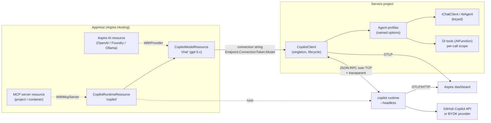

# Copilot SDK for Aspire: design

Status: **Draft** · Targets: Aspire 13.x, .NET 10 (`net8.0` where practical),
`GitHub.Copilot.SDK` 1.0.x, `Microsoft.Extensions.AI` 10.x.

This document proposes an Aspire integration for the
[GitHub Copilot SDK for .NET](https://github.com/github/copilot-sdk/tree/main/dotnet).
The [Spring Boot starter](../../spring-boot/) is the reference for *capabilities*,
not for *shape*. Every API here is expressed the way Aspire and modern .NET
expect: an AppHost resource model, `IHostApplicationBuilder` client extensions,
named/keyed services, `IOptions<T>`, `Microsoft.Extensions.AI` abstractions,
`IHealthCheck`, and OpenTelemetry.

---

## 1. Goals and non-goals

### Goals

1. **One line to run Copilot in an Aspire app.** `builder.AddCopilot("copilot")`
   in the AppHost starts a Copilot runtime locally with zero install, shows it on
   the dashboard, and wires it into referencing projects.
2. **One line to consume it.** `builder.AddCopilotClient("copilot")` in a service
   registers a lifecycle-managed `CopilotClient`, health check, and telemetry.
3. **Speak `Microsoft.Extensions.AI`.** Any code written against `IChatClient`
   (and Microsoft Agent Framework's `AIAgent`) works against Copilot unchanged.
4. **End-to-end traces on the dashboard.** App request → Copilot turn → model
   call → tool callback in the app, as one distributed trace.
5. **Safe by default.** No implicit tool approval, connection-token-protected
   runtime, explicit tool/MCP allow-lists, isolated (`Empty`) client mode for
   shared runtimes.
6. **Same deployment story as any Aspire resource.** `azd up` / `aspire publish`
   produce a container with secrets as parameters and persisted session state.

### Non-goals (for v1)

- Re-implementing the Copilot runtime or protocol.
- Replacing the Microsoft Agent Framework orchestration (we plug into it).
- A Java-style dynamic-proxy agent model. Typed agents are a later,
  source-generated option (see §9).

---

## 2. Spring Boot → Aspire mapping

| Spring Boot starter | Aspire integration (this design) |
| --- | --- |
| `copilot.cli-path`, `copilot.cli-url` properties | AppHost **`CopilotRuntimeResource`**; referencing projects get a connection string |
| Auto-configured `CopilotClient` bean, lazy/eager | `AddCopilotClient()` singleton + hosted-service lifecycle, lazy by default |
| `CopilotConnectionDetails` / `@ServiceConnection` | Aspire **connection strings** (`ConnectionStrings:copilot`) |
| `@CopilotAgent` interfaces | Named **agent profiles** consumed as keyed `IChatClient` / `AIAgent` / session factory |
| `@UserMessage` prompt templates | Plain C# (interpolated strings); optional typed agents later |
| `CompletableFuture<T>` structured results | `IChatClient.GetResponseAsync<T>()` (MEAI) / `SendAndWaitAsync<T>()` (SDK) |
| `Flux<CopilotAgentEvent>` (Reactor module) | `IAsyncEnumerable<ChatResponseUpdate>` / `IAsyncEnumerable<SessionEvent>` — no extra module |
| `@ConversationId` | `ChatOptions.ConversationId` / MAF `AgentThread` |
| Spring beans with `@CopilotTool` | DI services exposed as `AIFunction`s, invoked in a **per-call DI scope** |
| `copilot.mcp.servers.*` | Config-driven MCP servers **plus** AppHost-modeled MCP resources (`WithMcpServer(resource)`) |
| `copilot.providers.*` (BYOK) | Config-driven providers **plus** AppHost references to existing Aspire AI resources (OpenAI, Foundry, Ollama) |
| `CopilotTokenResolver`, Spring Security OAuth2 | `ICopilotTokenProvider`; ASP.NET Core package reads the user's access token from `HttpContext` |
| Permission policies, allow/deny lists, hook beans | `CopilotPermissionPolicy` options + `ICopilotPermissionHandler` / `ICopilotSessionHooks` services |
| Actuator health / info / `copilot` endpoint | `IHealthCheck` (tag `ready`) + **dashboard properties and commands** |
| Micrometer observations and counters | OpenTelemetry: runtime OTLP export + MEAI GenAI spans/metrics + integration `ActivitySource`/`Meter` |
| `copilot-spring-boot-test` scripted runtime, Testcontainers | `…Testing` package: scripted fake runtime + `Aspire.Hosting.Testing` support |

---

## 3. Architecture



The integration follows Aspire's two-sided convention (hosting + client):

| Package (working name) | Used in | Depends on |
| --- | --- | --- |
| `CopilotSdk.Aspire.Hosting` | AppHost | `Aspire.Hosting`, `GitHub.Copilot.SDK` (bundled runtime, health pings) |
| `CopilotSdk.Aspire` | Service projects | `GitHub.Copilot.SDK`, `Microsoft.Extensions.AI`, hosting/options/health abstractions |
| `CopilotSdk.Aspire.Agents` | Service projects (optional) | `CopilotSdk.Aspire`, `Microsoft.Agents.AI.GitHub.Copilot` |
| `CopilotSdk.Aspire.AspNetCore` | Web projects (optional) | `CopilotSdk.Aspire`, ASP.NET Core authentication |
| `CopilotSdk.Aspire.Testing` | Test projects | `CopilotSdk.Aspire`, `Aspire.Hosting.Testing` |

> **Naming.** The `Aspire.*` NuGet prefix is reserved by Microsoft and
> `GitHub.*` is likely reserved by GitHub, so the working package prefix is
> `CopilotSdk.Aspire`. Following Aspire convention, public *extension methods*
> live in the `Aspire.Hosting` (AppHost) and `Microsoft.Extensions.Hosting`
> (client) namespaces so they light up without extra `using`s; types live in
> `CopilotSdk.Aspire.*`. If the work is upstreamed to the Aspire Community
> Toolkit, packages would become `CommunityToolkit.Aspire.Hosting.GitHub.Copilot`
> and `CommunityToolkit.Aspire.GitHub.Copilot`.

---

## 4. Hosting integration (AppHost)

### 4.1 The happy path

```csharp
var builder = DistributedApplication.CreateBuilder(args);

var copilot = builder.AddCopilot("copilot");          // Copilot runtime, headless
var chat    = copilot.AddModel("chat", "gpt-5.4");     // model selection as a resource

builder.AddProject<Projects.Api>("api")
       .WithReference(chat)
       .WaitFor(chat);

builder.Build().Run();
```

That is all a developer writes to get a running, authenticated (via the
developer's logged-in Copilot user), observable runtime during `aspire run`.

### 4.2 Resource model

```csharp
public sealed class CopilotRuntimeResource(string name)
    : Resource(name), IResourceWithConnectionString, IResourceWithEnvironment,
      IResourceWithEndpoints, IResourceWithWaitSupport
{
    public EndpointReference PrimaryEndpoint { get; }            // "tcp"
    public ParameterResource ConnectionTokenParameter { get; }   // generated secret
    public ParameterResource? GitHubTokenParameter { get; }      // optional secret
    public ReferenceExpression ConnectionStringExpression { get; }
    // Endpoint=tcp://{host}:{port};ConnectionToken={token}
}

public sealed class CopilotModelResource(string name, string model, CopilotRuntimeResource parent)
    : Resource(name), IResourceWithParent<CopilotRuntimeResource>, IResourceWithConnectionString
{
    public string Model { get; }
    // {parent connection string};Model={model}[;Provider=...]
}
```

`CopilotModelResource` mirrors `AddOpenAI(...).AddModel(...)` and
`AddAzureAIFoundry(...).AddDeployment(...)`: projects reference *the model they
use*, and the client integration picks up endpoint and model from one connection
string. Referencing the runtime directly (`WithReference(copilot)`) is also
supported when an app selects models itself.

### 4.3 How the runtime runs

The runtime has no official container image, but the `GitHub.Copilot.SDK`
package already downloads and checksum-verifies a pinned `copilot-runtime` for
the build RID. The hosting package takes advantage of that:

| Mode | When | What runs |
| --- | --- | --- |
| **Executable** (default for `aspire run`) | Local development | The SDK-bundled `copilot-runtime` from the AppHost output, started as an Aspire executable resource with `--headless --host 127.0.0.1 --port {endpoint}`. No CLI install. `WithCliPath(path)` or `COPILOT_CLI_PATH` overrides it. |
| **Container** (`.RunAsContainer()`, and always for publish) | CI, Linux parity, deployment | A Dockerfile shipped with the package (Debian slim + checksum-verified CLI release, same version the SDK pins) via `WithDockerfile`, or `.WithImage(...)` for a prebuilt image in your registry. Binds `0.0.0.0` inside the container. |
| **Existing** | Shared or remotely managed runtime | Standard Aspire: `builder.AddConnectionString("copilot")`, or `AddCopilot("copilot").AsExisting(endpoint, token)`. Nothing is started. |
| **Client-managed** (no resource) | Single-service apps that don't need a shared runtime | No AppHost resource; the client integration falls back to the SDK default (stdio child process). Still gets lifecycle, health, telemetry, and `IChatClient`. |

All modes surface the same connection string, so service code never changes.

### 4.4 Authentication and secrets

```csharp
var token = builder.AddParameter("github-token", secret: true);

var copilot = builder.AddCopilot("copilot")
    .WithGitHubToken(token);     // → COPILOT_GITHUB_TOKEN on the runtime
```

- **Executable mode without a token** uses the developer's logged-in Copilot
  user: zero-config local development.
- **Container and publish modes** require a token. If none is supplied,
  `AddCopilot` creates a `{name}-github-token` secret parameter so the dashboard
  prompts for it (Aspire interactive parameters) and `aspire publish` emits it as
  a deployment secret. Credentials never appear in code or `appsettings.json`.
- A **connection token** is always generated
  (`CreateDefaultPasswordParameter`) and passed to the runtime as
  `COPILOT_CONNECTION_TOKEN` and to clients through the connection string. The
  endpoint is internal-only (`isExternal: false`) when published.
- Per-user tokens are a *session* concern handled in the client (§5.7), not a
  runtime setting.

### 4.5 Storage

```csharp
copilot.WithDataVolume();                       // named volume at COPILOT_HOME (container)
copilot.WithDataBindMount("./.copilot-data");
copilot.WithLifetime(ContainerLifetime.Persistent);
```

Session state lives under `COPILOT_HOME`; persisting it is what lets
conversation resume survive restarts. Executable mode defaults `COPILOT_HOME` to
an AppHost-scoped directory (not the developer's `~/.copilot`) so Aspire runs
don't mix with interactive CLI sessions; `WithHomeDirectory(path)` overrides it.

### 4.6 Observability wiring

The runtime exports OTLP over **HTTP** only (`http/json` or `http/protobuf`), so
`AddCopilot` applies `WithOtlpExporter(OtlpProtocol.HttpProtobuf)` and sets
`COPILOT_OTEL_ENABLED=true`. Because the SDK propagates `traceparent` on
create/resume/send and restores it on tool callbacks, the dashboard shows one
trace spanning the API request, the Copilot turn, model calls, and tool execution
back in the app. `WithMessageContentCapture()` opts in to
`OTEL_INSTRUMENTATION_GENAI_CAPTURE_MESSAGE_CONTENT` (off by default).

### 4.7 Health, dashboard state, and commands

- **Health check** (on by default): connects with the SDK and calls `PingAsync`
  and `GetAuthStatusAsync`. Unhealthy until authenticated, so `WaitFor(copilot)`
  means "ready to serve prompts".
- **Dashboard properties**: runtime version, auth status and login, active
  session count, available models (`ListModelsAsync`).
- **Dashboard commands** (`WithCommand`): *List models*, *List sessions*,
  *Delete idle sessions*, *Check authentication*. Destructive commands require
  confirmation.

### 4.8 MCP servers as resources

Aspire already models MCP servers as projects or containers. Let the AppHost
connect them to Copilot instead of copying URLs into configuration:

```csharp
var docs = builder.AddProject<Projects.DocsMcp>("docs-mcp");

var copilot = builder.AddCopilot("copilot")
    .WithMcpServer(docs, path: "/mcp", tools: ["search_docs", "get_page"]);
```

`WithMcpServer` adds a wait dependency and flows
`Copilot__McpServers__docs-mcp__Url` (resolved for the **runtime's** network
context, because the runtime, not the app, makes the MCP calls) plus the
allow-listed tools to every project referencing this runtime or its models.
Stdio MCP servers stay configuration-only (they run in the runtime's process
space). Agent profiles still opt in per agent (§5.4); declaring a server in the
AppHost never grants it to every agent.

### 4.9 BYOK through existing Aspire AI resources

```csharp
var foundry = builder.AddAzureAIFoundry("foundry");
var gpt     = foundry.AddDeployment("gpt", "gpt-5.2-codex", "2026-01-01", "OpenAI");

var chat = copilot.AddModel("chat", "gpt-5.2-codex")
                  .WithProvider(gpt, wireApi: CopilotWireApi.Responses);
```

`WithProvider` composes the referenced resource's endpoint and key into the model
connection string (`Provider=azure;ProviderEndpoint=...;ProviderKey=...`), which
the client turns into `SessionConfig.Provider`. Supported sources: OpenAI,
Azure OpenAI / Foundry, Ollama (Community Toolkit), and any
`IResourceWithConnectionString` exposing an OpenAI-compatible endpoint. "Use
Copilot's agent runtime with my own model" becomes a one-liner, while sessions
still run in the Copilot runtime.

### 4.10 AppHost API summary

```csharp
IResourceBuilder<CopilotRuntimeResource> AddCopilot(this IDistributedApplicationBuilder builder, [ResourceName] string name, int? port = null);
IResourceBuilder<CopilotModelResource>   AddModel(this IResourceBuilder<CopilotRuntimeResource> builder, [ResourceName] string name, string model);

// runtime
RunAsContainer(Action<IResourceBuilder<CopilotContainerResource>>? configure = null)
AsExisting(IResourceBuilder<ParameterResource> endpoint, IResourceBuilder<ParameterResource> connectionToken)
WithCliPath(string path) · WithHomeDirectory(string path) · WithLogLevel(CopilotLogLevel level)
WithGitHubToken(IResourceBuilder<ParameterResource> token)
WithConnectionToken(IResourceBuilder<ParameterResource> token)
WithDataVolume(string? name = null) · WithDataBindMount(string source)
WithMcpServer(IResourceBuilder<IResourceWithEndpoints> server, string path = "/mcp", string[]? tools = null)
WithMessageContentCapture(bool enabled = true)

// model
WithReasoningEffort(string effort)
WithProvider(IResourceBuilder<IResourceWithConnectionString> provider, CopilotWireApi? wireApi = null)
```

---

## 5. Client integration (service projects)

### 5.1 The happy path

```csharp
var builder = WebApplication.CreateBuilder(args);
builder.AddServiceDefaults();

builder.AddCopilotClient("chat")      // connection name from the AppHost
       .AddChatClient();              // IChatClient backed by Copilot sessions

var app = builder.Build();

app.MapPost("/ask", async (IChatClient chat, Question q, CancellationToken ct) =>
    (await chat.GetResponseAsync(q.Text, cancellationToken: ct)).Text);

app.Run();
```

### 5.2 Registration API

```csharp
CopilotClientBuilder AddCopilotClient(this IHostApplicationBuilder builder, string connectionName,
    Action<CopilotClientSettings>? configureSettings = null,
    Action<CopilotClientOptions>? configureOptions = null);

CopilotClientBuilder AddKeyedCopilotClient(this IHostApplicationBuilder builder, string name, ...);

// on CopilotClientBuilder (mirrors AspireOpenAIClientBuilder)
ChatClientBuilder   AddChatClient(string? agentName = null);
ChatClientBuilder   AddKeyedChatClient(string serviceKey, string? agentName = null);
CopilotAgentBuilder AddAgent(string name, Action<CopilotAgentOptions>? configure = null);
```

- Registers `CopilotClient` as a singleton (keyed for `AddKeyed…`), built from
  the connection string, `CopilotClientSettings`, and the `configureOptions`
  callback (the escape hatch to every native SDK option).
- Registers `ICopilotSessionFactory` (create/resume sessions with an agent
  profile applied): the native-SDK path for code that wants `CopilotSession`.
- `AddChatClient` returns MEAI's `ChatClientBuilder` so standard middleware
  composes (`.UseLogging()`, `.UseDistributedCache()`, custom middleware).
  `.UseFunctionInvocation()` is *not* needed because the runtime drives tool
  calls. `.UseOpenTelemetry()` is applied by default (disable through settings).

### 5.3 Settings and configuration

`CopilotClientSettings` binds from `Aspire:Copilot:Client` (and
`Aspire:Copilot:Client:{connectionName}`), then from
`ConnectionStrings:{connectionName}`, following Aspire's precedence rules.

```jsonc
{
  "ConnectionStrings": { "chat": "Endpoint=tcp://localhost:4321;ConnectionToken=...;Model=gpt-5.4" },
  "Aspire": {
    "Copilot": {
      "Client": {
        "Endpoint": null,              // overrides connection string parts
        "ConnectionToken": null,
        "Model": null,
        "Mode": "Empty",               // Empty | CopilotCli (see 5.8)
        "EagerStart": false,
        "StartupTimeout": "00:00:30",
        "DisableHealthChecks": false,
        "HealthCheckTimeout": "00:00:05",
        "DisableTracing": false,
        "DisableMetrics": false
      }
    }
  },
  "Copilot": {
    "Agents": {
      "support": {
        "Model": "gpt-5.4",
        "ReasoningEffort": "medium",
        "Instructions": "You help customers with orders.",
        "InstructionsMode": "Append",          // Append | Replace
        "McpServers": [ "docs-mcp" ],
        "Provider": null,
        "AvailableTools": [ "custom:*", "mcp:docs-mcp-search_docs" ],
        "ExcludedTools": [],
        "ResponseTimeout": "00:01:00",
        "Permissions": { "AllowTools": [ "lookup_order" ], "AllowReadOnly": false }
      }
    },
    "McpServers": { "docs-mcp": { "Type": "http", "Url": "https://...", "Tools": [ "search_docs" ] } },
    "Providers":  { "local": { "Type": "openai", "BaseUrl": "http://localhost:11434/v1" } },
    "Execution":  { "MaxConcurrentTurns": 8, "MaxQueuedTurns": 64 }
  }
}
```

The `Copilot:*` section deliberately has the same shape as the Spring starter's
`copilot.*` properties (agents, MCP servers, providers, execution), so docs and
mental models transfer across languages. Options are validated at startup with
`ValidateOnStart()` and source-generated `[OptionsValidator]` validators (no
reflection, AOT-friendly), matching Spring's fail-fast validation.

### 5.4 Agent profiles

An **agent profile** is a named, validated `CopilotAgentOptions` (a
`SessionConfig` template): model, instructions, tools, MCP servers, provider,
tool allow/deny lists, permission policy, hooks, and timeout. Profiles are the
single concept behind every consumption surface:

```csharp
builder.AddCopilotClient("chat")
    .AddAgent("support", agent => agent
        .WithInstructions("You help customers with orders. Be concise.")
        .WithTools<OrderTools>()                 // DI service → AIFunctions
        .WithMcpServer("docs-mcp")
        .AllowTools("lookup_order"))
    .AddChatClient();                            // IChatClient keyed "support"
```

| Surface | Resolve as | Best for |
| --- | --- | --- |
| `IChatClient` | `[FromKeyedServices("support")] IChatClient` | Portable MEAI code, structured output, streaming |
| `AIAgent` (`.Agents` package) | `[FromKeyedServices("support")] AIAgent` | Microsoft Agent Framework workflows and orchestration |
| `ICopilotSessionFactory` | `factory.CreateSessionAsync("support")` | Full native SDK: events, attachments, hooks, canvases |

Configuration under `Copilot:Agents:{name}` overrides code, so operators can
change a model or tighten tools without a rebuild. The default profile
(`AddChatClient()` with no agent) uses the model from the connection string and
no custom tools.

### 5.5 `IChatClient` semantics

Copilot sessions are stateful; `IChatClient` is message-oriented. The adapter maps:

| MEAI | Copilot |
| --- | --- |
| `ChatOptions.ConversationId` set | Resume that session; send only new user content |
| `ChatOptions.ConversationId` unset | Create a session; `ChatResponse.ConversationId` returns its id |
| System messages | `SystemMessage` (append mode) |
| `ChatOptions.ModelId`, `Reasoning` | `Model`, `ReasoningEffort` |
| `ChatOptions.Tools` (`AIFunction`) | Session tools, merged with the profile's tools |
| `ChatOptions.ResponseFormat` (JSON schema) | SDK structured output, so `GetResponseAsync<T>()` works |
| `GetStreamingResponseAsync` | `Streaming = true`; deltas → `ChatResponseUpdate` |
| `UsageDetails` | Session usage events (input, output, cached tokens) |
| `CancellationToken` | `session.AbortAsync()`: real cancellation of the in-flight turn |
| `DataContent` images and files | Message attachments |

Multi-turn history *without* a `ConversationId` is rendered as a transcript in
the first prompt (configurable to throw instead; see §9). Calls sharing a
`ConversationId` are serialized per conversation, mirroring the Spring starter.

### 5.6 Tools from DI

```csharp
public sealed class OrderTools(AppDbContext db)
{
    [Description("Looks up an order by id.")]
    public async Task<OrderDto?> LookupOrder([Description("Order id")] int id, CancellationToken ct)
        => await db.Orders.Where(o => o.Id == id).Select(o => o.ToDto()).FirstOrDefaultAsync(ct);
}

builder.Services.AddScoped<OrderTools>();
agent.WithTools<OrderTools>();                               // public methods with [Description]
agent.WithTool("now", () => TimeProvider.System.GetUtcNow()); // ad hoc delegate
```

- Built with `AIFunctionFactory` (the SDK's own tool type), so schemas match
  what MEAI and MAF produce.
- **Each tool call runs in a fresh `IServiceScope`**, so scoped services
  (`DbContext`, unit of work) behave as they do in a request. This is the .NET
  analogue of Spring invoking tools through the bean proxy.
- Tool callbacks arrive on the SDK's RPC thread, so the integration captures an
  `ICopilotInvocationContext` (caller `ClaimsPrincipal`, `Activity`, culture,
  logging scope, agent name, session id) at turn start and restores it in the
  tool scope. Tools inject `ICopilotInvocationContext` to see *who* asked.

### 5.7 Per-user identity

```csharp
builder.AddCopilotClient("chat")
       .AddChatClient()
       .WithUserGitHubTokens();                 // CopilotSdk.Aspire.AspNetCore
```

- `ICopilotTokenProvider` → SDK `GitHubTokenProvider` per session. Returning
  `null` falls back to the runtime's ambient identity only if
  `AllowAmbientFallback` is set (off by default, as in Spring).
- The ASP.NET Core package implements it from the authenticated user's GitHub
  access token (`HttpContext.GetTokenAsync("access_token")` for a configured
  scheme), captured at turn start so refreshes outside the request still work.
- Per-user conversation ids should be namespaced (`{tenant}/{user}/{key}`);
  `CopilotConversationId.For(user, key)` helps avoid cross-user resume.

### 5.8 Governance and safe defaults

| Default | Rationale |
| --- | --- |
| No permission handler ⇒ **deny** | Never approve tool use implicitly (same as Spring). |
| `Mode = Empty` when connecting to a shared or remote runtime | No ambient OS tools in multi-user servers (SDK multi-tenancy guidance). `CopilotCli` is opt-in. |
| MCP servers available only to agents that list them | AppHost wiring makes servers *known*, not *granted*. |
| Connection token required for non-loopback TCP endpoints | Startup fails otherwise. |
| Message content not captured in telemetry | Opt-in only. |

Policies: `CopilotPermissionPolicy` (declarative allowed kinds, tools, MCP
servers, read-only) or a custom `ICopilotPermissionHandler` service per agent.
Hooks: `ICopilotSessionHooks` services, resolved per session, ordered, with
global and per-agent registration.

### 5.9 Lifecycle, concurrency, cancellation

- A hosted lifecycle service owns the client: lazy by default (first use starts
  it, guarded against concurrent starts); `EagerStart` connects during host
  startup within `StartupTimeout`. Host shutdown calls `StopAsync()` and falls
  back to `ForceStopAsync()` when the shutdown token fires.
- Admission control uses `System.Threading.RateLimiting.ConcurrencyLimiter`
  (`MaxConcurrentTurns`, `MaxQueuedTurns`); rejection surfaces as
  `CopilotCapacityExceededException` and a metric.
- Every API takes a `CancellationToken`; cancellation and `ResponseTimeout`
  abort the runtime turn, not just the awaiting task.

### 5.10 Observability

| Signal | Source |
| --- | --- |
| Runtime spans (turns, model calls, tool execution) | Copilot runtime → OTLP (wired by the AppHost) |
| GenAI client spans and `gen_ai.client.*` metrics | MEAI `UseOpenTelemetry()` on the `IChatClient` pipeline |
| Integration spans (`copilot.session.create`/`resume`, `copilot.tool.invoke`) | `ActivitySource("CopilotSdk.Aspire")` |
| Integration metrics (active sessions, queue depth, rejections, tokens per agent) | `Meter("CopilotSdk.Aspire")` |
| Logs | SDK `ILogger` wired to the host's `ILoggerFactory` |

`AddCopilotClient` registers its sources and meters with OpenTelemetry (unless
disabled), so `AddServiceDefaults()` exports everything to the dashboard with no
extra code.

**Health check** `copilot_{connectionName}` (tag `ready`): pings the runtime and
checks authentication; never force-starts a lazy client (reports healthy with
"not started" data unless `HealthCheckStartsClient` is set), matching the Spring
indicator.

---

## 6. Testing

Two layers, both offline and free of model costs:

1. **Service tests.** `CopilotSdk.Aspire.Testing` provides a scripted fake
   runtime that speaks the SDK's JSON-RPC protocol on a loopback port, so the
   *real* `CopilotClient`, sessions, tool invocation, and `IChatClient` adapter
   are exercised:

   ```csharp
   await using var runtime = await CopilotTestRuntime.StartAsync(script => script
       .OnPrompt(p => p.Contains("order 42"))
           .CallTool("lookup_order", new { id = 42 })
           .ThenReply("Order 42 ships tomorrow."));

   builder.Configuration["ConnectionStrings:chat"] = runtime.ConnectionString;
   ```

   Assertions cover recorded prompts, tool calls, streamed deltas, failures, and
   cancellation (parity with Spring's `CopilotTestRuntime`).

2. **AppHost integration tests.** With `Aspire.Hosting.Testing`, swap the real
   runtime for the fake in one call:

   ```csharp
   var appHost = await DistributedApplicationTestingBuilder.CreateAsync<Projects.AppHost>();
   appHost.ReplaceCopilotWithTestRuntime("copilot", script => ...);
   ```

---

## 7. Deployment

`aspire publish` / `azd up` produce:

- A container for the runtime (bundled Dockerfile or `WithImage`) with
  internal-only ingress on its TCP port.
- Secrets for the GitHub token and the generated connection token.
- A persistent volume (for example, Azure Files on Container Apps) for
  `COPILOT_HOME` when `WithDataVolume()` is used.
- OTLP wired to the target's telemetry backend.

Documentation guidance: one runtime per trust boundary; `Mode = Empty` plus
per-user tokens for multi-user services; scale-out needs sticky session routing
or shared session storage (link to the SDK scaling guide).

---

## 8. Proposed repository layout

```
dotnet-aspire/
├── README.md
├── docs/design.md                         # this document
├── CopilotSdk.Aspire.slnx
├── Directory.Build.props / Directory.Packages.props / global.json
├── src/
│   ├── CopilotSdk.Aspire.Hosting/         # AppHost resources, Dockerfile, health check, commands
│   ├── CopilotSdk.Aspire/                 # client, settings, profiles, IChatClient, tools, telemetry
│   ├── CopilotSdk.Aspire.Agents/          # Microsoft Agent Framework AIAgent registration
│   ├── CopilotSdk.Aspire.AspNetCore/      # per-user token provider
│   └── CopilotSdk.Aspire.Testing/         # scripted runtime, AppHost test helpers
├── samples/
│   ├── CopilotSample.AppHost/             # runtime + model + MCP server + API
│   ├── CopilotSample.ServiceDefaults/
│   ├── CopilotSample.Api/                 # minimal API: chat, streaming, structured output, DI tools
│   └── CopilotSample.DocsMcp/             # tiny HTTP MCP server
└── tests/
    ├── CopilotSdk.Aspire.Hosting.Tests/
    ├── CopilotSdk.Aspire.Tests/
    └── CopilotSdk.Aspire.EndToEnd.Tests/  # Aspire.Hosting.Testing + scripted runtime
```

CI: a `dotnet-aspire` job scoped to `dotnet-aspire/**`, like the Spring Boot job.

---

## 9. Open questions

1. **Package prefix.** `CopilotSdk.Aspire.*` vs. targeting the Aspire Community
   Toolkit from day one.
2. **Default run mode.** Bundled-runtime executable (fast, no Docker) vs.
   container (Linux parity, matches publish). Proposal: executable for run,
   container for publish.
3. **Stateless `IChatClient` history.** Render a transcript (portable) or throw
   (honest about statefulness)? Proposal: transcript, with an option to throw.
4. **`Mode = Empty` default.** Proposed for any shared runtime; should it also
   apply to the client-managed stdio case?
5. **Typed agents.** Add a source generator for
   `[CopilotAgent] partial interface ISupportAgent { Task<Answer> AskAsync(...); }`
   later, or rely on MEAI and MAF only?
6. **MCP URL resolution.** Confirm the Aspire 13 API for resolving an endpoint
   in the *runtime's* network context when the value is delivered to a different
   resource (the app).
7. **Fake runtime fidelity.** Protocol-level fake (high fidelity, must track
   protocol versions) vs. an in-memory session fake (simpler, bypasses the SDK).

---

## 10. Phasing

| Phase | Scope |
| --- | --- |
| **1. Run and connect** | `AddCopilot` (executable, container, existing), `AddModel`, secrets, connection string, OTLP wiring, health check; `AddCopilotClient`, lifecycle, settings, health, tracing; `AddChatClient` (create/resume, streaming, structured output, cancellation); sample AppHost and API. |
| **2. Agents and tools** | Agent profiles and configuration binding, DI tools with per-call scopes, invocation context, permission policies, hooks, MCP and BYOK from configuration, admission control, MAF `AIAgent` package. |
| **3. Aspire-native wiring** | `WithMcpServer(resource)`, `WithProvider(resource)`, dashboard properties and commands, per-user tokens (ASP.NET Core). |
| **4. Testing and polish** | Scripted test runtime, `Aspire.Hosting.Testing` helpers, publish/azd validation, documentation chapters, optional typed-agent source generator. |
