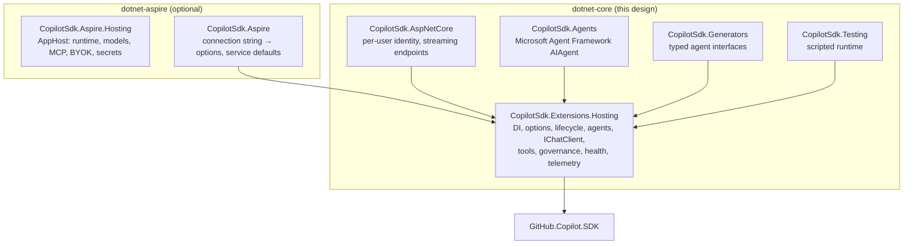

# Copilot SDK for .NET applications: design

Status: **Draft** · Targets: .NET 10 (`net8.0` where practical),
`GitHub.Copilot.SDK` 1.0.x, `Microsoft.Extensions.*` 10.x, ASP.NET Core 10.

This document proposes the **application-level** integration of the
[GitHub Copilot SDK for .NET](https://github.com/github/copilot-sdk/tree/main/dotnet)
for business applications built on the .NET Generic Host: ASP.NET Core APIs,
worker services, background jobs, and Blazor apps. It is the .NET counterpart of
the [Spring Boot starter](../../spring-boot/).

It is independent of Aspire. The [Aspire integration](../../dotnet-aspire/docs/design.md)
orchestrates the Copilot runtime (AppHost) and adds a thin client layer *on top
of* these packages, the same way `Aspire.Npgsql` builds on `Npgsql` and
`Aspire.OpenAI` builds on `OpenAI`.



---

## 1. Goals and non-goals

### Goals

1. **Copilot as an application service.** Register once in `Program.cs`, inject
   anywhere: controllers, minimal APIs, `BackgroundService`s, Blazor components.
2. **Business logic as tools.** Existing DI services (EF Core repositories,
   domain services, HTTP clients) become Copilot tools with their normal scopes,
   transactions, and authorization intact.
3. **Typed results.** Classification, extraction, and decision tasks return C#
   records, not strings to parse.
4. **Speak `Microsoft.Extensions.AI`.** `IChatClient` and Agent Framework
   `AIAgent` work over Copilot, so code is portable and composes with existing
   middleware.
5. **Enterprise-ready by default.** Per-user identity, deny-by-default
   permissions, auditable hooks, bounded concurrency, health checks, and
   OpenTelemetry.
6. **Testable without a model.** A scripted runtime for fast, deterministic,
   free tests.

### Non-goals

- Orchestrating the runtime process for distributed apps (that is Aspire's job).
- Re-implementing the SDK. Every surface has an escape hatch to native SDK types.
- Agent orchestration patterns (sequential, handoff, group chat): use Microsoft
  Agent Framework through the `AIAgent` surface.

---

## 2. Business application scenarios

The design is driven by these scenarios; each maps to a sample.

| Scenario | Shape | Key features |
| --- | --- | --- |
| **Support assistant API** | ASP.NET Core minimal API; one conversation per signed-in customer | Conversations, per-user GitHub token, streaming (SSE), tools over EF Core |
| **Document intake worker** | `BackgroundService` reading a queue; extracts invoices into records | Structured output, bounded concurrency, retries, no conversation state |
| **Back-office copilot** | Blazor Server; staff ask questions and trigger actions | Write tools gated by human approval, audit hooks, MCP server for internal docs |
| **Triage in an existing workflow** | Domain service calls a typed agent: `ITicketTriage.ClassifyAsync(ticket)` | Typed agent interface, prompt template, BYOK model |

---

## 3. Spring Boot → .NET mapping

| Spring Boot starter | .NET (this design) |
| --- | --- |
| Auto-configuration + `copilot.*` properties | `services.AddCopilot()` + `Copilot` configuration section, `IOptions<T>` with startup validation |
| `CopilotClient` bean, lazy/eager | Singleton `CopilotClient` owned by a hosted lifecycle service, lazy by default |
| `@CopilotAgent` interfaces | Named **agent profiles** consumed as keyed `IChatClient` / `AIAgent` / `ICopilotSessionFactory`; source-generated **typed agents** |
| `@UserMessage("... {{doc}}")` templates | Interpolated prompt templates on typed agent methods, validated at compile time |
| `CompletableFuture<T>` structured results | `Task<T>` (typed agents), `GetResponseAsync<T>()` (MEAI), `SendAndWaitAsync<T>()` (SDK) |
| `Flux<CopilotAgentEvent>` | `IAsyncEnumerable<ChatResponseUpdate>` / `IAsyncEnumerable<CopilotAgentEvent>`; no extra module |
| `@ConversationId` | `[ConversationId]` parameter (typed agents), `ChatOptions.ConversationId`, MAF `AgentThread` |
| `CopilotAgents` bound instances | `ICopilotConversation` from `ICopilotSessionFactory` |
| `@CopilotTool` Spring beans | DI services with `[Description]` methods, one `IServiceScope` per tool call |
| MCP and BYOK properties | `Copilot:McpServers` and `Copilot:Providers`, selected per agent |
| `CopilotTokenResolver`, Spring Security OAuth2 | `ICopilotTokenProvider`; ASP.NET Core implementation from the authenticated user |
| Permission policies, hooks, listeners | `CopilotPermissionPolicy`, `ICopilotPermissionHandler`, `ICopilotSessionHooks`, `ICopilotEventListener` |
| `CopilotAgentCustomizer` | `IConfigureNamedOptions<CopilotAgentOptions>` / `PostConfigure` |
| Actuator health, info, `copilot` endpoint | `IHealthCheck` + optional `MapCopilotDiagnostics()` endpoint |
| Micrometer observations | `ActivitySource` / `Meter` + MEAI `UseOpenTelemetry()` |
| `copilot-spring-boot-test` | `CopilotSdk.Testing` scripted runtime, `WebApplicationFactory` helpers |
| Testcontainers `CopilotContainer` | Aspire `AddCopilot()` or Testcontainers for .NET (docs only) |

---

## 4. Packages

| Package (working name) | Purpose | Depends on |
| --- | --- | --- |
| `CopilotSdk.Extensions.Hosting` | Core: DI, options, lifecycle, agent profiles, `IChatClient`, session factory, tools, governance, health checks, telemetry | `GitHub.Copilot.SDK`, `Microsoft.Extensions.AI`, `Microsoft.Extensions.Hosting.Abstractions`, `…Options`, `…Diagnostics.HealthChecks.Abstractions` |
| `CopilotSdk.AspNetCore` | Per-user tokens and invocation context from `HttpContext`, SSE streaming helpers, diagnostics endpoint | Core, `Microsoft.AspNetCore.App` |
| `CopilotSdk.Agents` | Register agent profiles as Microsoft Agent Framework `AIAgent`s | Core, `Microsoft.Agents.AI.GitHub.Copilot` |
| `CopilotSdk.Generators` | Source generator for typed agent interfaces (no runtime reflection, AOT-safe) | Core (analyzer package) |
| `CopilotSdk.Testing` | Scripted runtime, assertions, `WebApplicationFactory` helpers | Core |

`Microsoft.Extensions.AI.Abstractions` is already an SDK dependency, so the
`IChatClient` adapter lives in core rather than a separate package. Extension
methods live in `Microsoft.Extensions.DependencyInjection` /
`Microsoft.AspNetCore.Builder` namespaces; types in `CopilotSdk.*`. See the
naming question in §15.

---

## 5. Registration and configuration

### 5.1 The happy path

```csharp
var builder = WebApplication.CreateBuilder(args);

builder.Services.AddCopilot()                       // binds the "Copilot" section
    .AddAgent("support", agent => agent
        .WithInstructions("You help customers with their orders. Be concise.")
        .WithTools<OrderTools>())
    .AddChatClient("support");                      // keyed IChatClient "support"

builder.Services.AddScoped<OrderTools>();

var app = builder.Build();

app.MapPost("/support", async (
        [FromKeyedServices("support")] IChatClient chat,
        SupportRequest req, CancellationToken ct) =>
    (await chat.GetResponseAsync(req.Message,
        new ChatOptions { ConversationId = req.ConversationId }, ct)).Text);

app.Run();
```

### 5.2 API

```csharp
ICopilotBuilder AddCopilot(this IServiceCollection services, Action<CopilotOptions>? configure = null);
ICopilotBuilder AddCopilot(this IServiceCollection services, IConfiguration section);
ICopilotBuilder AddKeyedCopilot(this IServiceCollection services, string name, ...); // multiple runtimes

interface ICopilotBuilder
{
    IServiceCollection Services { get; }
    string? Name { get; }

    ICopilotBuilder ConfigureClient(Action<IServiceProvider, CopilotClientOptions> configure); // native escape hatch
    ICopilotBuilder AddAgent(string name, Action<CopilotAgentBuilder> configure);
    ICopilotBuilder AddTypedAgent<TAgent>() where TAgent : class;      // source-generated (§6.2)
    ChatClientBuilder AddChatClient(string? agentName = null);           // unkeyed IChatClient
    ChatClientBuilder AddKeyedChatClient(string agentName);              // keyed by agent name
    ICopilotBuilder AddPermissionHandler<T>() where T : class, ICopilotPermissionHandler;
    ICopilotBuilder AddHooks<T>() where T : class, ICopilotSessionHooks;
    ICopilotBuilder AddEventListener<T>() where T : class, ICopilotEventListener;
    ICopilotBuilder AddHealthCheck(string name = "copilot", params string[] tags);
}
```

`AddCopilot` always registers: `CopilotClient` (singleton), the lifecycle hosted
service, `ICopilotSessionFactory`, options validation, and telemetry sources.
Health checks are opt-in through `AddHealthCheck` (Aspire turns them on).

### 5.3 Configuration

```jsonc
{
  "Copilot": {
    "Client": {
      "Endpoint": null,                   // tcp://host:port of a headless runtime; null = managed stdio
      "ConnectionToken": null,            // required for non-loopback endpoints
      "CliPath": null,                    // override the SDK-bundled runtime
      "CliArgs": [],
      "WorkingDirectory": null,
      "HomeDirectory": null,              // COPILOT_HOME
      "LogLevel": null,
      "Mode": "Empty",                    // Empty | CopilotCli (see §9)
      "EagerStart": false,
      "StartupTimeout": "00:00:30",
      "GitHubToken": null                 // service identity; prefer secrets / user tokens
    },
    "Agents": {
      "support": {
        "Model": "gpt-5.4",
        "ReasoningEffort": "medium",
        "Instructions": "You help customers with their orders.",
        "InstructionsMode": "Append",       // Append | Replace
        "McpServers": [ "docs" ],
        "Provider": null,
        "AvailableTools": [ "custom:*", "mcp:docs-search" ],
        "ExcludedTools": [],
        "BuiltInTools": false,
        "ResponseTimeout": "00:01:00",
        "Permissions": { "AllowTools": [ "lookup_order" ], "AllowReadOnly": false }
      }
    },
    "McpServers": {
      "docs":  { "Type": "http",  "Url": "https://docs.internal/mcp", "Tools": [ "search" ] },
      "files": { "Type": "stdio", "Command": "npx", "Args": [ "-y", "@modelcontextprotocol/server-filesystem", "/data" ] }
    },
    "Providers": {
      "foundry": { "Type": "azure", "BaseUrl": "https://my.openai.azure.com/openai/v1/", "ApiKey": "<from secret store>", "WireApi": "Responses" }
    },
    "Execution": { "MaxConcurrentTurns": 8, "MaxQueuedTurns": 64 },
    "Telemetry": { "CaptureMessageContent": false }
  }
}
```

The shape intentionally matches the Spring starter's `copilot.*` properties.
Options use `ValidateOnStart()` with source-generated `[OptionsValidator]`
validators (AOT-friendly) and fail fast: unknown MCP server or provider names,
non-loopback endpoints without a token, invalid durations, and so on.
Configuration overrides code for agent profiles, so operators can change a model
or tighten tools without a rebuild.

---

## 6. Agents

### 6.1 Agent profiles

An **agent profile** is a named `CopilotAgentOptions`: a validated template for
`SessionConfig` (model, reasoning effort, instructions, tools, MCP servers,
provider, allow/deny lists, permission policy, hooks, timeout). It is defined in
code, configuration, or both, and is consumed through four surfaces:

| Surface | Resolve as | Best for |
| --- | --- | --- |
| `IChatClient` | `[FromKeyedServices("support")] IChatClient` | Portable MEAI code, middleware, `GetResponseAsync<T>()` |
| Typed agent | `ITicketTriage` (generated) | Domain services: business-shaped methods, typed results |
| `ICopilotSessionFactory` | `factory.CreateConversationAsync("support", id)` | Full SDK: events, attachments, hooks, canvases |
| `AIAgent` (`CopilotSdk.Agents`) | `[FromKeyedServices("support")] AIAgent` | Agent Framework workflows |

```csharp
services.AddCopilot()
    .AddAgent("support", agent => agent
        .WithModel("gpt-5.4")
        .WithInstructions("You help customers with their orders.")  // or .WithInstructionsFile("Prompts/support.md")
        .WithTools<OrderTools>()
        .WithTool("today", () => DateOnly.FromDateTime(DateTime.UtcNow))
        .WithMcpServer("docs")
        .WithProvider("foundry")
        .AllowTools("lookup_order")
        .WithResponseTimeout(TimeSpan.FromSeconds(45)));
```

### 6.2 Typed agents (source-generated)

The .NET answer to `@CopilotAgent` interfaces, without dynamic proxies:

```csharp
[CopilotAgent("triage", Instructions = "You triage support tickets for Contoso.")]
public partial interface ITicketTriage
{
    [Prompt("Classify this ticket. Subject: {subject}. Body: {body}")]
    Task<TriageResult> ClassifyAsync(string subject, string body, CancellationToken ct = default);

    [Prompt("{question}")]
    IAsyncEnumerable<string> AskAsync([ConversationId] string conversationId, string question,
                                      CancellationToken ct = default);
}

public sealed record TriageResult(TicketCategory Category, Priority Priority, string Summary);

services.AddCopilot().AddTypedAgent<ITicketTriage>();
```

- A Roslyn incremental generator emits the implementation and a
  `JsonSerializerContext` for result types, so it is trimming- and AOT-safe.
- Prompt placeholders are checked against parameters **at compile time**
  (diagnostics instead of Spring's startup validation).
- Supported returns: `Task<string>`, `Task<T>` (structured output),
  `IAsyncEnumerable<string>` (streaming text), `IAsyncEnumerable<CopilotAgentEvent>`,
  and `Task` (fire and forget the reply).
- `[ConversationId]` routes to a persisted conversation; without it each call is
  a fresh, disposable session.
- Configuration under `Copilot:Agents:triage` still applies.

### 6.3 Conversations

```csharp
await using var conversation = await sessions.GetOrCreateConversationAsync(
    "support", CopilotConversationId.For(user, "orders"), ct);

var reply = await conversation.SendAsync("Where is order 42?", ct);
await foreach (var evt in conversation.StreamAsync("And order 43?", ct)) { ... }
```

- Create-or-resume by id; sends on the same conversation are serialized.
- `CopilotConversationId.For(ClaimsPrincipal, key)` namespaces ids by tenant and
  user so one user can never resume another's conversation.
- `ICopilotConversationStore` (optional) records ownership and metadata (default:
  in-memory; EF Core sample) for listing a user's conversations and cleanup.
- Idle cleanup: `Copilot:Execution:IdleSessionTimeout` disconnects idle sessions;
  history persists in the runtime's `COPILOT_HOME`.

### 6.4 `IChatClient` semantics

| MEAI | Copilot |
| --- | --- |
| `ChatOptions.ConversationId` set | Resume that session; send only new user content |
| `ChatOptions.ConversationId` unset | New session; `ChatResponse.ConversationId` returns its id |
| System messages | `SystemMessage` (append) |
| `ModelId`, `Reasoning` | `Model`, `ReasoningEffort` |
| `Tools` (`AIFunction`) | Session tools, merged with the profile's tools |
| `ResponseFormat` (JSON schema) | SDK structured output, so `GetResponseAsync<T>()` works |
| `GetStreamingResponseAsync` | Streaming deltas → `ChatResponseUpdate` |
| `UsageDetails` | Session usage events |
| `CancellationToken` | `session.AbortAsync()`: real cancellation of the runtime turn |
| `DataContent` | Attachments |

Multi-turn history without a `ConversationId` is rendered as a transcript in
the first prompt by default (`HistoryMode = Transcript | Reject`).
`UseFunctionInvocation()` is unnecessary because the runtime drives tool calls.

---

## 7. Tools: business logic the model can call

```csharp
public sealed class OrderTools(OrdersDbContext db, ICopilotInvocationContext ctx)
{
    [Description("Looks up one of the current customer's orders by id.")]
    public async Task<OrderDto?> LookupOrder([Description("Order id")] int id, CancellationToken ct)
    {
        var customerId = ctx.User.GetCustomerId();             // the caller, not the service
        return await db.Orders
            .Where(o => o.Id == id && o.CustomerId == customerId)
            .Select(o => o.ToDto())
            .FirstOrDefaultAsync(ct);
    }

    [Description("Cancels an order that has not shipped.")]
    [CopilotToolApproval(Required = true)]                       // human-in-the-loop (§9.3)
    public Task<CancelResult> CancelOrder(int id, CancellationToken ct) => ...;
}
```

- **Discovery**: public methods with `[Description]` (MEAI convention) on the
  registered type; `WithTools<T>(filter)` narrows the set. Built with
  `AIFunctionFactory`, the SDK's own tool type, so schemas match MEAI and MAF.
- **Scope per call**: each tool invocation resolves `T` from a new
  `IServiceScope`, so `DbContext`, unit of work, and other scoped services
  behave as in a request. `[FromServices]` parameters are injected and excluded
  from the schema.
- **Invocation context**: tool callbacks arrive on the SDK's RPC thread, so the
  caller's `ExecutionContext` is lost. At turn start the integration captures
  `ICopilotInvocationContext` (user `ClaimsPrincipal`, tenant, agent, session id,
  `Activity`, culture, logging scope, custom items) and restores it inside the
  tool scope. This is the analogue of Spring's security/MDC/observation
  propagation.
- **Errors**: exceptions become failed tool results with a safe message (details
  only in logs/telemetry); `CopilotToolException` lets tools return a
  model-visible message deliberately.
- **Transactions**: no implicit ambient transaction across a turn; each tool call
  is its own unit of work, which is the safe default for retries and approvals.

---

## 8. Identity and multi-tenancy

| Mode | Use when | How |
| --- | --- | --- |
| **Service identity** | Internal tools, workers, batch jobs | `Copilot:Client:GitHubToken` from a secret store, or the runtime's ambient auth |
| **Per-user identity** | Copilot usage should be billed to and scoped by the signed-in user | `ICopilotTokenProvider` → SDK `GitHubTokenProvider` per session |
| **BYOK** | Your own model deployment; no Copilot subscription per user | Agent `Provider` (§5.3) |

```csharp
builder.Services.AddAuthentication().AddGitHub(...);         // any OAuth handler that saves tokens
builder.Services.AddCopilot().AddAspNetCoreUserTokens();     // CopilotSdk.AspNetCore
```

- The ASP.NET Core provider reads the user's GitHub access token
  (`HttpContext.GetTokenAsync`) at turn start; token refresh is delegated to an
  optional `IGitHubTokenRefresher`.
- No silent fallback: if a per-user token is required and missing, the call fails
  with `CopilotAuthenticationRequiredException` (mapped to 401 by an optional
  `IExceptionHandler`), unless `AllowAmbientFallback` is set.
- Shared runtimes default to `Mode = Empty` (no ambient OS tools), following the
  SDK multi-tenancy guidance.

---

## 9. Governance, safety, and auditing

### 9.1 Safe defaults

| Default | Rationale |
| --- | --- |
| No permission handler ⇒ **deny** | The integration never approves tool use implicitly. |
| `Mode = Empty`, `BuiltInTools = false` for agents | Business apps expose only their own tools unless they opt in. |
| MCP servers usable only by agents that list them | Declared ≠ granted. |
| Connection token required for non-loopback endpoints | Startup fails otherwise. |
| Message content excluded from telemetry and logs | Opt-in only (PII). |

### 9.2 Permission policies

Declarative per agent (`Permissions` in §5.3) or code:

```csharp
agent.WithPermissions(p => p.AllowTools("lookup_order").AllowReadOnly());
agent.WithPermissionHandler<RoleBasedPermissionHandler>();   // ICopilotPermissionHandler, DI-resolved
```

Handlers receive the `ICopilotInvocationContext`, so decisions can use the
caller's roles and tenant (`IAuthorizationService` works inside handlers).

### 9.3 Human-in-the-loop approvals

For write operations, `[CopilotToolApproval]` (or a handler that leaves the
request pending) parks the turn and raises an approval request
through `ICopilotApprovalQueue`. Implementations: in-memory (default), and a
sample backed by EF Core + SignalR for the back-office scenario. The turn
resumes when approved, or fails with a model-visible denial after a timeout.
This uses the SDK's pending-permission and manual-resume support.

### 9.4 Hooks, listeners, and audit

- `ICopilotSessionHooks` (pre/post tool use, prompt submitted, session start/end)
  as DI services, global or per agent, ordered.
- `ICopilotEventListener` receives typed session events for metrics, logging, or
  persistence.
- `CopilotAuditHooks` (opt-in) writes structured audit records (who, agent,
  tool, arguments hash, decision, outcome) through `ILogger` with a dedicated
  category, ready for any log sink.

---

## 10. Runtime behavior

- **Lifecycle**: a hosted lifecycle service owns `CopilotClient`. Lazy by
  default (first use starts it, guarded against concurrent starts);
  `EagerStart` connects during host startup within `StartupTimeout`. Shutdown
  calls `StopAsync()` and falls back to `ForceStopAsync()` when the shutdown
  token fires.
- **Connection**: `Endpoint` set ⇒ `RuntimeConnection.ForUri`; otherwise the
  SDK's managed stdio runtime (bundled with the NuGet package).
- **Concurrency**: `System.Threading.RateLimiting.ConcurrencyLimiter`
  (`MaxConcurrentTurns`, `MaxQueuedTurns`); rejection throws
  `CopilotCapacityExceededException` (maps to 503 / `Retry-After`).
- **Cancellation and timeouts**: every API takes a `CancellationToken`;
  cancellation and `ResponseTimeout` abort the runtime turn.
- **Resilience**: transient connection failures surface as
  `CopilotUnavailableException`; callers can compose
  `Microsoft.Extensions.Resilience` pipelines. The integration does not retry
  turns implicitly (turns are not idempotent once tools run).

---

## 11. Web, streaming, and diagnostics (`CopilotSdk.AspNetCore`)

```csharp
app.MapPost("/support/stream", (
        [FromKeyedServices("support")] IChatClient chat, SupportRequest req, CancellationToken ct) =>
    TypedResults.ServerSentEvents(
        chat.GetStreamingResponseAsync(req.Message,
            new ChatOptions { ConversationId = req.ConversationId }, ct)
            .Select(u => u.Text)));

app.MapCopilotDiagnostics("/_copilot").RequireAuthorization("Admin");
```

- Streaming uses .NET 10's built-in `TypedResults.ServerSentEvents`; no custom
  result types needed. Client disconnects cancel the runtime turn.
- `MapCopilotDiagnostics` is the Actuator `copilot` endpoint equivalent:
  agents (without instructions by default), models, active sessions, execution
  capacity. Never force-starts a lazy client. Requires explicit authorization.
- Blazor Server and SignalR samples show streaming to the UI and approval
  prompts (§9.3).

---

## 12. Observability

| Signal | Source |
| --- | --- |
| Integration spans: `copilot.turn`, `copilot.session.create`/`resume`, `copilot.tool.invoke`, `copilot.permission` | `ActivitySource("CopilotSdk")` |
| GenAI spans and `gen_ai.client.*` metrics | MEAI `UseOpenTelemetry()`, on by default in `AddChatClient` |
| Integration metrics: active sessions, queue depth, rejections, turn duration, tokens per agent/model | `Meter("CopilotSdk")` |
| Runtime spans (model calls, built-in tools) | Copilot runtime OTLP export (`Copilot:Telemetry`), correlated through `traceparent` |
| Logs | SDK `ILogger` wired to the host `ILoggerFactory` |
| Health | `CopilotHealthCheck`: ping + auth status, never force-starts a lazy client |

Apps opt in with standard OpenTelemetry:
`.WithTracing(t => t.AddCopilotInstrumentation())` and
`.WithMetrics(m => m.AddCopilotInstrumentation())`.

---

## 13. Testing (`CopilotSdk.Testing`)

A scripted fake runtime speaks the SDK's JSON-RPC protocol on a loopback port,
so the real `CopilotClient`, sessions, tool invocation (into real DI tools),
`IChatClient`, and typed agents are exercised, offline and free:

```csharp
public class SupportApiTests(WebApplicationFactory<Program> factory)
{
    [Fact]
    public async Task Looks_up_order_through_tool()
    {
        await using var runtime = await CopilotTestRuntime.StartAsync(s => s
            .OnPrompt(p => p.Contains("order 42"))
                .CallTool("lookup_order", new { id = 42 })
                .ThenReply("Order 42 ships tomorrow."));

        var client = factory.WithCopilotTestRuntime(runtime).CreateClient();
        var response = await client.PostAsJsonAsync("/support", new { message = "Where is order 42?" });

        Assert.Equal("Order 42 ships tomorrow.", await response.Content.ReadAsStringAsync());
        Assert.Single(runtime.ToolCalls, c => c.Name == "lookup_order");
    }
}
```

Scripts cover replies, streamed deltas, structured results, tool calls, permission
requests, failures, delays, and cancellation; recorded prompts and tool calls are
assertable. Typed agents and `IChatClient` can also be faked directly with
standard mocking when the runtime is irrelevant.

---

## 14. Repository layout

```
dotnet-core/
├── README.md
├── docs/design.md
├── CopilotSdk.slnx
├── Directory.Build.props / Directory.Packages.props / global.json
├── src/
│   ├── CopilotSdk.Extensions.Hosting/
│   ├── CopilotSdk.AspNetCore/
│   ├── CopilotSdk.Agents/
│   ├── CopilotSdk.Generators/
│   └── CopilotSdk.Testing/
├── samples/
│   ├── SupportApi/          # minimal API, conversations, SSE, EF Core tools, per-user tokens
│   ├── InvoiceWorker/       # BackgroundService, structured extraction, bounded concurrency
│   ├── BackOffice/          # Blazor Server, approvals, audit, MCP
│   └── TicketTriage/        # typed agent, BYOK
└── tests/
```

The Aspire packages in `dotnet-aspire/` reference these projects. CI: a job
scoped to `dotnet-core/**` and `dotnet-aspire/**` (Aspire depends on core).

---

## 15. Open questions

1. **Package names.** `CopilotSdk.*` (the `GitHub.*` and `Microsoft.*` prefixes
   are reserved). Alternatives: `Copilot.Extensions.*`, or proposing these
   upstream to `github/copilot-sdk`.
2. **Folder and solution layout.** Keep `dotnet-core/` and `dotnet-aspire/`
   separate (mirrors the README's per-integration layout) or use one `dotnet/`
   solution with both (simpler project references, one CI job).
3. **Typed agents in v1?** They are the most "business-app" feature but need a
   generator. Proposal: phase 3.
4. **Stateless `IChatClient` history.** Transcript (portable) vs. reject (honest).
5. **`Mode = Empty` default** also for the managed stdio runtime in single-user
   apps?
6. **Approvals.** How much of the approval queue belongs in the library vs. samples?
7. **Fake runtime fidelity.** Protocol-level (high fidelity, tracks protocol
   versions) vs. in-memory session fake.

---

## 16. Phasing

| Phase | Scope |
| --- | --- |
| **1. Client and chat** | `AddCopilot`, options and validation, lifecycle, `ICopilotSessionFactory`, `IChatClient` (create/resume, streaming, structured output, cancellation), health check, telemetry, `SupportApi` sample. |
| **2. Agents and tools** | Agent profiles from code and configuration, DI tools with per-call scopes, invocation context, MCP and BYOK, permission policies, hooks, listeners, admission control, `InvoiceWorker` sample. |
| **3. Business features** | Typed agents (generator), per-user identity (ASP.NET Core), approvals, audit hooks, diagnostics endpoint, `CopilotSdk.Agents`, `BackOffice` and `TicketTriage` samples. |
| **4. Testing and docs** | Scripted runtime, `WebApplicationFactory` helpers, documentation site chapters. |
