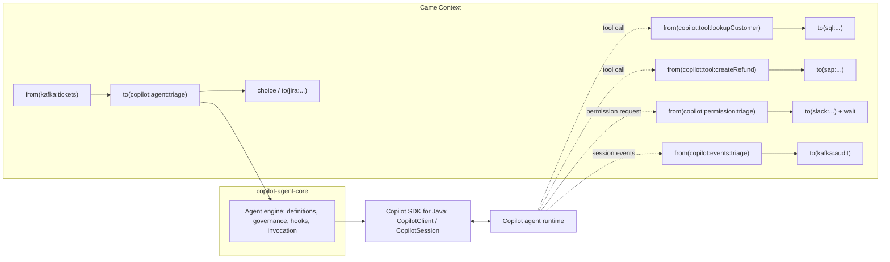

# Apache Camel integration: design

Status: **MVP implemented** (unreleased). Section 7 lists what is built and what is still planned;
see [README.md](README.md) for usage.

This document designs `camel-copilot`, an [Apache Camel](https://camel.apache.org/) component that
brings the GitHub Copilot agent runtime into Camel routes. It builds on the
[Copilot SDK for Java](https://github.com/github/copilot-sdk) and reuses the framework-neutral
engine in [`java/core`](../core/) (`copilot-agent-core`), the same engine behind the
[Spring Boot starter](../spring-boot/) and the [Quarkus extension](../quarkus/).

## 1. Why Camel

Camel is an integration framework: hundreds of components (Kafka, JMS, SFTP, Salesforce, SAP,
databases, HTTP, mail, cloud services) wired together with Enterprise Integration Patterns
(EIPs). Two things make it a strong match for an agent runtime:

1. **Agents as a step in a route.** A Copilot agent becomes a processing step: classify an
   inbound email, summarize a support ticket, triage a failed build, extract structured data
   from a document, then keep routing with content-based routers, splitters, and aggregators.
2. **Routes as agent tools.** Any Camel route can be exposed to the agent as a tool. Because a
   route can reach any system Camel supports, the agent gets governed, observable access to the
   enterprise estate without writing a custom tool per system.

The second point is the more distinctive one: Camel becomes the agent's *tool fabric*.

## 2. Goals and non-goals

Goals, aligned with the [repository design goals](../../README.md#design-goals):

- A `copilot:` component that follows Camel conventions (URI options, headers, type
  converters, `AsyncProcessor`, health checks, Camel's error handling).
- Routes exposed as Copilot tools, with JSON-schema arguments and results.
- Declarative `@CopilotAgent` interfaces usable from Camel (bean binding) without duplicating
  the engine.
- Conversation continuity keyed by an exchange expression (for example
  `${header.ticketId}`).
- Safe defaults: no implicit tool approval, and permission decisions routable to a Camel route
  (human in the loop).
- A plain Camel component with no runtime-specific wiring: it uses whatever `CopilotClient`
  is in the registry, or creates its own.
- Deterministic testing with the scripted in-memory runtime.

Non-goals:

- A general LLM chat abstraction. Camel already has LangChain4j-based components for raw chat
  completion. `camel-copilot` targets the *agent runtime*: sessions, built-in tools, MCP
  servers, permissions, and hooks.
- Reimplementing agent governance. Permission policies, tool allow/deny lists, limits, and
  hooks come from `copilot-agent-core`.

## 3. Architecture

### 3.1 Plugging into `copilot-agent-core`

The engine is container-neutral; frameworks plug in through `BindingContext`. Camel supplies:

| Core SPI | Camel implementation |
| --- | --- |
| `BeanLookup` | `CamelRegistryBeanLookup` over `CamelContext.getRegistry()` (`lookupByName`, `findByType`). Ordering uses `Ordered` when present. |
| `PropertyResolver` | Camel `PropertiesComponent`, so placeholders resolve from `application.properties`, environment variables, and vaults. |
| `ResourceLookup` | Class-path and `file:` resources (the same lookup the other integrations use). |
| `CopilotAgentSettings` | The component's `agentSettings` option, or the single `CopilotAgentSettings` bean in the registry. |
| MCP servers / providers | Registry beans of type `McpServerConfig` / `ProviderConfig`, by name. |
| `configPrefix` | `camel.component.copilot` |

Because `*Ref` attributes are bean names, `@CopilotAgent(toolRefs = "orderTools")` resolves
against the Camel registry exactly as it resolves against Spring or CDI.

### 3.2 Client lifecycle

`CopilotComponent` owns, or borrows, one `CopilotClient`:

- If the registry already contains a `CopilotClient`, the component **reuses it** and does
  not close it.
- Otherwise it creates one in `doStart()` and closes it in `doStop()`.
- A `client` component option overrides both.

## 4. Endpoints

Every endpoint has the form `copilot:<kind>:<name>`. Tool, permission, and event endpoints
**register a bean named `<name>`** in the Camel registry when the route is created. Agents then
reference those routes with the ordinary core `*Ref` attributes, so a route, a Java bean, and a
Spring or CDI bean are interchangeable:

| Endpoint | Registers | Referenced with |
| --- | --- | --- |
| `copilot:tool:<name>` | `ToolDefinition` | `toolRefs` |
| `copilot:permission:<name>` | `PermissionHandler` | `permissionHandlerRef` |
| `copilot:events:<name>` | `CopilotAgentListener` | `listenerRefs` |

This replaces the earlier `toolRoutes` proposal: one naming model (bean names) covers routes and
beans, and nothing is wired implicitly.

### 4.1 `copilot:agent:<name>`: producer

An asynchronous producer (`DefaultAsyncProducer`); the route thread is released while the agent
works. The agent is resolved on the first exchange, after every tool, permission, and event route
has registered its bean.

- **Agent source.** If `<name>` is a `@CopilotAgent` interface listed in the component's
  `agentTypes`, that definition is used and endpoint agent options are rejected. Otherwise the
  endpoint options form the agent: they map one-to-one onto `@CopilotAgent` attributes
  (`instructions`, `instructionsResource`, `instructionsMode`, `systemMessageRef`, `model`,
  `reasoningEffort`, `permissionHandlerRef`, `toolRefs`, `mcpServers`, `provider`, `listenerRefs`,
  `customizerRefs`, `availableTools`, `excludedTools`, `excludedBuiltInAgents`, `builtInTools`,
  `toolSearch`, `toolSearchDeferThreshold`, `workingDirectory`, `additionalDirectories`, `hookRefs`, `tokenResolverRef`) and are passed to
  core's `CopilotAgentDefinition.create(type, attributes, binding)`, so validation and governance
  are identical to the other integrations. Endpoint agents use the identity type
  `CopilotEndpointAgent`.
- **Settings.** `responseTimeout` and the permission options (`allow`, `allowTools`,
  `allowMcpServers`, `allowAgentTools`, `allowReadOnly`) overlay the agent's
  `CopilotAgentSettings` entry.
- **Prompt.** The body, or the `prompt` Simple expression.
- **Conversation.** The `conversationId` Simple expression, else the `CopilotConversationId`
  header. With neither, the exchange is a one-shot conversation and its session is deleted
  afterward.
- **Structured output.** `outputClass` requests a provider-native JSON schema and converts the
  reply (core's `StructuredResponse`).
- **Reply.** The body becomes the answer; `CopilotAgentName` and, for named conversations,
  `CopilotConversationId` are set.

### 4.2 `copilot:tool:<name>`: consumer (routes as tools)

- Options: `description` (required), `parametersClass` (record or POJO; schema generated) or
  `parametersSchema` (JSON Schema resource), `skipPermission` (default `false`).
- The body is the arguments (`Map`, or `parametersClass`); headers `CopilotToolName`,
  `CopilotToolCallId`, `CopilotSessionId`. The final body is the result; strings, numbers, maps,
  and collections are returned as is, streams are read as text, other objects are handed to the
  SDK, which serializes them to JSON. A failed exchange fails the tool call.
- Registering a tool never grants it: an agent must list it in `toolRefs`, and calls still go
  through the agent's permission handler unless `skipPermission=true` (or the agent sets
  `allowAgentTools=true`).

### 4.3 `copilot:permission:<name>`: consumer (human in the loop)

The body is the `PermissionRequest`; headers `CopilotPermissionKind`, `CopilotToolCallId`,
`CopilotSessionId`. The route approves by ending with `true`, `"approve"`, or an approving
`PermissionRequestResult`. Any other body, a failure, a stopped route, or exceeding `timeout`
(default 30s) rejects the request.

### 4.4 `copilot:events:<name>`: consumer (event stream)

Session events of every agent listing `<name>` in `listenerRefs`, optionally filtered with
`types` globs (`assistant.*,tool.*`). Events are routed in order on one thread, off the Copilot
event thread; beyond `queueSize` (default 1000) pending events, new events are dropped with a
warning. Headers: `CopilotEventType`, `CopilotAgentName`, `CopilotConversationId`,
`CopilotSessionId`.

## 5. Declarative agents

`agentTypes` lists `@CopilotAgent` interfaces. Each is routable as `copilot:agent:<name>`. When
the context has fully started, explicit-ID agents are bound in the registry under their agent
name (for `bean:` calls or direct injection), and a `copilotAgents` bean (`CopilotAgents`) creates
and resumes ID-less agents.

## 6. Security

- **No implicit approval.** Without a handler, policy, or route, permission requests are logged
  and rejected.
- **Built-in tools off by default** for endpoint-configured agents: a route usually runs
  unattended on a server, so shell and file tools must be opted into (`builtInTools=true`, or
  listing them in `availableTools`). Declarative `@CopilotAgent` interfaces keep their own
  defaults.
- **Untrusted tool arguments.** Tool routes receive model-produced arguments and must treat them
  as untrusted input (parameterized SQL, allow-listed hosts).
- **No header leakage.** Inbound headers never reach the prompt unless the `prompt` expression
  references them.

## 7. Status and roadmap

Implemented:

- `copilot:agent` (endpoint and declarative agents, conversations, one-shot cleanup, structured
  output), `copilot:tool`, `copilot:permission`, `copilot:events`.
- Registry-backed `BindingContext`, client reuse, execution limits
  (`maxConcurrentInvocations`, `maxOutstandingInvocations`), telemetry from the registry.
- Session management: the component's `sessionStore()` (also bound as `copilotSessionStore`) lists,
  reads, and deletes agent sessions; `sessionMaxAge` enables age-based cleanup on a scheduled
  executor from Camel's `ExecutorServiceManager`, shut down with the component.
- `camel-copilot-test`: the scripted in-memory runtime, shared with the Spring Boot and Quarkus
  test modules.

Planned:

- Streaming deltas from the producer, typed exceptions for rate limits and timeouts, and a
  pluggable conversation repository for clustered deployments.
- A Camel `HealthCheck`, dev console, and generated component metadata
  (`camel-package-maven-plugin`) for tooling and Kaoto.
- Kamelets for low-code use.
- Optionally publishing `copilot:tool` routes as an MCP server (`camel-copilot-mcp`).
