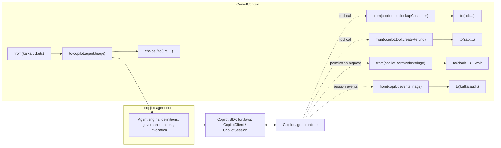

# Apache Camel integration: design

Status: **proposal**. Nothing in this document is implemented yet.

This document designs `camel-copilot`, an [Apache Camel](https://camel.apache.org/) component that
brings the GitHub Copilot agent runtime into Camel routes. It builds on the
[Copilot SDK for Java](https://github.com/github/copilot-sdk) and reuses the framework-neutral
engine in [`java/core`](../core/) (`copilot-agent-core`), the same engine behind the
[Spring Boot starter](../spring-boot/) and the [Quarkus extension](../quarkus/).

## 1. Why Camel

Camel is an integration framework: hundreds of components (Kafka, JMS, SFTP, Salesforce, SAP,
databases, HTTP, mail, cloud services) wired together with Enterprise Integration Patterns
(EIPs). Two things make it a strong match for an agent runtime:

1. **Agents as a step in a route.** A Copilot agent becomes a processing step: classify an
   inbound email, summarize a support ticket, triage a failed build, extract structured data
   from a document, then keep routing with content-based routers, splitters, and aggregators.
2. **Routes as agent tools.** Any Camel route can be exposed to the agent as a tool. Because a
   route can reach any system Camel supports, the agent gets governed, observable access to the
   enterprise estate without writing a custom tool per system.

The second point is the more distinctive one: Camel becomes the agent's *tool fabric*.

## 2. Goals and non-goals

Goals, aligned with the [repository design goals](../../README.md#design-goals):

- A `copilot:` component that follows Camel conventions (URI options, headers, type
  converters, `AsyncProcessor`, health checks, Camel's error handling).
- Routes exposed as Copilot tools, with JSON-schema arguments and results.
- Declarative `@CopilotAgent` interfaces usable from Camel (bean binding) without duplicating
  the engine.
- Conversation continuity keyed by an exchange expression (for example
  `${header.ticketId}`).
- Safe defaults: no implicit tool approval, and permission decisions routable to a Camel route
  (human in the loop).
- Runs on all three Camel runtimes: Camel Main / JBang, Camel Spring Boot, and Camel Quarkus,
  sharing the client with the existing Spring Boot and Quarkus integrations when present.
- Deterministic testing with the scripted in-memory runtime.

Non-goals:

- A general LLM chat abstraction. Camel already has LangChain4j-based components for raw chat
  completion. `camel-copilot` targets the *agent runtime*: sessions, built-in tools, MCP
  servers, permissions, and hooks.
- Reimplementing agent governance. Permission policies, tool allow/deny lists, limits, and
  hooks come from `copilot-agent-core`.

## 3. Architecture



### 3.1 Plugging into `copilot-agent-core`

The engine is container-neutral; frameworks plug in through `BindingContext`. Camel supplies:

| Core SPI | Camel implementation |
| --- | --- |
| `BeanLookup` | `CamelRegistryBeanLookup` over `CamelContext.getRegistry()` (`lookupByName`, `findByType`). Ordering uses `Ordered` when present. |
| `PropertyResolver` | Camel `PropertiesComponent`, so placeholders resolve from `application.properties`, environment variables, and vaults. |
| `ResourceLookup` | Camel `ResourceLoader` (`classpath:`, `file:`, `http:`, `ref:`). |
| MCP servers / providers | `camel.component.copilot.mcp-servers.*` and `camel.component.copilot.providers.*`, then registry beans of type `McpServerConfig` / `ProviderConfig`. |
| `configPrefix` | `camel.component.copilot` |

Because `*Ref` attributes are bean names, `@CopilotAgent(toolRefs = "orderTools")` resolves
against the Camel registry exactly as it resolves against Spring or CDI.

### 3.2 Client lifecycle

`CopilotComponent` owns, or borrows, one `CopilotClient`:

- If the registry already contains a `CopilotClient` (Camel Spring Boot with the Copilot
  starter, or Camel Quarkus with the Copilot extension), the component **reuses it** and does
  not close it.
- Otherwise it creates one in `doStart()` and closes it in `doStop()`, honoring Camel's
  `lazyStartProducer` and a `startupMode=lazy|eager` component option.

## 4. Endpoints

One component, scheme `copilot`, with four endpoint kinds selected by the first path segment.

### 4.1 `copilot:agent:<name>`: producer

Sends the message body as a prompt and replaces the body with the agent's answer.

```java
from("kafka:support-tickets")
    .to("copilot:agent:triage?conversationId=${header.ticketId}&outputClass=com.acme.Triage")
    .choice()
        .when(simple("${body.severity} == 'HIGH'")).to("jira:addIssue")
        .otherwise().to("smtp://mail.acme.com?to=support@acme.com");
```

```yaml
- route:
    from:
      uri: kafka:support-tickets
      steps:
        - to:
            uri: copilot:agent:triage
            parameters:
              conversationId: "${header.ticketId}"
              outputClass: com.acme.Triage
        - log: "Severity ${body.severity}"
```

`<name>` resolves in this order:

1. A `@CopilotAgent` definition with that name.
2. An agent configured entirely by endpoint options and
   `camel.component.copilot.agents.<name>.*` properties.

Key options (each also settable per agent under `camel.component.copilot.agents.<name>.*`):

| Option | Purpose |
| --- | --- |
| `operation` | `prompt` (default), `create`, `resume`, `close`, `abort`. |
| `conversationId` | Simple expression for the conversation key; empty means a one-shot conversation closed after the exchange. |
| `prompt` | Simple/template expression for the prompt; defaults to the body converted to `String`. Accepts `resource:classpath:prompts/triage.txt`. |
| `outputClass` | Structured output: the answer is validated and unmarshalled (Jackson) into this type. |
| `model`, `reasoningEffort`, `provider` | Same semantics as `@CopilotAgent`. |
| `instructions`, `instructionsResource`, `instructionsMode` | System message. |
| `toolRefs`, `toolRoutes`, `mcpServers` | Tools from beans, from `copilot:tool:*` routes (`toolRoutes=lookupCustomer,createRefund` or `*`), and MCP servers. |
| `availableTools`, `excludedTools`, `builtInTools` | Runtime allow/deny lists. Endpoint-configured agents default to `builtInTools=false` (see §7). |
| `permissionHandlerRef`, `permissionEndpoint` | Permission decisions from a bean or a route (§4.3). |
| `attachments` | Expression yielding files or blobs (for example bodies from `file:` or `aws2-s3:`). |
| `timeout`, `maxTurns`, `maxToolCalls` | Execution limits, mapped to core's execution limits. |
| `streaming` | `true` publishes deltas to `copilot:events` and still returns the final answer. |
| `tokenHeader` | Header carrying a per-exchange GitHub token (§7). |

Message contract:

| Direction | Name | Meaning |
| --- | --- | --- |
| In | body | Prompt (any type convertible to `String`), or a `CopilotPrompt` value with text and attachments. |
| In | `CopilotConversationId` | Overrides the `conversationId` option. |
| In | `CopilotModel` | Per-exchange model override, when the agent allows it. |
| Out | body | `String` answer, or an `outputClass` instance. |
| Out | `CopilotConversationId` | Key to resume later; persist it with the business entity. |
| Out | `CopilotUsage` | Token counts from `AssistantUsageEvent`. |
| Out | `CopilotToolCalls` | Names of the tools invoked during the turn, for auditing. |

The producer is an `AsyncProcessor`: it completes Camel's `AsyncCallback` from the SDK's
`CompletableFuture`, so long agent turns do not block a routing thread.

Bean binding with declarative agents also works, with no component-specific code:

```java
@CopilotAgent(name = "triage", instructionsResource = "classpath:/agents/triage.md",
              toolRefs = "customerTools", builtInTools = false)
public interface TriageAgent {
    Triage triage(ConversationId id, @UserMessage String ticket);
}

from("kafka:support-tickets")
    .bean(TriageAgent.class, "triage(${header.ticketId}, ${body})");
```

### 4.2 `copilot:tool:<name>`: consumer (routes as tools)

A route that starts with `copilot:tool:<name>` is registered as an SDK `ToolDefinition`.
When the runtime calls the tool, the consumer creates an exchange whose body is the tool
arguments, runs the route, and returns the resulting body to the model.

```java
from("copilot:tool:lookupCustomer"
        + "?description=Look up a customer by email"
        + "&parametersClass=com.acme.CustomerQuery")
    .to("sql:select * from customers where email = :#${body.email}")
    .marshal().json();
```

```yaml
- route:
    from:
      uri: copilot:tool:createRefund
      parameters:
        description: Create a refund for an order
        parametersSchema: classpath:schemas/refund.json
        requiresApproval: true
      steps:
        - to: direct:sap-refund
```

Design details:

- **Schema.** Taken from `parametersSchema` (a JSON Schema resource), or derived from
  `parametersClass` with the same generator used for `@CopilotTool` records. The body is
  converted to that class (or a `Map`) before entering the route.
- **Result.** The final body is converted with Camel type converters to `String` / JSON. An
  exception the route does not handle becomes a tool error result, not a session failure, so the
  model can recover.
- **Scoping.** Tool routes are *not* visible to every agent. An agent sees a tool route only when
  it lists it in `toolRoutes` (or uses `toolRoutes=*`). Registering a tool never grants it
  permission.
- **Approval.** `requiresApproval=true` sends the tool's permission request through the agent's
  permission handler; otherwise the tool is approved *for agents that list it*.
- **Context.** Headers on the tool exchange expose `CopilotAgentName`, `CopilotConversationId`,
  `CopilotToolCallId`, and the originating exchange ID, so tool routes can correlate with the
  business transaction.
- **Concurrency.** Tool exchanges run on the consumer's bounded executor
  (`concurrentConsumers`), so a runaway agent cannot exhaust routing threads.

This mirrors the "route as a tool" model already used by Camel's LangChain4j tools component,
so it is familiar to Camel users, while the agent loop itself runs in the Copilot runtime.

### 4.3 `copilot:permission:<agent>`: consumer (human in the loop)

Permission requests (shell, file write, MCP, URL fetch, custom tools with `requiresApproval`)
can be decided by a route. The body is the SDK `PermissionRequest`; the route sets the body to
`approve`, `deny`, or a `PermissionRequestResult`.

```java
from("copilot:permission:triage?timeout=10m&onTimeout=deny")
    .to("slack:#approvals")                  // post the request with approve/deny actions
    .pollEnrich().simple("seda:approval-${header.CopilotToolCallId}").timeout(600_000)
    .transform(simple("${body.decision}"));
```

Without a permission route or handler, the agent falls back to its
`camel.component.copilot.agents.<name>.permissions.*` policy, and otherwise logs and rejects, as
in every other integration.

### 4.4 `copilot:events:<agent>`: consumer (event stream)

Publishes session events (assistant message deltas, tool start and finish, usage, subagent
events, errors) as exchanges for auditing, analytics, or streaming to clients.

```java
from("copilot:events:triage?types=tool.*,assistant.usage")
    .marshal().json()
    .to("kafka:agent-audit");

from("copilot:events:chat?types=assistant.message_delta")
    .toD("vertx-websocket:/chat/${header.CopilotConversationId}");
```

Implemented with a `CopilotAgentListener` per agent that hands events to the consumer through a
bounded queue (`blockWhenFull` or `discardWhenFull`), so slow consumers never stall the runtime.

## 5. Conversations and state

- **Key.** The conversation key is the business correlation key (`${header.ticketId}`), so a
  ticket processed by many exchanges, possibly days apart, shares one Copilot session.
- **Persistence.** History persistence is the runtime's job. The component persists only the
  mapping it needs through a pluggable `CopilotConversationRepository`. The default is
  in-memory; adapters reuse Camel's existing repository backends (JDBC, Infinispan, Redis) for
  clustered deployments.
- **Ordering.** Exchanges for the same key are serialized, because a session processes one turn
  at a time. Users who need throughput combine this with Kafka partitioning by key or the
  `resequence` EIP.
- **Cleanup.** `operation=close` ends a conversation; `conversationTtl` evicts idle mappings.

## 6. Error handling and resilience

Failures surface as typed exceptions (the names below are proposals, except
`CopilotConversationNotFoundException`, which exists in core), so Camel's `onException`,
`errorHandler`, `circuitBreaker`, and dead-letter channels work unchanged:

| Exception | Cause | Typical handling |
| --- | --- | --- |
| `CopilotConversationNotFoundException` | `resume` of an unknown key | create a new conversation |
| `CopilotRateLimitException` | runtime or model throttling | `redeliveryPolicy` with backoff |
| `CopilotTimeoutException` | `timeout` exceeded | dead-letter channel, alert |
| `CopilotExecutionLimitException` | `maxTurns` / `maxToolCalls` reached | dead-letter channel for review |
| `CopilotStructuredOutputException` | answer did not match `outputClass` | retry with a repair prompt |
| `CopilotRuntimeUnavailableException` | client or runtime not available | circuit breaker |

Agent turns are not idempotent. The documentation recommends `idempotentConsumer` in front of
`copilot:agent` for at-least-once sources such as Kafka and JMS.

## 7. Security

- **No implicit approval.** Same rule as every integration: without a handler, policy, or
  route, permission requests are logged and rejected.
- **Built-in tools off by default** for endpoint-configured agents: a route usually runs
  unattended on a server, so shell and file tools must be opted into. Declarative
  `@CopilotAgent` interfaces keep their own defaults.
- **Per-exchange identity.** `tokenHeader` (or a `CopilotTokenResolver` bean) supplies a
  per-invocation token. The header is removed before the exchange leaves the producer, is masked
  in Camel logs, and never appears in events.
- **Untrusted tool arguments.** Tool routes receive model-produced arguments; they are
  validated against the declared schema before entering the route. Documentation calls out that
  tool routes must treat arguments as untrusted input (parameterized SQL, allow-listed hosts).
- **Header filtering.** Inbound headers are not forwarded into prompts or tool exchanges unless
  listed in `includeHeaders`, so transport headers do not leak into the model context.

## 8. Observability

- **Tracing.** Agent turns and tool calls become spans in Camel's tracing (OpenTelemetry or
  Micrometer Observation), with tool-route spans as children of the agent span, so a trace reads
  `kafka → copilot:agent:triage → copilot:tool:lookupCustomer → sql`. Built on core's
  `CopilotAgentTelemetry`.
- **Metrics.** Turn latency, token usage, tool-call counts, and permission outcomes through
  `camel-micrometer`, tagged by agent and model.
- **Health.** A Camel `HealthCheck` (`copilot-client`) reports runtime connectivity and is
  exposed by Camel Main, Spring Boot Actuator, and Quarkus health endpoints.
- **Developer console.** A `copilot` dev console lists agents, tool routes, active
  conversations, and recent usage, also available from Camel JBang.

## 9. Testing

`camel-copilot-test` wraps the scripted in-memory runtime used by the Spring Boot and Quarkus
test modules. A sketch:

```java
class TriageRouteTest extends CamelTestSupport {

    @RegisterExtension
    static CopilotScriptedRuntime copilot = CopilotScriptedRuntime.create()
        .onPrompt(containsString("refund"))
            .callTool("lookupCustomer", Map.of("email", "a@b.com"))
            .reply("{\"severity\":\"HIGH\"}");

    @Test
    void routesHighSeverityToJira() { /* assert with MockEndpoint */ }
}
```

Users can also replace the endpoint with `AdviceWith` (`weaveByToUri("copilot:*").replace()`)
for pure route tests, and invoke tool routes directly with a `ProducerTemplate` against
`copilot:tool:*`.

## 10. Runtime support and packaging

| Artifact | Contents |
| --- | --- |
| `camel-copilot` | Component, endpoints, Camel `BindingContext` adapters, health check, dev console. Depends on `copilot-agent-core` and `copilot-sdk-java`. |
| `camel-copilot-test` | Scripted runtime and JUnit 5 helpers. |
| Kamelets | `copilot-agent-action` (prompt step) and `copilot-tool-source` for low-code use in Kaoto and Camel K. |

- **Camel Main / JBang:** works out of the box, for example
  `camel run route.yaml --dep=io.github.brunoborges:camel-copilot:<version>`.
- **Camel Spring Boot:** auto-configuration reuses the Copilot starter's `CopilotClient` and agent
  definitions when the starter is on the classpath.
- **Camel Quarkus:** a thin `camel-quarkus-copilot` extension reuses the Copilot Quarkus
  extension's build-time agent discovery and native-image metadata.

Layout in this repository: `java/camel/` with its own Maven wrapper, including `../core` as a
reactor module like the other Java integrations. Upstreaming to Apache Camel would require an
Apache-2.0 licensed contribution and an SDK release on Maven Central; until then it ships from
this repository.

## 11. Phasing

1. **MVP:** `copilot:agent` producer (prompt, structured output, conversation key),
   `copilot:tool` consumer, registry-backed `BindingContext`, health check, scripted test runtime.
2. **Governance:** `copilot:permission`, execution limits, per-exchange tokens, header filtering.
3. **Streaming and operations:** `copilot:events`, tracing and metrics, dev console, clustered
   conversation repository.
4. **Ecosystem:** Kamelets, Camel Quarkus extension, Kaoto catalog metadata.

## 12. Open questions

- Should `copilot:tool` routes also be publishable as an **MCP server**, so non-Java agents and
  the Copilot CLI itself can call Camel routes? That would make Camel an MCP gateway to
  enterprise systems; it may belong in a separate `camel-copilot-mcp` module.
- Should declarative agents also default to `builtInTools=false` when invoked from a route? This
  proposal keeps declarative defaults unchanged to avoid behavior differences between
  frameworks.
- How much of `CopilotConversationRepository` belongs in `copilot-agent-core`, so Spring Boot and
  Quarkus can share clustered conversation mappings?

See [Bridges for other Java frameworks](../FRAMEWORK-BRIDGES.md) for the wider roadmap.
