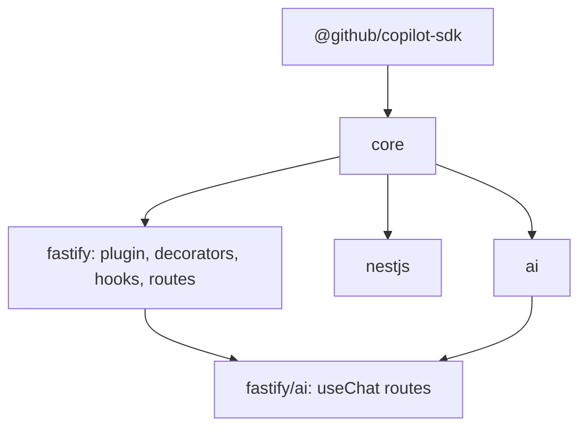

# Copilot for Fastify

Status: **proposed**. API and package names are working names.

This document designs `@copilot-sdk-integrations/fastify`, a Fastify plugin for the
[Copilot SDK for Node.js/TypeScript](https://github.com/github/copilot-sdk/tree/main/nodejs).
It is the second framework integration after the [NestJS module](DESIGN.md) and is built
on the same framework-agnostic core ([DESIGN.md §3](DESIGN.md#3-shared-core)). Everything
the core owns (client manager, agents, tools, governance, conversations, context, events,
test runtime) is reused as is; this document only covers what is Fastify-specific.

Versions surveyed: `fastify` 5.12, `fastify-plugin` 6.0, `@fastify/under-pressure` 9.2,
`@github/copilot-sdk` 1.0.26, `ai` 7.0.

**Contents**

1. [Why Fastify](#1-why-fastify)
2. [Package and layering](#2-package-and-layering)
3. [Plugin at a glance](#3-plugin-at-a-glance)
4. [Plugin options](#4-plugin-options)
5. [Decorators and typed agents](#5-decorators-and-typed-agents)
6. [Lifecycle](#6-lifecycle)
7. [Request context and identity](#7-request-context-and-identity)
8. [Errors](#8-errors)
9. [Streaming](#9-streaming)
10. [AI SDK `useChat` endpoints and approvals](#10-ai-sdk-usechat-endpoints-and-approvals)
11. [Health and info](#11-health-and-info)
12. [Encapsulation](#12-encapsulation)
13. [Testing](#13-testing)
14. [Core changes](#14-core-changes)
15. [NestJS to Fastify mapping](#15-nestjs-to-fastify-mapping)
16. [Roadmap](#16-roadmap)
17. [Open questions](#17-open-questions)

---

## 1. Why Fastify

- **The other mainstream Node.js server framework.** Fastify is the most used
  performance-oriented framework and the usual choice for teams that want structure
  without NestJS's DI and decorators. NestJS itself can run on Fastify, but many teams
  use Fastify directly.
- **Long-lived server.** Like NestJS, a Fastify app is a long-running process, the
  natural host for the Copilot runtime and its on-disk session state.
- **A plugin model that fits.** Fastify's decorators, hooks, and encapsulation map
  cleanly onto what the integration needs: one shared client, request-scoped context,
  lifecycle-managed startup and shutdown, and opt-in routes.

| Integration need | Fastify mechanism |
| --- | --- |
| One client per app | `fastify.decorate("copilot", ...)` |
| Request-bound agents and abort signal | `fastify.decorateRequest(...)` |
| Request context (principal, headers) | `preHandler` hook running the handler inside `AsyncLocalStorage` |
| Eager start, graceful drain, stop | `onReady`, `preClose`, `onClose` hooks |
| Streaming | `reply.send(ReadableStream)` (keeps hooks, CORS, compression) |
| Error mapping | Root `setErrorHandler`, or a reusable handler function |
| Health and info | Opt-in routes, plus a `@fastify/under-pressure` health check |

---

## 2. Package and layering



| Entry point | Contents | Depends on |
| --- | --- | --- |
| `@copilot-sdk-integrations/fastify` | `copilotPlugin`, decorators, context hook, error handler, SSE helper, health and info routes | core, `fastify-plugin`; peer `fastify ^5` |
| `@copilot-sdk-integrations/fastify/ai` | `reply.copilotChat()` / `reply.copilotUIStream()` for AI SDK `useChat` front ends | the `ai` package; optional peer `ai` |
| `@copilot-sdk-integrations/fastify/testing` | `buildCopilotTestApp()` convenience on top of `core/testing` | core |

Same conventions as the other packages: ESM-only with `require(esm)` for CommonJS apps,
`types` and `default` export conditions plus `typesVersions`, released with the same
version, tested in the existing `nodejs.yml` workflow. Peer range `fastify ^5`: Fastify 4
reached end of life on 2025-06-30, and Fastify 6 is added when it ships.

---

## 3. Plugin at a glance

```ts
// app.ts
import Fastify from "fastify";
import { copilotPlugin } from "@copilot-sdk-integrations/fastify";
import { support } from "./agents/support.js";

export async function buildApp() {
  const app = Fastify({ logger: true });

  await app.register(copilotPlugin, {
    client: { limits: { maxConcurrentTurns: 32, maxQueuedTurns: 128 } },
    startup: "eager",
    agents: [support],
    context: { principal: (req) => req.user?.id },
    health: { path: "/health/copilot" },
  });

  app.post<{ Params: { id: string }; Body: { message: string } }>("/chat/:id", async (req) => {
    const answer = await req.copilot.agent("support").send({
      conversationId: req.params.id,
      prompt: req.body.message,
    });
    return { answer };
  });

  app.get<{ Querystring: { q: string } }>("/chat/stream", (req, reply) =>
    reply.copilotEvents(req.copilot.agent("support").stream({ prompt: req.query.q })),
  );

  return app;
}
```

```ts
// agents/support.ts: plain core definitions, shared with NestJS or Express apps
export const support = defineAgent({
  name: "support",
  instructions: "You help customers with their orders. Be concise.",
  tools: [lookupOrder],
  permissions: permissions.allowCustomTools(),
});

declare module "@copilot-sdk-integrations/fastify" {
  interface CopilotAgentRegistry {
    support: typeof support;
  }
}
```

There are no decorators or classes: agents are the core's `defineAgent` objects, which
is idiomatic for Fastify and lets the same definitions run under NestJS, Express, or
Fastify.

---

## 4. Plugin options

```ts
interface CopilotPluginOptions {
  /** Core client options (cliPath, cliUrl, githubToken, limits, restart, ...), or an existing Copilot. */
  client?: CopilotOptions | Copilot;
  /** "lazy" (default) starts the runtime on the first turn; "eager" starts it in onReady. */
  startup?: "lazy" | "eager";
  /** Agents available through fastify.copilot.agent(name) and request.copilot.agent(name). */
  agents?: CopilotAgentDefinition[];
  /** Per-agent overrides by name (model, provider, ...), like NestJS `agents` options. */
  agentOverrides?: Record<string, Partial<CopilotAgentDefinition>>;
  /** Request context capture (§7); false disables the hook. */
  context?: CopilotContextOptions | false;
  /** Root error handler mapping Copilot errors to HTTP (§8); false skips it. */
  errorHandler?: boolean;
  /** Health route (§11); off unless set. */
  health?: { path?: string } | false;
  /** Info route (§11); off unless set, and should be guarded. */
  info?: { path?: string; onRequest?: onRequestHookHandler | onRequestHookHandler[] } | false;
  /** How long preClose waits for in-flight turns before onClose aborts them. Default 30s. */
  shutdownGracePeriod?: number;
  /** Stop the client on close. Default: true when the plugin created it, false when one was passed in. */
  stopOnClose?: boolean;
}
```

- Options are validated with Zod at registration; errors name the offending key and
  fail `app.register`, so a bad config fails at boot.
- Configuration comes from wherever the app already gets it (`@fastify/env`,
  `process.env`, a config module); the plugin doesn't read environment variables beyond
  what the core already resolves (`COPILOT_CLI_PATH`).
- Core pass-throughs live under `client` (hooks, `onEvent`, `tokenResolver`,
  `mcpServers`, `providers`, `restart`, `store`, `logger`). The default `logger` is the
  Fastify instance's pino logger (`fastify.log.child({ module: "copilot" })`).

---

## 5. Decorators and typed agents

| Decorator | Type | Purpose |
| --- | --- | --- |
| `fastify.copilot` | `FastifyCopilot` | The core `Copilot` plus `agent(name)`, `agents()`, and `registerAgent(def)` |
| `request.copilot` | `RequestCopilot` | `agent(name)` handles bound to this request's context and abort signal; `context`; `signal` |
| `reply.copilotEvents(events, options?)` | method | Streams Copilot events as SSE (§9) |
| `reply.copilotChat(...)`, `reply.copilotUIStream(...)` | methods, `./ai` only | AI SDK UI message stream responses (§10) |

- `fastify.copilot.agent(name)` returns the core `CopilotAgentHandle`. Unknown names
  throw a `CopilotConfigurationError` that lists the registered agents.
- `request.copilot.agent(name)` returns the same handle, but every `send`, `stream`, and
  `conversation` call defaults `context` to the request context and `signal` to the
  request's abort signal, so a handler doesn't have to pass them. Explicit arguments
  still win.
- **Typed names.** `CopilotAgentRegistry` is an empty interface that apps augment
  (`declare module`, shown in §3). When it has keys, `agent()` accepts only those
  names and structured results keep their Zod types. When it's empty, any string is
  accepted.
- `registerAgent(def)` lets feature plugins add agents before `ready()`; registering
  after `ready()` or registering a duplicate name throws.
- Request decorators are created lazily with a getter (Fastify's recommended pattern
  for reference types), so requests that never use Copilot pay nothing.

---

## 6. Lifecycle

| Fastify hook | Behaviour |
| --- | --- |
| `register` | Validate options, create the client (or adopt the given one), validate agent tool filters |
| `onReady` | `startup: "eager"`: `await copilot.start()`, so `app.ready()` and `app.listen()` fail if the runtime can't start |
| `preClose` | Stop admitting turns and drain in-flight turns for up to `shutdownGracePeriod` |
| `onClose` | Abort remaining turns, disconnect sessions, stop the runtime (only when `stopOnClose`) |

- Fastify's `return503OnClosing` (on by default) rejects new requests while closing, so
  the drain only sees requests already running.
- Crash restart is the core's behaviour unchanged ([DESIGN.md §6](DESIGN.md#6-managed-client-and-lifecycle)).
- Signal handling stays with the app. The docs show `close-with-grace`, the pattern
  the Fastify CLI and templates use.

---

## 7. Request context and identity

The core's `AsyncLocalStorage` context must be active while tools, permission policies,
hooks, and listeners run. The plugin adds a `preHandler` hook that builds the context
and runs the rest of the request inside it (`runWithCopilotContext(ctx, done)`), the
same technique `@fastify/request-context` uses.

```ts
interface CopilotContextOptions {
  /** Principal for session-id derivation and permission ownership. Default: request.user?.id ?? request.user?.sub. */
  principal?: (request: FastifyRequest) => string | undefined | Promise<string | undefined>;
  /** Request headers copied into context.headers (for MCP header functions, token resolvers). */
  headers?: string[];
  /** Extra attributes for tools and policies. */
  attributes?: (request: FastifyRequest) => Record<string, unknown> | Promise<Record<string, unknown>>;
  /** Abort turns when the client disconnects. Default true. */
  abortOnDisconnect?: boolean;
  /** Hook stage. Default "preHandler", which runs after auth in onRequest/preValidation. */
  hook?: "onRequest" | "preValidation" | "preHandler";
}
```

- **Why `preHandler`.** Auth plugins (`@fastify/jwt`, `@fastify/auth`, `@fastify/passport`)
  usually set `request.user` in `onRequest` or `preValidation`; capturing later means
  the principal is already known.
- The **abort signal** comes from an `AbortController` tied to `request.raw` `close`
  (and `reply.raw` `close` before the response finishes), exposed as
  `request.copilot.signal`.
- `request.copilot.context` is also available for code that needs the principal outside
  the ALS scope (for example `onSend` hooks).
- Per-user GitHub tokens use the core's `tokenResolver(ctx)`. A typical app copies the
  user's token into `attributes` and returns it from the resolver.

---

## 8. Errors

With `errorHandler: true` (the default), the plugin installs a root `setErrorHandler`
that maps core errors to HTTP and leaves everything else to Fastify's default
behaviour:

| Error | Status |
| --- | --- |
| `CopilotAdmissionRejectedError` | `429` with `Retry-After` |
| `CopilotConversationBusyError`, `CopilotConversationExistsError` | `409` |
| `CopilotConversationNotFoundError` | `404` |
| `CopilotTimeoutError` | `504` |
| `CopilotAbortedError` | `499` (logged at debug, body skipped when the socket is gone) |
| `CopilotRuntimeUnavailableError`, `CopilotShuttingDownError` | `503` |
| `CopilotSessionError`, `CopilotOutputValidationError` | `502` |
| Other `CopilotIntegrationError` | `500` with a generic message |

- The body follows Fastify's error shape: `{ statusCode, code, error, message }`, where
  `code` is the error class name (for example `COPILOT_ADMISSION_REJECTED`).
- Fastify allows one error handler per encapsulation context. Apps that already set
  their own root handler pass `errorHandler: false` and call the exported
  `copilotErrorHandler` (or `copilotErrorToHttp`) from theirs.
- The mapping table moves from the NestJS package into core (§14), so NestJS, Fastify,
  and the Express example share it.

---

## 9. Streaming

`reply.copilotEvents(events, options?)` turns an `AsyncIterable<CopilotAgentEvent>` into
a `text/event-stream` response:

- Each event is written as `event: <type>` plus `data: <json>`. `permission-request`
  events carry an id instead of the `respond` callback, which can't be serialized
  (answering goes through §10 or the app's own route).
- The body is a web `ReadableStream` passed to `reply.send()`, not `reply.hijack()`.
  Fastify 5 sends web streams natively, so `onSend` hooks, `@fastify/cors` headers, and
  `@fastify/compress` rules still apply. Hijacking would bypass them, a common
  Fastify streaming pitfall.
- Headers: `Content-Type: text/event-stream`, `Cache-Control: no-cache`, and
  `X-Accel-Buffering: no` for proxies.
- Optional heartbeat comments (`heartbeatMs`, default 15s) keep idle connections open
  through proxies.
- Client disconnect cancels the stream, which ends the iteration and aborts the turn
  (the core already aborts on `return()`).
- Errors after the headers are sent become an `event: error` frame; before that, they go
  to the error handler (§8).

WebSockets are left to `@fastify/websocket` handlers that iterate the same stream; the
docs include a short example, as for NestJS.

---

## 10. AI SDK `useChat` endpoints and approvals

The `./ai` entry point wraps the existing `ai` package helpers so a `useChat` endpoint
is one call:

```ts
import { copilotAiPlugin } from "@copilot-sdk-integrations/fastify/ai";

await app.register(copilotAiPlugin); // adds reply.copilotChat / reply.copilotUIStream

app.post<{ Body: CopilotChatRequest }>("/api/chat", (req, reply) =>
  reply.copilotChat({ agent: req.copilot.agent("support"), request: req.body }),
);
```

- `reply.copilotChat` calls `createCopilotChatResponse` from the `ai` package and sends
  the resulting web `Response` body and headers through `reply` (same reasons as §9).
- **Conversation ids are principal-scoped.** The `useChat` chat id is combined with the
  principal (`${principal}:${chatId}`), as in the Express example, so users can't resume
  each other's chats even before session-id derivation adds its own scoping.
- **Approvals.** `permissions.askUser()` and AI SDK `needsApproval` tools round-trip
  through `addToolApprovalResponse` using the `ai` package's approval store. The
  plugin creates one per app (`fastify.copilotApprovals`); pass `approvals` to share or
  replace it. Pending approvals are in process memory, so multi-instance deployments
  need sticky routing until the phase 4 store lands.
- `reply.copilotUIStream(events)` covers one-shot prompts (no history) for `useCompletion`
  or custom front ends.

---

## 11. Health and info

- **Health route** (`health: { path }`): `GET` returns `copilot.health()`
  (`{ state, version, capacity }`), with `503` when the state is `failed`, `stopping`, or
  `stopped`. It never starts a lazy runtime.
- **`@fastify/under-pressure`**: `copilotHealthCheck(fastify)` returns a function for
  under-pressure's `healthCheck` option, so the Copilot state joins the app's existing
  `/status` route and load-shedding.
- **Info route** (opt-in, `info: { path, onRequest }`): agents (name, model, provider,
  tool names, MCP servers, permission policy name), client state, and capacity,
  read-only. Registration logs a warning when no `onRequest` guard is configured.
- Both routes are registered with JSON response schemas, so they show up in
  `@fastify/swagger` and serialize with `fast-json-stringify`.

---

## 12. Encapsulation

- The plugin is wrapped with `fastify-plugin` (name `@copilot-sdk-integrations/fastify`,
  `fastify: "5.x"`), so its decorators and hooks apply to the whole app, which is the
  usual choice for shared clients (like `@fastify/postgres`).
- Registering the plugin twice in the same scope fails (Fastify's duplicate-decorator
  check); a second, isolated client in a child scope is possible with
  `copilotPlugin.scoped`, which is not wrapped, for apps that serve two tenants with
  different runtimes.
- Routes from the plugin (`health`, `info`) respect a `prefix` passed to `register`.

---

## 13. Testing

Fastify apps test with `app.inject()`, and the core already ships a scripted runtime, so
the testing entry point is small:

```ts
import { buildCopilotTestApp } from "@copilot-sdk-integrations/fastify/testing";

const { app, runtime } = await buildCopilotTestApp(buildApp, (runtime) =>
  runtime.onPrompt(/order 42/).callTool("lookupOrder", { id: "42" }).thenReply("Order 42 shipped."),
);

const res = await app.inject({ method: "POST", url: "/chat/c1", payload: { message: "Where is order 42?" } });
expect(res.json()).toEqual({ answer: "Order 42 shipped." });
expect(runtime.prompts).toEqual(["Where is order 42?"]);
await app.close();
```

- `buildCopilotTestApp(build, script)` creates a `createTestCopilot` client and passes it
  to the app as `client`. Apps make that possible by accepting plugin options in their
  `buildApp(opts)`, the usual Fastify app-factory pattern.
- No runtime process, credentials, or paid requests; streaming routes are tested by
  reading `res.body` and parsing SSE frames (a `parseSse()` helper is exported).

---

## 14. Core changes

Small, shared changes made alongside the plugin:

1. **`copilotErrorToHttp` moves to core** (`core/http`), with `CLIENT_CLOSED_REQUEST`.
   NestJS re-exports it unchanged; the Express example uses it instead of answering
   `500` for every error.
2. **`describeAgent(def)`** moves to core so the NestJS info controller and the Fastify
   info route return the same document.
3. **SSE encoding helper** (`toSseStream(events, options)`) in core, used by Fastify
   and available to Express and plain `http` apps.

No behaviour changes for existing NestJS or `ai` users.

---

## 15. NestJS to Fastify mapping

| NestJS module | Fastify plugin |
| --- | --- |
| `CopilotModule.forRoot/forRootAsync` | `app.register(copilotPlugin, options)` |
| `CopilotModule.forFeature([...])` | `agents: [...]` option or `fastify.copilot.registerAgent(def)` |
| `@CopilotAgent` abstract class | Core `defineAgent` object, typed via `CopilotAgentRegistry` |
| `@CopilotTool` on providers | Core `defineCopilotTool` or AI SDK `tool()` |
| `CopilotContextInterceptor` | `preHandler` context hook |
| `nestjs-cls` bridge | Not needed: the hook runs the handler inside the core's ALS context |
| `CopilotExceptionFilter` | Root `setErrorHandler`, or `copilotErrorHandler` |
| `@Sse()` with Observable | `reply.copilotEvents(asyncIterable)` |
| `pipeCopilotChatToResponse(res, ...)` | `reply.copilotChat(...)` (`./ai`) |
| `onApplicationBootstrap` / shutdown hooks | `onReady` / `preClose` / `onClose` |
| Terminus `CopilotHealthIndicator` | Health route, `copilotHealthCheck` for under-pressure |
| `CopilotInfoModule` | Opt-in `info` route |
| `CopilotTestingModule` | `buildCopilotTestApp` plus `app.inject()` |
| `@nestjs/event-emitter` re-emission | Core `onEvent` listeners (no Fastify event bus to target) |

---

## 16. Roadmap

| Phase | Scope | Exit criteria |
| --- | --- | --- |
| **F1. Plugin** | Core changes (§14), `copilotPlugin`, decorators, typed registry, lifecycle, context hook, error handler, health/info routes, under-pressure check | Unit tests with `app.inject()` cover every decorator, hook, error mapping, and the crash -> 503 -> restart path |
| **F2. Streaming and AI SDK** | `reply.copilotEvents`, `./ai` (`copilotChat`, `copilotUIStream`, approvals), `./testing` | SSE and `useChat` streams verified through `inject`, including approvals and disconnect aborts |
| **F3. Example and docs** | `examples/fastify` (same advisor as the Express example, with tests), package README, docs site pages, landing page and root README updates | Example tests pass in CI; docs site link check passes |

Scale-out (`redisStore`, `sessionFs`) and OpenTelemetry stay on the shared roadmap in
[DESIGN.md §17](DESIGN.md#17-roadmap) and apply to Fastify unchanged.

---

## 17. Open questions

1. **Default error handler.** Install the root error handler by default (current
   proposal) or require apps to opt in, given Fastify allows only one per scope?
2. **Context hook stage.** `preHandler` by default works with most auth plugins. Is
   `onRequest` with a lazily resolved principal a better default?
3. **Typed agent registry.** Declaration merging (`CopilotAgentRegistry`) is the Fastify
   way to type decorators, but it's global. Is a generic `copilotPlugin<typeof agents>`
   with a typed `app.copilot` worth the extra type complexity?
4. **`./ai` as a subpath or a separate package.** A subpath keeps one package but needs
   `ai` as an optional peer; a separate `fastify-ai` package is more explicit.
5. **Type providers.** Should the docs standardize on `fastify-type-provider-zod` for
   route schemas, since agents and tools already use Zod?

---

## 18. Implementation notes

Deviations from, or clarifications of, the design above, made while implementing phases F1 and F2:

- **Shutdown is one core call.** The core has no separate drain API: `copilot.stop({ gracePeriodMs })` closes admission at once, drains, aborts the rest, and stops the runtime. `preClose` starts it (with `shutdownGracePeriod`) and `onClose` awaits the same promise, so admission closes in `preClose` and the abort happens at the end of the grace period rather than strictly in `onClose`.
- **`copilotEvents` waits for the first event.** The core's `stream()` reports errors as `error` events rather than throwing. To honour "errors before the headers are sent go to the error handler" (§9), `reply.copilotEvents()` returns a `Promise<FastifyReply>` and awaits the first event: a first `error` event, or a throw before it, goes through `reply.send(error)` and so gets a real status (for example 429 or 503). Later errors become an `event: error` frame. Heartbeats start once the first event arrives, so a turn waiting in the admission queue doesn't send any.
- **Stream cancellation.** Cancelling the SSE body calls the iterator's `return()`, but a core turn's `return()` waits for its pending step to settle. Request-bound handles also receive the request's disconnect signal, which aborts immediately. Handles from `fastify.copilot.agent()` used for streaming should be given `signal: request.copilot.signal`.
- **Disconnect detection.** `request.raw` emits `close` as soon as its body is consumed, so the signal aborts only on `reply.raw` `close` before the response ended, or on `request.raw` `close` when the socket is destroyed or the request errored or is incomplete.
- **Headers in the context** go to `context.attributes.headers` (lowercased names), as in NestJS, since `CopilotContext` has no `headers` field. `attributes` also always carry `user` (when set) and `requestId`.
- **`hook` stages before `preHandler`.** Body parsing runs outside the async scope of `onRequest` and `preValidation` hooks, so with those stages the plugin also re-enters the context in `preHandler`.
- **Prefix.** Routes registered by a `fastify-plugin`-wrapped plugin ignore the `register` prefix, so the plugin prepends `prefix` to the health and info paths itself. `prefix`, `logLevel`, and `logSerializers` are accepted by option validation.
- **`copilotPlugin.scoped`** is the unwrapped plugin. Its decorators are visible only inside its own scope (useful for its routes and hooks). Because the wrapped `copilotPlugin` already applies to the scope it's registered in, per-tenant clients are best done by registering `copilotPlugin` inside each tenant's child plugin; the README documents that.
- **`fastify.copilot`** additionally exposes `core` (the underlying core `Copilot`), and `agent()` also accepts a definition (as the core does). `agents()` returns definitions with overrides applied. Overrides for unknown agent names are logged as a warning in `onReady`.
- **Info document.** `describeAgent` produces exactly the NestJS document (name, description, model, reasoning effort, provider, built-in tools, tool names, MCP servers, tool filters, optional instructions). It doesn't include a permission policy name (§11), since policies are functions without a stable name. The Fastify route has `includeInstructions` (default false) like NestJS. Named providers are a NestJS module option, so the Fastify route reports the inline provider's `type`.
- **`reply.copilotChat` input.** `request` is the `useChat` body (`{ id?, messages? }`, exported as `CopilotChatBody`, default `request.body`), not the `ai` package's parsed `CopilotChatRequest`. `agent` accepts a registered name or a handle; handles are bound to the request context. `conversationId` can be passed to override the `${principal}:${id}` default.
- **Error body.** `error` is Node's status text (`"Client Closed Request"` for 499). Copilot errors are logged at `error` (5xx), `info` (4xx), or `debug` (499). Errors that aren't Copilot errors are rethrown to Fastify's default handler, so validation errors and plain errors are unchanged.
- **Core extras.** Besides `copilotErrorToHttp`, `describeAgent`, and `toSseStream`, core now exports `copilotErrorCode`, `formatSseEvent`, `serializeAgentEvent` (moved from NestJS, which re-exports it), and `parseSse` from `core/testing`.
- **Approval ownership (`ai` package).** The approval store records each suspended turn's owner: its `conversationId` and principal (`context.principal`, else the ambient `getCopilotContext()` principal). A response only resumes the turn when both match the current request (ephemeral turns: principal only). A mismatch gets the same `EXPIRED_APPROVAL` tool error as an unknown id, and the suspended turn isn't answered, taken, or aborted, so approval ids can't be probed or hijacked. A new user message only supersedes the same owner's suspended turns. `reply.copilotChat` also passes the request principal explicitly instead of relying only on the async context. With `context: false` there is no principal, so approvals are scoped by conversation id alone.
