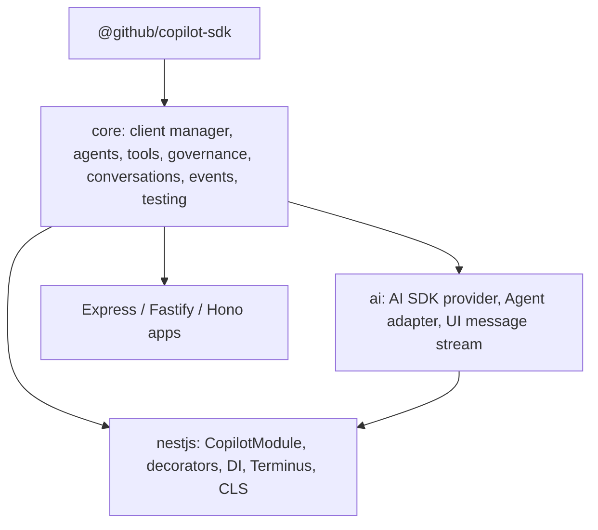

# Copilot for Node.js: shared core and NestJS module

Status: **approved; phases 1–3 implemented** (see §19). API and package names are working
names.

This document designs the Node.js integrations for the
[Copilot SDK for Node.js/TypeScript](https://github.com/github/copilot-sdk/tree/main/nodejs)
(`@github/copilot-sdk`):

- a **framework-agnostic core** that holds everything not tied to a framework, and
- a **NestJS module**, the first framework integration and the closest counterpart to
  the [Spring Boot starter](../spring-boot/).

Versions surveyed: `@github/copilot-sdk` 1.0.26, `@nestjs/core` 12.2, `@nestjs/terminus`
12.1, `ai` 7.0, `rxjs` 7.8.

**Contents**

1. [Why NestJS](#1-why-nestjs)
2. [Layering](#2-layering)
3. [Shared core](#3-shared-core)
4. [NestJS module at a glance](#4-nestjs-module-at-a-glance)
5. [Module configuration](#5-module-configuration)
6. [Managed client and lifecycle](#6-managed-client-and-lifecycle)
7. [Agents](#7-agents)
8. [Tools](#8-tools)
9. [Request context and per-user identity](#9-request-context-and-per-user-identity)
10. [Governance](#10-governance)
11. [Conversations](#11-conversations)
12. [Streaming over HTTP](#12-streaming-over-http)
13. [MCP servers and BYOK](#13-mcp-servers-and-byok)
14. [Health, observability, and events](#14-health-observability-and-events)
15. [Testing](#15-testing)
16. [Spring Boot to NestJS mapping](#16-spring-boot-to-nestjs-mapping)
17. [Roadmap](#17-roadmap)
18. [Open questions](#18-open-questions)

---

## 1. Why NestJS

- **Same programming model as Spring.** Modules, dependency injection, decorators, and
  lifecycle hooks map almost one-to-one, so the Spring starter's proven design ports
  with few changes.
- **Long-lived server.** The Copilot runtime is a separate process with on-disk
  session state; a long-running NestJS server is its natural host, with no cold-start
  or packaging constraints.
- **Enterprise backend audience.** NestJS is the most widely used structured
  server-side framework in Node.js, used for the same kind of applications as Spring
  Boot.

NestJS isn't the only target. Express, Fastify, Hono, and Koa applications use the
framework-agnostic core directly (§3).

---

## 2. Layering



| Package (working name) | Contents | Depends on |
| --- | --- | --- |
| `@copilot-sdk-integrations/core` | Client manager, agent definitions and execution, tool adapters, governance, conversation manager, session store interface, event model, test runtime | `@github/copilot-sdk`, `zod` |
| `@copilot-sdk-integrations/ai` | `copilot()` AI SDK provider, AI SDK `Agent` adapter, Copilot event to UI message stream mapping | core, `ai` |
| `@copilot-sdk-integrations/nestjs` | `CopilotModule`, decorators, discovery, CLS context, Terminus indicator, testing module | core, `@nestjs/common`, `@nestjs/core`; optional `ai`, `@nestjs/terminus`, `rxjs` |

Packages live in an npm workspace under `nodejs/packages/*` and are released together
with one version, like the Spring Boot reactor modules. Toolchain: TypeScript (ESM and
CJS builds), Vitest, Node.js `^20.19 || >=22.12` (the SDK's floor), and a CI workflow
scoped to `nodejs/**`.

---

## 3. Shared core

The core is a plain TypeScript library; any Node.js app can use it without NestJS.

```ts
import { createCopilot, defineAgent, permissions } from "@copilot-sdk-integrations/core";

const copilot = createCopilot({ cliPath: process.env.COPILOT_CLI_PATH });

const advisor = defineAgent({
  name: "advisor",
  instructions: "Explain Node.js concepts concisely.",
  permissions: permissions.denyAll(),
});

const answer = await copilot.agent(advisor).send({ conversationId: "u42", prompt: "What is libuv?" });
```

What the core owns (described once here and reused by framework modules):

| Capability | Summary |
| --- | --- |
| **Client manager** | Lazy or eager start, single in-flight start, crash restart, graceful stop that disconnects sessions, `mode: "empty"` for multi-user servers, access to the raw `CopilotClient` |
| **Agent definitions** | Plain objects: name, instructions (append/replace/customize), model, reasoning effort, provider, tools, MCP servers, tool filters, permissions, hooks, custom agents |
| **Agent execution** | Ephemeral or conversation-scoped turns; text, structured (Zod schema via the SDK's `responseSchema`), and streamed results |
| **Tool adapters** | AI SDK `tool()`, SDK `defineTool`, and plain `{ description, input, execute }` objects all become Copilot tools |
| **Governance** | Tool allow/deny validation, `permissions.*` policies (deny by default), composed hooks |
| **Conversations** | Session id derived from agent name, principal, and conversation id; create/resume; resume-only bound handles; per-conversation serialization; bounded admission; real cancellation through `AbortSignal` |
| **Context** | `AsyncLocalStorage` request context (`principal`, `conversationId`, `signal`, custom attributes) restored inside tools, permission handlers, hooks, and listeners |
| **Session stores** | `SessionStore` interface for cross-replica leases and, optionally, shared session state through the SDK's `sessionFs`. Ships `memoryStore` and `redisStore` |
| **Events** | Typed `CopilotAgentEvent` union (text delta, reasoning, tool start/end, permission, usage, error, done), as an `AsyncIterable` |
| **Observability** | OpenTelemetry spans and usage metrics; no-ops when no OTel SDK is registered |
| **Testing** | Scripted, in-memory runtime implementing the same client interface |

---

## 4. NestJS module at a glance

```ts
// app.module.ts
@Module({
  imports: [
    CopilotModule.forRootAsync({
      imports: [ConfigModule],
      inject: [ConfigService],
      useFactory: (config: ConfigService) => ({
        cliPath: config.get("COPILOT_CLI_PATH"),
        startup: "lazy",
        limits: { maxConcurrentTurns: 32, maxQueuedTurns: 128 },
      }),
    }),
    CopilotModule.forFeature([SupportAgent], { tools: [OrdersTools] }),
  ],
  controllers: [ChatController],
  providers: [OrdersTools],
})
export class AppModule {}
```

```ts
// support.agent.ts
@CopilotAgent({
  name: "support",
  instructions: "You help customers with their orders. Be concise.",
  model: "gpt-5",
  tools: [OrdersTools],
  builtInTools: false,
  permissions: permissions.allowCustomTools(),
})
export abstract class SupportAgent {
  @UserMessage()
  abstract answer(@ConversationId() id: string, @Message() question: string): Promise<string>;

  @UserMessage("Classify the sentiment of: {{text}}")
  @Returns(z.enum(["positive", "neutral", "negative"]))
  abstract sentiment(@P("text") text: string): Promise<"positive" | "neutral" | "negative">;

  @UserMessage()
  abstract stream(@ConversationId() id: string, @Message() question: string): Observable<CopilotAgentEvent>;
}
```

```ts
// orders.tools.ts
@Injectable()
export class OrdersTools {
  constructor(private readonly orders: OrdersService) {}

  @CopilotTool({ description: "Look up an order by id", input: z.object({ id: z.string() }) })
  lookupOrder({ id }: { id: string }) {
    return this.orders.find(id);
  }
}
```

```ts
// chat.controller.ts
@Controller("chat")
@UseGuards(AuthGuard("jwt"))
export class ChatController {
  constructor(private readonly support: SupportAgent) {}

  @Post(":id")
  answer(@Param("id") id: string, @Body("message") message: string) {
    return this.support.answer(id, message);
  }

  @Sse(":id/stream")
  stream(@Param("id") id: string, @Query("q") q: string) {
    return this.support.stream(id, q).pipe(map((e) => ({ type: e.type, data: e })));
  }
}
```

No implementation class is written: the module provides an implementation of the
abstract class, as Spring generates a proxy for an annotated interface.

---

## 5. Module configuration

- `CopilotModule.forRoot(options)` / `forRootAsync({ useFactory, inject, imports })`,
  built with Nest's `ConfigurableModuleBuilder`, global by default.
- `CopilotModule.forFeature(agents, { tools })` registers agent classes and tool
  providers in a feature module, the counterpart of Spring's component scanning.
- Options mirror the `copilot.*` properties: `cliPath`, `cliUrl` (existing TCP
  server), `startup` (`lazy` | `eager`), `githubToken`, `useLoggedInUser`,
  `baseDirectory`, `logLevel`, `limits`, `responseTimeout`, `providers` (named BYOK
  providers), `mcpServers` (named), `agents` (per-agent overrides by name), `store`.
- Per-agent overrides from configuration (`agents.support.model`) win over decorator
  values, so models and providers change per environment without code changes.
- Options are validated with Zod at bootstrap; errors name the offending key.
- **Customizers**: `COPILOT_CLIENT_CUSTOMIZER` and `COPILOT_SESSION_CUSTOMIZER`
  multi-providers adjust raw SDK options, like Spring's customizer beans.

---

## 6. Managed client and lifecycle

- `CopilotClientManager` is a singleton provider wrapping the core client manager.
  The raw `CopilotClient` is injectable through `@InjectCopilotClient()`.
- **Lazy** (default): the runtime starts on the first turn. **Eager**: it starts in
  `onApplicationBootstrap`, and bootstrap fails if the runtime can't start.
- **Shutdown**: `beforeApplicationShutdown` stops admitting turns and drains in-flight
  turns up to `shutdownGracePeriod`; `onApplicationShutdown` aborts the rest,
  disconnects sessions, and stops the runtime. Docs remind apps to call
  `app.enableShutdownHooks()`.
- The runtime is resolved like the Spring starter: `cliPath`, then `COPILOT_CLI_PATH`,
  then the SDK's bundled platform runtime, or `cliUrl` for an existing server.
- Built-in tools are **off by default** (`mode: "empty"`) but can be enabled. Docs
  recommend a container per tenant when enabling shell or write tools for multi-user
  apps, because the runtime runs them on the server's host.

---

## 7. Agents

TypeScript interfaces don't exist at runtime, so Spring's interface proxies become
**abstract classes**. The module discovers classes decorated with `@CopilotAgent`
(through `DiscoveryService`) and registers a provider whose methods are implemented by
the core agent executor.

### Decorators

| Decorator | Target | Meaning |
| --- | --- | --- |
| `@CopilotAgent(options)` | Class | Agent definition (same fields as core `defineAgent`) |
| `@UserMessage(template?)` | Method | Prompt template with `{{name}}` placeholders, or the `@Message()` argument verbatim |
| `@UserMessageFrom(path)` | Method | Template loaded from a file at bootstrap |
| `@Message()` | Parameter | The user message text |
| `@P(name)` | Parameter | Template variable |
| `@ConversationId()` | Parameter | Conversation key for create/resume |
| `@Returns(schema)` | Method | Zod schema for a structured result (types are erased, so the schema is explicit) |
| `@Signal()` | Parameter | `AbortSignal` that cancels the turn |
| `@Tools(...providers)` | Class or method | Tool providers available to the agent or call |

### Return types

| Declared return | Behavior |
| --- | --- |
| `Promise<string>` | Final assistant text |
| `Promise<T>` with `@Returns(schema)` | Validated structured result |
| `Observable<CopilotAgentEvent>` | Cold stream; unsubscribing aborts the turn (the Reactor `Flux` equivalent) |
| `AsyncIterable<CopilotAgentEvent>` | Same, for `for await` |

Templates, parameter names, and schemas are validated at bootstrap; a method with an
unknown placeholder fails startup, as `@P` validation does in Spring.

### Bound instances

```ts
constructor(private readonly agents: CopilotAgents) {}

const bound = this.agents.bind(SupportAgent, "tenant-1/customer-42"); // resume-only by default
await bound.answer("And the delivery date?");
```

Methods of a bound instance omit the `@ConversationId()` argument. A missing session
raises `CopilotConversationNotFoundError` unless created explicitly with
`agents.create(SupportAgent, id)`.

### Functional alternative

Apps that prefer no decorators register core definitions directly:
`CopilotModule.forFeature([defineAgent({...})])` and inject with
`@InjectAgent("support")`.

---

## 8. Tools

- `@CopilotTool({ name?, description, input, skipPermission?, overridesBuiltInTool? })`
  marks a method on any `@Injectable()` provider. `input` is a Zod schema; the handler
  receives the parsed input plus a `ToolInvocation` (tool call id, session id,
  `AbortSignal`).
- Discovery uses `DiscoveryService` and `MetadataScanner`. Tools are invoked **on the
  DI-managed instance**, so injected dependencies, transactions, and other provider
  behavior apply. Request-scoped tool providers are resolved per turn with a
  `ContextIdFactory` context.
- NestJS interceptors and guards apply to controllers, not provider methods. For
  cross-cutting tool behavior the module provides `@UseToolInterceptors(...)` with a
  `CopilotToolInterceptor` interface (logging, metrics, authorization), plus the SDK's
  pre/post tool hooks.
- AI SDK `tool()` objects and SDK `defineTool` tools are accepted in `tools: []`
  alongside provider classes.
- Duplicate tool names across an agent's tools fail at bootstrap.

---

## 9. Request context and per-user identity

- The core's `AsyncLocalStorage` context is populated by a `CopilotContextInterceptor`
  (global, opt-out). It captures the request principal (`request.user` from Passport
  by default), headers selected by configuration, and an abort signal tied to client
  disconnect.
- Integration with `nestjs-cls` is optional: when `ClsModule` is present, the CLS store
  is propagated into tools, permission handlers, hooks, and listeners, like Spring
  propagates the security context and MDC.
- **Per-user GitHub tokens**: a `CopilotTokenResolver` provider returns the caller's
  token (`resolve(ctx) => string | undefined`), used as the SDK's per-session
  `gitHubTokenProvider`. A ready-made resolver reads a Passport GitHub strategy's
  access token.
- The **principal** feeds session-id derivation, so users can't resume each other's
  conversations.

---

## 10. Governance

Same model as Spring, expressed as Nest providers:

- Tool filters on `@CopilotAgent`: `availableTools`, `excludedTools`,
  `builtInTools`, validated at bootstrap (both lists set, or an allow-list hiding the
  agent's own tools or MCP servers, fails fast).
- **Permissions denied unless configured.** `permissions.*` policies (`denyAll`,
  `allowReadOnly`, `allowCustomTools`, `allowTools`, `allowMcpServers`, `allowKinds`,
  `anyOf`, `allowAll`), or a custom injectable implementing `CopilotPermissionPolicy`,
  selected per agent (`permissions: MyPolicy`) or globally
  (`COPILOT_PERMISSION_POLICY`).
- `permissions.askUser()` emits a `permission` event on streaming calls and waits for
  `agents.respondToPermission(conversationId, requestId, decision)` within
  `approvalWindow`; non-streaming calls treat "ask user" as denial.
- **Hooks** as providers: methods decorated with `@CopilotHook("preToolUse")`,
  `@CopilotHook("postToolUse")`, and so on, scoped globally or to agents with
  `agents: [SupportAgent]`.

---

## 11. Conversations

All from the core:

- Session id from a digest of agent name, principal, and conversation id.
- Create-or-resume for `@ConversationId()` calls; ephemeral sessions otherwise.
- One turn at a time per conversation; bounded admission across agents with
  `CopilotAdmissionRejectedError`, mapped to HTTP `429` by `CopilotExceptionFilter`.
- Real cancellation from `@Signal()`, Observable unsubscription, client disconnect,
  and `responseTimeout`.
- **Scaling out**: with one replica, session state stays on the runtime's local disk.
  With several replicas, configure a store (`store: redisStore()`) for cross-replica
  conversation leases, and either sticky routing by conversation id or shared session
  state through the store's `sessionFs` adapter.

---

## 12. Streaming over HTTP

Three options, each a few lines in a controller:

- **SSE with `@Sse()`**: return the agent's `Observable<CopilotAgentEvent>` mapped to
  `MessageEvent`s.
- **AI SDK UI protocol**: `toUIMessageStream(events)` from the `ai` package, then
  `pipeUIMessageStreamToResponse(res, stream)`, so `useChat` front ends (React, Vue,
  Svelte) talk to a NestJS backend with no Copilot-specific client code, including
  tool-approval UIs mapped to `permissions.askUser()`.
- **WebSockets**: `@WebSocketGateway` handlers subscribe to the Observable; the docs
  include a gateway example with approval round trips.

---

## 13. MCP servers and BYOK

Same as Spring, as configuration objects:

- Named MCP servers in `forRoot({ mcpServers })`, selected per agent with
  `mcpServers: ["github", "docs"]`. Local (stdio) and remote (HTTP) servers are
  supported; header functions receive the request context for per-user credentials.
- Named BYOK providers in `forRoot({ providers })` (OpenAI, Azure OpenAI / Microsoft
  Foundry, Anthropic, Ollama, OpenAI-compatible), selected per agent with
  `provider: "foundry"`. Keys come from `ConfigService`, never decorators.

---

## 14. Health, observability, and events

- **Terminus**: `CopilotHealthIndicator` reports client state, runtime version, and
  admission capacity, and never force-starts a lazy client.
- **Info endpoint** (opt-in): `CopilotInfoController` lists agents, models, active
  sessions, and capacity, read-only, like the Spring Actuator endpoint. Disabled
  unless explicitly imported and guarded.
- **OpenTelemetry**: spans per turn and per tool call from the core, and token usage
  metrics, picked up by any registered OTel SDK (`@opentelemetry/sdk-node`).
- **Events**: session events delivered to `@OnCopilotEvent("tool.execution_complete")`
  provider methods, and re-emitted through `@nestjs/event-emitter` when installed.
  Listener failures are logged and never break a turn.
- **Logging**: Nest `Logger` with conversation and session ids; credentials never
  logged.

---

## 15. Testing

```ts
const moduleRef = await Test.createTestingModule({
  imports: [
    CopilotTestingModule.forRoot((runtime) =>
      runtime
        .onPrompt(/order 42/).callTool("lookupOrder", { id: "42" }).thenReply("Order 42 shipped.")
        .onPrompt(/.*/).reply("Hello")),
    CopilotModule.forFeature([SupportAgent], { tools: [OrdersTools] }),
  ],
  providers: [OrdersTools, { provide: OrdersService, useValue: fakeOrders }],
}).compile();

const support = moduleRef.get(SupportAgent);
await expect(support.answer("c1", "Where is order 42?")).resolves.toBe("Order 42 shipped.");
expect(moduleRef.get(CopilotTestRuntime).prompts).toEqual(["Where is order 42?"]);
```

- `CopilotTestingModule` swaps the client for the core's scripted runtime: replies,
  streaming, tool calls into real `@CopilotTool` providers, permission requests,
  failures, recorded prompts. No runtime process, credentials, or paid requests.
- Without NestJS, `createTestCopilot({ script })` from `@copilot-sdk-integrations/core/testing`
  returns `{ copilot, runtime, stop }` (async-disposable) with test-friendly defaults (silent
  logger, throwaway `baseDirectory`, short timeouts).
- An optional `CopilotContainer` (Testcontainers for Node.js) runs a real runtime in
  integration tests, mirroring the Spring test module.

---

## 16. Spring Boot to NestJS mapping

| Spring Boot starter | NestJS module |
| --- | --- |
| Auto-configuration, `copilot.*` properties | `CopilotModule.forRoot/forRootAsync`, `ConfigService` |
| Component scanning of agents | `CopilotModule.forFeature([...])`, `DiscoveryService` |
| `@CopilotAgent` interface plus proxy | `@CopilotAgent` abstract class plus generated implementation |
| `@UserMessage`, `@P`, `@ConversationId` | Same names as method and parameter decorators |
| `CompletableFuture<T>` structured results | `Promise<T>` with `@Returns(zodSchema)` |
| Reactor `Flux<CopilotAgentEvent>` | RxJS `Observable<CopilotAgentEvent>` or `AsyncIterable` |
| `CopilotAgents` bound instances | `CopilotAgents.bind(...)` |
| `@CopilotTool` on Spring beans via proxy | `@CopilotTool` on providers, invoked on the DI instance |
| Security context, MDC, observation propagation | `AsyncLocalStorage` context, optional `nestjs-cls` |
| `CopilotTokenResolver`, OAuth2 client | `CopilotTokenResolver` provider, Passport GitHub resolver |
| `PermissionHandler` beans, policies | `CopilotPermissionPolicy` providers, `permissions.*` |
| Session hooks as beans | `@CopilotHook(...)` provider methods |
| Customizer beans | `COPILOT_CLIENT_CUSTOMIZER`, `COPILOT_SESSION_CUSTOMIZER` |
| Lifecycle (lazy/eager, shutdown) | `onApplicationBootstrap`, `beforeApplicationShutdown`, `onApplicationShutdown` |
| Actuator health, endpoint, info | Terminus indicator, opt-in info controller |
| Micrometer | OpenTelemetry |
| `copilot-spring-boot-test`, Testcontainers | `CopilotTestingModule`, `CopilotContainer` |

---

## 17. Roadmap

| Phase | Scope | Exit criteria |
| --- | --- | --- |
| **1. Core** | Client manager, `defineAgent`, execution (text, structured, streamed), tool adapters, governance, conversations, context, `memoryStore`, test runtime | Unit tests run without credentials; a plain Express example works |
| **2. NestJS** | `CopilotModule`, decorators and generated agents, tool discovery, context interceptor, token resolver, hooks, exception filter, Terminus, testing module, example app | Example NestJS app with a typed agent, tools, SSE streaming, and tests |
| **3. AI SDK** | `ai` package: provider, `Agent` adapter, UI message stream; NestJS + `useChat` example | A React `useChat` UI against a NestJS backend, including tool approvals |
| **4. Scale-out** | `redisStore`, cross-replica leases, `sessionFs` state, `CopilotContainer` | Conversations survive moving between replicas |

---

## 18. Open questions

1. **Package scope.** `@copilot-sdk-integrations/*`, an `@brunoborges` scope, or
   unscoped names? Should align with the Spring starter's coordinates.
2. **Agent declaration style.** Abstract classes with decorators (closest to Spring)
   as the primary NestJS API, with `defineAgent` objects as the alternative. Is that
   the right default?
3. **AI SDK package in v1.** Ship `ai` with the NestJS module, or defer it?
4. **Built-in tools on servers.** Off by default but allowed. Should enabling shell or
   write tools additionally require an explicit `trustedHost: true`?
5. **NestJS version floor.** Support NestJS 11 as well as 12, or 12 only?
6. **`sessionFs` completeness.** Does shared session state through `sessionFs` cover
   everything needed to resume on another replica, or is sticky routing required?

---

## 19. Implementation notes

Phases 1–3 are implemented in `packages/core`, `packages/nestjs`, and `packages/ai`.
Where the code differs from the sections above:

- **ESM only.** Packages ship ESM builds; a CJS build is not produced yet.
- **Admission order.** A turn reserves a queue place, then takes the conversation
  lock, then waits for an execution slot (Spring's order), so a turn waiting on its
  conversation does not hold a slot. `timeout` covers queueing time too.
- **Built-in tools.** Hidden by adding `builtin:*` to `excludedTools`;
  `availableTools` defaults to `custom:*` and `mcp:*` because the SDK requires it.
- **Streams.** Errors arrive as a final `error` event rather than a thrown error.
  Streams are cold, and breaking out of iteration aborts the turn.
- **Agent methods.** TypeScript rejects decorators on abstract methods, so agent
  methods are concrete stubs that `return implementedByCopilot();`.
- **`@InjectCopilotClient()`** injects an accessor so injection does not start a lazy
  runtime.
- **Exception filter.** Aborted turns map to HTTP 499.
- **AI SDK approvals.** Approval answers arrive on the next `useChat` request; turns
  waiting for approval live in one process, so replicas need sticky routing until
  phase 4.
- **AI SDK provider.** Tools passed to `generateText`/`streamText` are rejected;
  declare them on the agent definition.
- **`nestjs-cls`.** Opt-in through `CopilotClsModule.forRoot()` from the
  `@copilot-sdk-integrations/nestjs/cls` subpath, so the main entry never loads
  `nestjs-cls`. The context is read from CLS when an agent is called, not by the
  interceptor, so non-HTTP entry points work too. The CLS store is restored around DI
  tools, hooks, listeners, and injectable policies. It is not restored around plain
  core tool objects, or for calls through the raw `@InjectCopilot()` facade.
  `CopilotClsModule` is built on a generic `COPILOT_CONTEXT_BRIDGE` provider.
- **Info endpoint.** It is a separately imported `CopilotInfoModule.register({ path,
  guards })` rather than a `forRoot` flag. It reports in-flight turns from
  `capacity.activeTurns` rather than a list of sessions.
- **Event re-emission.** Opt-in with `eventEmitter: true | { prefix }`; events are
  named `copilot.<core event type>` (for example `copilot.tool-end`), not raw SDK
  event names. `@nestjs/event-emitter` is loaded with a dynamic import.
- **MCP credentials.** Contextual `headers` and `env` (§13) are resolved in the core
  on every session create and resume.
- **Template files.** `@UserMessageFrom` resolves relative paths against the
  `templatesDir` option, which defaults to `process.cwd()`. It also accepts absolute
  paths and `file:` URLs (`new URL("./x.md", import.meta.url)`).
- **Not yet implemented:** the example apps listed in the roadmap.
