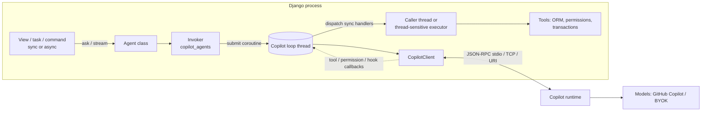

# Copilot for Django — design

Status: **M1 and M2 implemented** (`python/core`, `python/django`); M3–M5 remain proposals. See README.md for deviations.

This document designs `copilot-django`, a Django integration for the
[GitHub Copilot SDK for Python](https://github.com/github/copilot-sdk/tree/main/python)
(`github-copilot-sdk`). It follows the repository's [design goals](../../README.md#design-goals)
and mirrors the concepts of the Java integrations (`java-core`, Spring Boot, Quarkus) in
Django idioms, so the integrations feel like siblings.

## 1. Goals and non-goals

Goals:

- Configure Copilot from `settings.py`, validated by Django system checks.
- A process-wide, framework-managed `CopilotClient` that works under WSGI, ASGI,
  `runserver`, management commands, and task workers.
- Declarative, class-based agents with prompt templates and typed (Pydantic) results,
  usable from both sync and async code.
- Expose application code as Copilot tools that keep Django's behavior: the request
  user, permissions, transactions, and the ORM.
- Safe defaults: no implicit tool approval, deny-by-default permission policies,
  per-user session isolation.
- Per-user GitHub identity derived from the Django user.
- Observability through Django signals, logging, OpenTelemetry, and health checks.
- Fast, deterministic tests with a scripted in-memory runtime.

Non-goals (v1):

- Replacing the SDK. Every agent can drop down to the raw `CopilotSession`.
- A chat UI. We ship building blocks (SSE response, Channels consumer), not templates.
- LangChain/LangGraph interop (tracked separately).

Supported versions: Python 3.11+ (SDK minimum), Django 5.2 LTS and 6.x.

## 2. Packages

| Distribution | Import | Contents |
| --- | --- | --- |
| `copilot-agent-core` | `copilot_agents` | Framework-neutral Python core, the counterpart of `java-core`: runtime/loop bridge, agent definitions, invocation engine, tool adapter, permission policies, hook chain, token resolution, structured output, scripted test runtime. No Django imports. |
| `copilot-django` | `copilot_django` | Django app: settings binding, system checks, autodiscovery, request-context middleware, ORM-aware tool execution, signals, management commands, test helpers. |
| extras `[allauth]`, `[channels]`, `[conversations]`, `[health]` | `copilot_django.contrib.*` | Optional integrations (§9–§12). |

The split keeps a future FastAPI integration cheap: it reuses `copilot_agents` and only
adds lifespan, dependency injection, and request context.

Repository layout:

```
python/
├── core/        # copilot-agent-core (copilot_agents)
└── django/      # copilot-django (copilot_django), example project, tests
```

## 3. Architecture



The central constraint: **the SDK is asyncio-only and its client is bound to one event
loop, while most Django code is synchronous.** Section 4 exists to make that invisible.

## 4. Runtime and event-loop bridge

### 4.1 One loop thread per process

`copilot_agents.runtime.CopilotRuntime` owns:

- a daemon thread running a dedicated asyncio event loop (the "Copilot loop");
- one `CopilotClient`, created and started **on that loop**;
- a registry of live `CopilotSession` objects keyed by session ID.

Why not `async_to_sync` per call: it may run each call on a short-lived loop, orphaning
the client's JSON-RPC reader task and breaking long-lived sessions. Why not start in
`AppConfig.ready()`: `ready()` also runs for migrations, `collectstatic`, the autoreloader
parent, and gunicorn's master before it forks.

| Concern | Behavior |
| --- | --- |
| Start | Lazy by default: the first invocation starts the loop and client. `RUNTIME.START = "eager"` starts on the first `request_started`, never in `ready()`. |
| Fork safety | `os.register_at_fork(after_in_child=...)` discards inherited loop/client state; the child starts its own on first use. |
| Autoreload | Falls out of lazy start: only the serving child (`RUN_MAIN`) ever starts a runtime. |
| Shutdown | `atexit` calls `client.stop()` (graceful, bounded by the SDK) and falls back to `force_stop()`. Also exposed as `copilot_django.runtime.shutdown()`. |
| Status | `runtime.status()` → `stopped`, `starting`, `ready`, or `failed(reason)`. |

### 4.2 Calling into the loop

- **Sync callers** (WSGI views, Celery tasks, commands): `run_coroutine_threadsafe(coro,
  loop)` and block on the future with the configured timeout. Calling the sync API *from*
  the Copilot loop thread raises `RuntimeError` instead of deadlocking.
- **Async callers** (ASGI views, Channels): the server's loop is a different loop, so we
  `await asyncio.wrap_future(run_coroutine_threadsafe(coro, copilot_loop))`. Cancelling
  the awaiting task calls `session.abort()`.

`contextvars` (user, request, token, conversation) are captured at the call site and
re-applied inside the submitted coroutine.

### 4.3 Running callbacks on the right thread

The SDK invokes tool handlers, permission handlers, and hooks on the Copilot loop. User
code is usually synchronous and touches the ORM, which must not run on the loop.

- **Async handlers** run on the Copilot loop directly.
- **Sync handlers, sync caller:** run on **the calling thread**. While the caller blocks
  waiting for the agent, it services a small work queue (the technique behind asgiref's
  `CurrentThreadExecutor`). Tool code therefore sees the request's thread-locals, its DB
  connection, and **the caller's open transaction** (`ATOMIC_REQUESTS` or an enclosing
  `transaction.atomic()`), exactly as if the view had called the function directly.
- **Sync handlers, async caller:** run via `sync_to_async(thread_sensitive=True)`, Django's
  standard rule for ORM access from async code.
- **Callbacks with no waiting caller** (for example a resumed pending tool call): run in a
  bounded thread pool wrapped in `close_old_connections()`.

This is the integration's most important correctness property and gets dedicated tests
(transaction visibility, rollback when the view raises, thread-local access).

### 4.4 Runtime connection modes

| `RUNTIME.CONNECTION` | SDK | When |
| --- | --- | --- |
| `"stdio"` (default) | `RuntimeConnection.for_stdio()` | Development and single-process servers. One runtime process per Django worker. |
| `"uri"` | `RuntimeConnection.for_uri(url, connection_token=...)` | Production with many workers: one shared, externally managed runtime (sidecar or container) that also shares session state. |
| `"tcp"` | `RuntimeConnection.for_tcp()` | SDK-managed TCP runtime. |
| `"inprocess"` | `RuntimeConnection.for_inprocess()` | Experimental FFI transport; opt-in only. |

Session state lives in the runtime's `base_directory` (`COPILOT_HOME`); see §10 for
multi-host implications.

## 5. Configuration

One settings dict, bound to a frozen, typed `CopilotSettings`
(`copilot_django.conf.copilot_settings`) and rebuilt on `setting_changed`, so
`override_settings` works in tests.

```python
COPILOT = {
    "RUNTIME": {
        "CONNECTION": "stdio",            # stdio | uri | tcp | inprocess
        "URL": None,                      # for "uri"
        "CONNECTION_TOKEN": None,
        "BASE_DIRECTORY": BASE_DIR / ".copilot",
        "LOG_LEVEL": "info",
        "START": "lazy",                  # lazy | eager
        "REQUEST_TIMEOUT": 300,           # seconds per invocation
        "MODE": "copilot-cli",            # SDK client mode; "empty" for minimal runtimes
    },
    "AUTH": {
        "GITHUB_TOKEN": env("GITHUB_TOKEN", default=None),  # ambient/shared identity
        "TOKEN_RESOLVER": None,           # dotted path, §9
    },
    "DEFAULTS": {
        "MODEL": None,                    # None = runtime default
        "REASONING_EFFORT": None,
        "PERMISSIONS": "deny",            # policy spec, §8.2
        "WORKING_DIRECTORY": "isolated",  # isolated | <path>
    },
    "MCP_SERVERS": {
        "github": {"type": "http", "url": "https://api.githubcopilot.com/mcp/"},
    },
    "PROVIDERS": {                        # BYOK
        "azure": {"type": "azure", "base_url": "...", "api_key": env("AZURE_KEY")},
    },
    "AGENTS": {                           # per-agent overrides by agent name
        "support": {"MODEL": "claude-sonnet-4.5", "AVAILABLE_TOOLS": ["custom:*"]},
    },
    "HOOKS": [],                          # global hooks, §12
    "TELEMETRY": {"OTEL": True},
}
```

Precedence matches Java: **settings override class attributes**, and named MCP servers and
providers resolve from settings.

System checks (`manage.py check`; they never start the runtime):

| ID | Check |
| --- | --- |
| `copilot.E001` | Unknown key or wrong type in `COPILOT`. |
| `copilot.E002` | Agent references an unknown tool, MCP server, provider, or hook. |
| `copilot.E003` | `available_tools` combined with `excluded_tools` or `built_in_tools = False` (as in Java). |
| `copilot.E004` | BYOK provider without a model. |
| `copilot.E005` | Duplicate agent or tool name. |
| `copilot.W001` | Runtime binary not downloaded in `stdio` mode; suggests `copilot_download_runtime`. |
| `copilot.W002` | An agent uses an allow-all permission policy. |
| `copilot.W003` | `stdio` with likely many workers (`WEB_CONCURRENCY > 2`); suggests `uri`. |

## 6. Agents

### 6.1 Declaring an agent

Agents are classes discovered from each installed app's `copilot_agents.py` (like
`admin.py`, via `autodiscover_modules`) or registered with `@register`.

```python
# orders/copilot_agents.py
from pydantic import BaseModel
from copilot_django import CopilotAgent, prompt, policies
from .copilot_tools import lookup_order, issue_refund


class RefundDecision(BaseModel):
    approve: bool
    reason: str


class SupportAgent(CopilotAgent):
    name = "support"                      # default: snake_case class name
    instructions = "You are a support agent for ACME orders."
    # or: instructions_template = "orders/agents/support.txt"  (Django template)
    instructions_mode = "append"          # append | replace | customize
    model = "claude-sonnet-4.5"
    tools = [lookup_order, issue_refund]  # callables or dotted paths
    mcp_servers = ["github"]
    built_in_tools = False
    permissions = policies.allow_tools("lookup_order", "issue_refund")
    hooks = ["orders.hooks.AuditHooks"]

    @prompt("Should we refund order {{ order_id }}? Customer says: {{ message }}")
    def decide_refund(self, order_id: int, message: str) -> RefundDecision: ...

    @prompt("Summarize order {{ order_id }} for {{ user.get_full_name }}.")
    async def asummarize(self, order_id: int) -> str: ...
```

Parity with Java `@CopilotAgent`:

| Java | Django |
| --- | --- |
| `name`, `instructions`, `instructionsResource`, `instructionsMode`, `systemMessageRef` | `name`, `instructions`, `instructions_template`, `instructions_mode`, `system_message` |
| `model`, `reasoningEffort`, `provider` | `model`, `reasoning_effort`, `provider` |
| `toolRefs`, `mcpServers` | `tools`, `mcp_servers` |
| `availableTools`, `excludedTools`, `excludedBuiltInAgents`, `builtInTools` | `available_tools`, `excluded_tools`, `excluded_built_in_agents`, `built_in_tools` |
| `workingDirectory`, `additionalDirectories` | `working_directory`, `additional_directories` |
| `permissionHandlerRef` | `permissions` |
| `hookRefs`, `listenerRefs`, `customizerRefs` | `hooks`, `listeners`, `customizers` |
| `tokenResolverRef` | `token_resolver` |

Attributes accept objects or dotted-path strings (the Python analogue of Java's `*Ref` bean
names). Strings are imported lazily and validated by system checks.

### 6.2 Prompt methods

`@prompt(template)` turns a stub method into an invocation, like Java's interface proxies:

- The template is rendered by a dedicated **Django template engine** (autoescape off,
  undefined variables raise) with the method arguments plus `user`, `request`, and
  `conversation` from the context.
- The **return annotation** selects the result: `str` → final assistant text; a Pydantic
  model → `send(..., response_schema=Model)` and validation (as SDK
  `send_and_wait_typed`); `CopilotReply` → text plus metadata (usage, tool calls, session
  ID); `Stream` → streaming (§7).
- `def` stubs run synchronously, `async def` stubs are awaitable; both share one engine.
- A `conversation_id` keyword makes the call stateful. Without it, each call uses a fresh
  ephemeral session that is deleted afterwards.

### 6.3 Imperative API

```python
agent = SupportAgent(user=request.user)          # user defaults to the request context
text = agent.ask("Where is order 42?")            # one-shot, ephemeral session

conv = agent.conversation("ticket-1234")          # stateful and resumable
reply = conv.send("Where is order 42?")
decision = conv.send("Refund it?", result=RefundDecision)
for event in conv.stream("Explain the delay"):    # sync iterator
    ...
reply = await conv.asend("...")                   # async variants are a*-prefixed
conv.session                                      # raw SDK CopilotSession (escape hatch)
conv.close()                                      # disconnect; conv.delete() removes state
```

### 6.4 Conversation and session IDs

As in `java-core`, the SDK session ID is **derived**, never taken raw from the client: a
stable hash of agent name, partition key, and conversation ID. The partition key comes from
the token resolver (the user's primary key for per-user resolvers, otherwise shared).
Consequences:

- A user cannot resume another user's conversation by guessing its ID.
- The same conversation ID under different agents maps to different sessions.
- `agent.resume(id)` raises `CopilotConversationNotFound` for a missing session.

### 6.5 Customizers

`customizers = [fn]` receive the fully built SDK `create_session` keyword arguments and may
modify them (mirrors `CopilotAgentCustomizer`). This is the supported path to SDK options
the integration does not model yet.

## 7. Streaming

`conv.stream(prompt)` enables SDK `streaming=True` and yields a small, typed event model
translated from SDK session events:

| Event | Source |
| --- | --- |
| `TextDelta(text)` | assistant message deltas |
| `ReasoningDelta(text)` | reasoning deltas (opt-in) |
| `ToolStarted(name, call_id)`, `ToolFinished(name, call_id, ok)` | tool execution events |
| `PermissionRequested(...)` | deferred permission request (§8.3) |
| `Completed(reply)`, `Failed(error)` | idle, autopilot stop, or error |

Sync iteration drains a thread-safe queue fed by the Copilot loop; async iteration uses an
`asyncio.Queue` fed with `call_soon_threadsafe`. Closing the iterator early aborts the turn.

Helpers:

- `copilot_django.http.sse_response(stream)` returns a `StreamingHttpResponse`
  (`text/event-stream`) for sync (WSGI) or async (ASGI) iterators.
- `copilot_django.contrib.channels.CopilotChatConsumer` (`[channels]`): a WebSocket
  consumer that maps inbound messages to `conv.asend` and outbound events to JSON,
  including approval prompts.

## 8. Tools and permissions

### 8.1 Tools

```python
# orders/copilot_tools.py
from pydantic import BaseModel, Field
from copilot_django import copilot_tool, ToolContext
from .models import Order


class LookupOrder(BaseModel):
    order_id: int = Field(description="Order number")


@copilot_tool(description="Look up an order the current user can see.")
def lookup_order(params: LookupOrder, ctx: ToolContext) -> dict:
    order = Order.objects.for_user(ctx.user).get(pk=params.order_id)
    return {"id": order.pk, "status": order.status}


@copilot_tool(permission_required="orders.refund_order", atomic=True)
def issue_refund(order_id: int, amount_cents: int, ctx: ToolContext) -> str:
    """Issue a refund for an order."""        # docstring becomes the description
    ...
```

- Built on SDK `define_tool`. Parameters come from a Pydantic model or from type hints (the
  decorator synthesizes a model); the description from the argument or the docstring.
- `ToolContext` exposes `user`, `request` (if any), `agent`, `conversation_id`,
  `session_id`, and the raw SDK `ToolInvocation`.
- `permission_required` checks `ctx.user.has_perm(...)`. Failure returns an SDK failure
  `ToolResult` ("permission denied") to the model instead of raising. This is **Django
  authorization**, independent of the Copilot permission policy (§8.2).
- `atomic=True` wraps the call in `transaction.atomic()` (a savepoint when the caller
  already holds a transaction, §4.3).
- Return values: `str` → text; `dict`, `list`, or Pydantic → JSON; `ToolResult` passes
  through. `ObjectDoesNotExist` → failure "not found". Other exceptions → failure with the
  message only when `DEBUG` (a generic message otherwise), always logged in full.
- Sync and `async def` tools are both supported; §4.3 picks the thread.
- Tools are discovered from `copilot_tools.py` modules; names must be unique.

### 8.2 Copilot permission policies

Registering a tool never approves it. Each agent gets one SDK permission handler built from
a policy. The default **denies everything and logs**, as in Java; an approving policy is
never chosen implicitly.

```python
from copilot_django import policies

permissions = policies.deny_all()                        # default
permissions = policies.allow_kinds("read", "custom-tool")
permissions = policies.allow_tools("lookup_order")
permissions = policies.allow_registered_tools()          # this agent's own tools only
permissions = policies.any_of(policies.allow_kinds("read"), my_callable)
permissions = policies.defer()                           # human approval, §8.3
```

Settings accept the same policies (`"PERMISSIONS": {"ALLOW_KINDS": ["read"]}`) with the
same kind names as `CopilotPermissionPolicies`: `shell`, `write`, `read`, `mcp`,
`custom-tool`, `url`, `memory`, `hook`.

`working_directory = "isolated"` (the default) gives each session its own directory under
`BASE_DIRECTORY`, so built-in file tools never default to the project root.

### 8.3 Human approval

`policies.defer()` leaves the SDK permission request **pending** instead of answering it:

1. A `PermissionRequested` stream event is emitted and the `permission_requested` signal
   fires. With `[conversations]`, a `PendingApproval` row is stored.
2. The invocation returns `CopilotReply(status="awaiting_approval", approval_id=...)`, or
   for live UIs the stream yields the event and stays open.
3. Approval arrives later (admin action, JSON endpoint, Channels message):
   `approvals.resolve(approval_id, approve=True)` calls
   `session.rpc.permissions.handle_pending_permission_request(...)`, resuming the session
   with `continue_pending_work=True` if needed. This works across processes (SDK
   `manual_tool_resume` sample).

The same mechanism supports **deferred tools** (declared without a handler) whose results
are supplied later through `session.rpc.tools.handle_pending_tool_call`, for example after a
background task finishes.

## 9. Identity

A token resolver supplies the GitHub identity per invocation:

```python
class CopilotTokenResolver(Protocol):
    def resolve(self, ctx: AgentContext) -> GitHubToken | None: ...  # None = ambient
    def partition_key(self, ctx: AgentContext) -> str | None: ...     # session isolation
```

It is wired into the SDK's session-scoped `github_token_provider`, so the SDK handles
expiry and refresh, and resolver failures fail the invocation rather than silently falling
back to ambient credentials.

| Resolver | Behavior |
| --- | --- |
| none | Ambient: `AUTH.GITHUB_TOKEN` or the runtime's signed-in user. Shared partition. |
| `copilot_django.auth.StaticTokenResolver` | One configured token. Shared partition. |
| `copilot_django.contrib.allauth.AllauthTokenResolver` | The user's django-allauth GitHub `SocialToken`, refreshed through allauth. Partition = user PK. |
| custom | Any dotted path. |

`copilot_django.middleware.CopilotContextMiddleware` (sync and async capable) stores the
current request and user in context variables so agents and tools find them without
explicit arguments. An explicit `user=` always wins. Outside requests (tasks, commands) the
user is `None` unless given.

## 10. State and persistence

- **Runtime state** (history, compaction) belongs to the Copilot runtime under
  `BASE_DIRECTORY`. Django does not duplicate transcripts by default.
- **Multi-host deployments** must use a shared `uri` runtime, a shared persistent
  `BASE_DIRECTORY`, or sticky routing per conversation. An SDK `session_fs` provider backed
  by Django storage is an open question (§17).
- **`copilot_django.contrib.conversations`** (`[conversations]`, optional app with
  migrations):
  - `Conversation(agent, conversation_id, session_id, user, title, status, created_at, updated_at)`
  - `ToolCall(conversation, tool_name, arguments, ok, duration_ms, created_at)`, an audit log
    written from post-tool hooks, with a configurable redaction callback
  - `PendingApproval(conversation, request_id, kind, summary, status, decided_by, decided_at)`
  - Read-only admins, plus approve/deny admin actions on `PendingApproval`
  - Deleting a `Conversation` also deletes the runtime session (`client.delete_session`).

## 11. Background work

The sync API works unchanged inside Celery, RQ, Django-Q, and Django's built-in tasks
framework (`django.tasks`, Django 6.0+), because the loop bridge is per process and
fork-safe. We add:

- `copilot_django.tasks.run_agent`: a `django.tasks` task that invokes an agent method by
  name with serializable arguments and stores the result on the `Conversation`
  (requires `[conversations]`).
- Guidance for prefork workers (lazy start after fork; prefer a `uri` runtime).

## 12. Observability

- **Signals** (`copilot_django.signals`): `agent_invocation_started`,
  `agent_invocation_finished` (duration, usage, outcome), `tool_invoked`,
  `permission_requested`, `permission_decided`.
- **Hooks**: a `CopilotAgentHooks` base class with no-op `on_pre_tool_use`,
  `on_post_tool_use`, `on_post_tool_use_failure`, `on_user_prompt_submitted`,
  `on_session_start`, `on_session_end`, `on_agent_stop`, `on_subagent_start`, and
  `on_subagent_stop`, mapped onto SDK `SessionHooks`. Global hooks (`COPILOT["HOOKS"]`)
  run before per-agent hooks, as in Java.
- **Listeners**: `listeners = [fn(ctx, event)]` receive every raw SDK session event.
- **Logging**: `copilot_django` and `copilot_agents` loggers, with agent name, conversation
  ID, and session ID in `extra`.
- **Tracing**: SDK `TelemetryConfig` when `TELEMETRY.OTEL` is set; a
  `copilot.agent.invoke` span opened in the caller's context so runtime spans nest under
  the request span from `opentelemetry-instrumentation-django`.
- **Health**: `copilot_django.health.check()` (runtime status, `get_auth_status`, optional
  `list_models` probe) and a `django-health-check` backend in `[health]`.

## 13. Management commands

| Command | Purpose |
| --- | --- |
| `copilot_download_runtime [--in-process]` | Wraps `python -m copilot download-runtime`. |
| `copilot_check` | Starts the runtime; reports version, auth status, models, and each agent's resolved tools, MCP servers, and policy. |
| `copilot_chat <agent> [--conversation ID] [--user USERNAME]` | Development REPL against an agent. |
| `copilot_sessions [list\|delete]` | Inspect or prune runtime sessions created by the project. |

## 14. Testing

`copilot_agents.testing.CopilotTestRuntime` is a scripted, in-memory runtime matching the
Java `CopilotTestRuntime`: a fake client that never starts the runtime, keeps sessions in
memory (so resume works), answers prompts from per-agent scripts, runs scripted tool calls
against the **real** tool handlers (so ORM and permission logic is exercised), and records
everything.

```python
# pytest-django
def test_refund(copilot_runtime, django_user_model):
    user = django_user_model.objects.create_user("ana")
    copilot_runtime.agent("support") \
        .calls_tool("lookup_order", {"order_id": 42}) \
        .replies_json({"approve": True, "reason": "late delivery"})

    decision = SupportAgent(user=user).decide_refund(order_id=42, message="It was late")

    assert decision.approve
    assert copilot_runtime.prompts("support") == [
        "Should we refund order 42? Customer says: It was late"
    ]
```

- A pytest plugin (entry point) provides the `copilot_runtime` fixture; a
  `CopilotTestMixin` serves `django.test.TestCase`.
- The fixture swaps the client factory; no real runtime or network is touched.
- Permission policies apply in tests: a scripted call to a denied tool fails exactly as in
  production.
- Optional live tests (marked) run against a real runtime with a token from the environment.

## 15. Deployment matrix

| Server | Notes |
| --- | --- |
| `runserver` | Lazy start in the reloader child; `stdio` is fine. |
| gunicorn (sync, gthread) | One loop thread per worker. Use `uri` beyond a couple of workers. `--preload` is safe because nothing starts before fork. |
| uvicorn, daphne, gunicorn + uvicorn workers | Async views use the async API; sync views still work. |
| Celery, RQ, `django.tasks` workers | As gunicorn; lazy start after fork. |
| Containers, Kubernetes | Runtime as a sidecar (`uri`), persistent volume for `BASE_DIRECTORY`, readiness from the health check. |

## 16. Security

- Deny-by-default permission policies; `copilot.W002` flags allow-all.
- Two independent authorization layers: the Copilot policy (may the agent use the tool)
  and Django `permission_required` (may *this user* do it).
- Per-user session partitioning (§6.4) prevents cross-user conversation access.
- Isolated working directories by default; built-in shell and write tools still need
  explicit policy approval.
- Tool output and fetched content are untrusted model input (prompt injection). The docs
  recommend narrow tools and `available_tools` allow-lists for user-facing agents.
- Tokens and BYOK keys come from settings or the environment and are redacted from logs,
  errors, and `copilot_check` output.

## 17. Open questions

1. **Caller-thread execution and SDK timeouts**: confirm long-running tool handlers
   completed from another thread behave well, and define the timeout model (per
   invocation vs per tool).
2. **Multi-host session state**: is a Django-storage-backed `session_fs` provider viable,
   or do we only document shared runtimes?
3. **Runtime footprint per worker** in `stdio` mode: measure memory and startup time to set
   the `copilot.W003` threshold.
4. **SDK stability**: the Python SDK is pre-1.0; pin a compatible range and test against
   the latest release in CI.
5. **Ephemeral session cleanup**: delete on completion vs rely on
   `session_idle_timeout_seconds`.
6. **Naming**: `copilot-django` (matches this repo's `copilot-*` artifacts) vs
   `django-copilot` (Django community convention).

## 18. Milestones

| Milestone | Scope |
| --- | --- |
| M1: core | `copilot-agent-core`: loop bridge, agent definitions and invoker, tool adapter, policies, hooks, token resolver protocol, structured output, `CopilotTestRuntime`. |
| M2: Django MVP | Settings and system checks, autodiscovery, `CopilotAgent` and `@prompt`, `@copilot_tool` with `ToolContext`, `permission_required`, and `atomic`, caller-thread execution, middleware, sync and async APIs, pytest plugin, `copilot_download_runtime`, `copilot_check`, example project, docs. |
| M3: production | Streaming and SSE helper, signals, OpenTelemetry, health check, `uri` deployment guide, `copilot_chat`, `copilot_sessions`. |
| M4: extras | `[conversations]` models, admin, and audit log; deferred approvals (§8.3); `[allauth]` resolver; `[channels]` consumer; `django.tasks` helper. |
