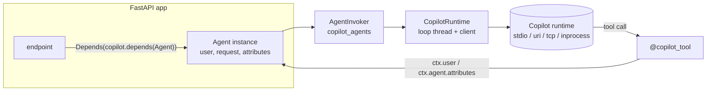

# Copilot Agents for FastAPI — design

This document describes `copilot-fastapi`, the FastAPI integration for the GitHub Copilot
SDK for Python. It is the second integration built on the framework-neutral
[`copilot-agent-core`](../core/) package (import `copilot_agents`). The first is
[`copilot-django`](../django/DESIGN.md). The two packages share the agent model, session
partitioning, permission policies, tools and the fake runtime used in tests. This package
only adds FastAPI idioms on top.

## 1. Goals and non-goals

Goals:

- **FastAPI-native wiring.**
  - Use a lifespan, not import-time side effects.
  - Inject agents with `Depends`.
  - Configure through typed `pydantic-settings`.
  - Handle errors with exception handlers.
- **One explicit extension object (`Copilot`).** Agents are registered on an instance
  rather than a global registry. Several apps, or several test configurations, can coexist
  in one process.
- **Request context reaches tools.** The current user, the `Request` and any extra
  dependencies (for example a DB session) are available through `ToolContext`.
- **The same safety defaults as every integration.**
  - Permissions are denied by default.
  - Each session gets an isolated working directory.
  - Conversations are partitioned per user.
  - Session IDs are derived, never taken from callers.
  - Client-facing errors are generic.

Non-goals for the first milestone: streaming responses (SSE/WebSockets), interactive human
approval, OpenTelemetry instrumentation beyond what the SDK provides, and an ASGI
middleware.

## 2. Architecture

- `Copilot` owns one `CopilotRuntime`, which means one SDK client per worker process. It
  starts lazily on the first call, or during the lifespan when `start=eager`, and shuts
  down when the lifespan exits.
- Agent classes are declarative. `Copilot.definition(cls)` resolves them into an
  `AgentDefinition` once and caches it. Precedence, highest first:
  1. `settings.agents[name]`
  2. class attributes
  3. `settings.defaults`
- `Copilot.depends(cls, **deps)` builds a dependency whose signature is
  `(request: Request, user=Depends(current_user), **deps)`. FastAPI therefore resolves,
  caches and cleans up the user and the extra dependencies exactly as it does for an
  endpoint. Extra dependency values become `attributes`.

## 3. Threads and event loops

The core runs the SDK on a dedicated loop thread. The two FastAPI entry points work like
this:

- **`async def` endpoints** call `aask` / `asend`. The core awaits the result from the
  request's loop. Sync tools, hooks and policies run in Starlette's threadpool
  (`run_in_threadpool`, which propagates context variables).
- **Async tools** run on the Copilot loop, with a copy of the caller's context variables.
  Objects bound to the request's event loop must not be used from an async tool. One
  example is an `AsyncSession` from an async SQLAlchemy engine. Use a sync tool with a sync
  session, or open the resource inside the tool.
- **`def` endpoints** (already in the threadpool) call `ask` / `send`. Sync callbacks run
  on the calling worker thread, so thread-bound resources such as a sync SQLAlchemy
  session stay on one thread.

`ask` called from inside a running event loop raises an error that names the async
alternative.

## 4. Configuration

`CopilotSettings` reads `COPILOT_*` environment variables (`__` for nesting) and `.env`.
It is grouped into `runtime`, `auth`, `defaults`, `mcp_servers`, `providers`, `agents`,
`hooks`, `sessions` and `telemetry`, mirroring Django's `COPILOT` setting.

- Per-agent overrides use `extra="forbid"`, so typos fail at startup.
- Permission mappings accept lower-case keys.
- Secrets are `SecretStr` values.
- `sessions.max_age` (off by default) makes the lifespan run `SessionCleanup.run()` as an
  asyncio task, cancelled on shutdown. `copilot.session_store` is a dependency returning a
  `CopilotSessionStore` (list, read history without resuming, delete).

## 5. Identity and partitioning

The `current_user` dependency returns whatever the app uses as a user. `user_key` maps that
user to a partition key:

| User value | Partition key |
| --- | --- |
| `None` | shared |
| `str` or `int` | the value itself |
| any other object | its `id`, `pk`, `sub` or `username` attribute |

A non-`None` user without a key is a configuration error; sessions are never silently
shared. A `CopilotTokenResolver` supplies per-user GitHub tokens and, when configured,
takes precedence for partitioning. `UserTokenResolver` covers the common case.

## 6. Tools

`@copilot_tool` wraps the core `tool` and adds two behaviours:

- **`HTTPException` mapping.** A 4xx `HTTPException` becomes a `ToolError`, so the model
  sees its `detail`. A 5xx stays a generic failure. This lets existing service helpers be
  reused as tools.
- **`requires=` guards.** These are application-level access checks, evaluated with the
  current `AgentContext`. They are independent of the Copilot permission policy, which
  decides whether the runtime may call the tool at all.

## 7. Errors and health

- `copilot.exception_handlers` maps errors to HTTP statuses:

  | Error | HTTP status |
  | --- | --- |
  | `CopilotConversationNotFound` | 404 |
  | `CopilotTimeout` | 504 |
  | `CopilotInvocationError` | 502 |
  | `CopilotConfigurationError` | 500 |

  Response bodies are generic; 5xx errors are logged.
- `copilot.router()` exposes `GET /copilot/health`, which reports the runtime status and the
  registered agents. With `?deep=true` it also starts the runtime and checks
  authentication. It returns 503 when the runtime is unhealthy.

## 8. Testing

`copilot_fastapi.testing.copilot_test_runtime(copilot)` installs the core
`CopilotTestRuntime` on the instance's runtime. Scripted tool calls run the real tools,
guards, hooks and permission policies against the app's dependencies.

## 9. Milestones

1. **M1 (this package).** Settings, lifespan, DI, agents, prompts, tools, partitioning,
   error mapping, health, testing, and an example.
2. **M2.** Streaming: `agent.stream()` yielding assistant deltas and tool events, plus an
   `EventSourceResponse` helper.
3. **M3.** Deferred human approval: a pending-approval store, plus approve and deny
   endpoints.
4. **M4.** Observability: OpenTelemetry spans per invocation and tool call, and metrics.
