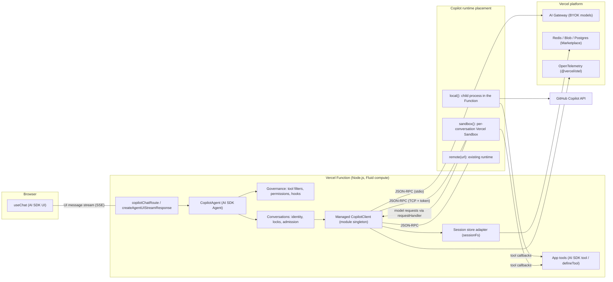
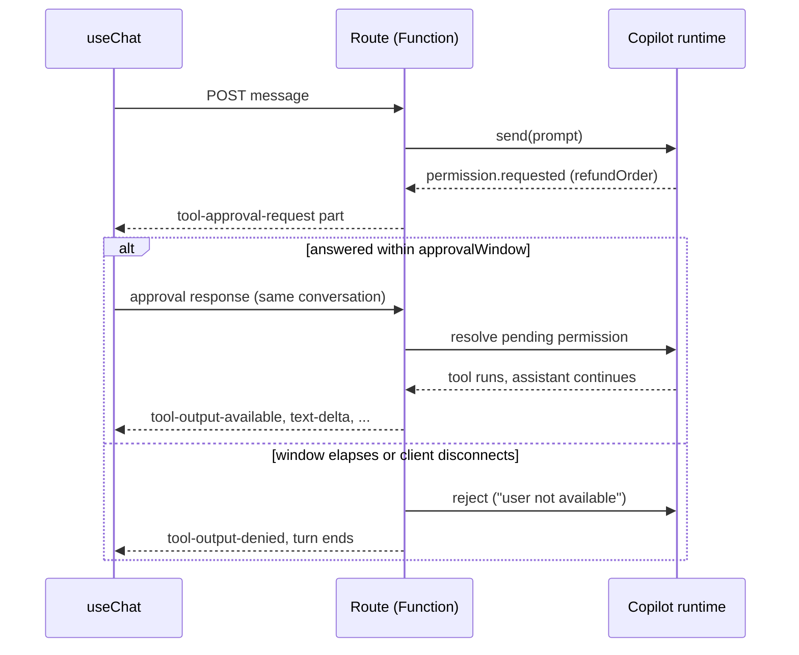

# Copilot for Vercel: design

Status: **draft for review**. Nothing here is implemented yet. API names are working
names and may change.

This document designs an integration module that makes it simple to bring GitHub
Copilot agents and AI usage, through the
[Copilot SDK for Node.js/TypeScript](https://github.com/github/copilot-sdk/tree/main/nodejs)
(`@github/copilot-sdk`), into applications deployed on [Vercel](https://vercel.com).

The [Spring Boot starter](../spring-boot/) is the reference for *capabilities*. This
design keeps the same capabilities but expresses them in Vercel's idioms: the
[AI SDK](https://ai-sdk.dev) (`ai`, `@ai-sdk/react`), Route Handlers on Fluid compute,
`next.config.ts` wrappers, Vercel Sandbox, AI Gateway, OIDC, Marketplace storage, and
(later) the Workflow SDK.

Versions surveyed: `@github/copilot-sdk` 1.0.26, `ai` 7.0, `@ai-sdk/provider` 4.0
(`LanguageModelV4`), `next` 16, `@vercel/sandbox` 3.9, `@vercel/functions` 3.10.

**Contents**

1. [Goals and non-goals](#1-goals-and-non-goals)
2. [What makes Vercel different](#2-what-makes-vercel-different)
3. [Developer experience at a glance](#3-developer-experience-at-a-glance)
4. [Architecture](#4-architecture)
5. [Package layout](#5-package-layout)
6. [Runtime placement](#6-runtime-placement)
7. [Client lifecycle on Fluid compute](#7-client-lifecycle-on-fluid-compute)
8. [Agents](#8-agents)
9. [Tools](#9-tools)
10. [Governance and human approval](#10-governance-and-human-approval)
11. [Conversations and session state](#11-conversations-and-session-state)
12. [Streaming to the UI](#12-streaming-to-the-ui)
13. [Authentication and models](#13-authentication-and-models)
14. [MCP servers](#14-mcp-servers)
15. [Build and deployment](#15-build-and-deployment)
16. [Observability and health](#16-observability-and-health)
17. [Testing](#17-testing)
18. [Durable agents (later phase)](#18-durable-agents-later-phase)
19. [Spring Boot to Vercel mapping](#19-spring-boot-to-vercel-mapping)
20. [Roadmap](#20-roadmap)
21. [Risks and open questions](#21-risks-and-open-questions)

---

## 1. Goals and non-goals

### Goals

- **One-file chat route.** A Copilot-powered chat UI with `useChat` needs one agent
  definition, one Route Handler, and one `next.config.ts` wrapper.
- **AI SDK native.** A Copilot agent is an AI SDK `Agent`, and Copilot is usable as an
  AI SDK provider. Existing AI SDK code (`createAgentUIStreamResponse`, `useChat`,
  `tool()`, Zod schemas, the tool-approval UI) works unchanged.
- **Serverless correct.** Works on Fluid compute: instance reuse, concurrent
  invocations, `/tmp`-only writes, bounded duration, no shutdown hook, and requests
  for one conversation landing on different instances.
- **Safe by default.** Same stance as the Spring starter: no implicit tool approval,
  explicit allow/deny lists, per-user identity. In addition, built-in shell and file
  tools never run on the Function's own machine.
- **Platform integrated.** AI Gateway for BYOK models, OIDC instead of long-lived keys,
  Vercel Sandbox for code-executing agents, Marketplace storage for durable
  conversations, OpenTelemetry through `@vercel/otel`.
- **Framework-agnostic core.** Next.js is first-class, but the core works in any
  Vercel Node.js function (Nitro/Nuxt, SvelteKit, Hono, plain `api/` functions).
- **Deterministic tests.** A scripted, in-memory Copilot runtime for unit tests, the
  equivalent of `copilot-spring-boot-test`.

### Non-goals

- Edge runtime support. The Copilot runtime is a native process; only the Node.js
  runtime is supported.
- Re-implementing the agent loop. Copilot owns the loop, compaction, sub-agents, and
  built-in tools; this module adapts and governs it.
- Hiding the SDK. Every abstraction exposes the underlying `CopilotClient` /
  `CopilotSession` and a configuration hook, like the Spring starter's customizers.

---

## 2. What makes Vercel different

The Spring starter assumes a long-lived JVM next to a long-lived Copilot runtime with a
local disk. None of that holds on Vercel, and it drives most of this design.

| Concern | Long-lived server (Spring) | Vercel Functions (Fluid compute) | Design consequence |
| --- | --- | --- | --- |
| Process lifetime | Hours or days; explicit shutdown | Instances reused while warm; no reliable shutdown hook | Lazy module-scope singleton; `waitUntil` for cleanup; idle timeouts |
| Concurrency | Thread pools | Many concurrent invocations per instance | Per-instance admission limits and per-conversation locks |
| Disk | Persistent `~/.copilot` | Read-only bundle; writable `/tmp`, lost with the instance | `COPILOT_HOME` under `/tmp`; pluggable session store |
| Routing | One server or sticky load balancer | Any request can land on any instance | Conversation state must be externalized |
| Duration | Unbounded | 300 s default, 800 s max (Pro/Enterprise) | Turn deadlines, abort on timeout, durable phase for long work |
| Bundle | Fat JAR | 250 MB uncompressed per function | Trace only the Linux runtime; exclude other platforms |
| Untrusted commands | Same host, operator's risk | Shared Function machine | Built-in shell/file tools only inside Vercel Sandbox |
| Secrets | Env vars, vaults | Env vars, OIDC tokens | OIDC-first for AI Gateway and Sandbox |
| UI | Server-rendered or SPA | AI SDK UI (`useChat`) is the de facto standard | Emit the AI SDK UI message stream protocol |

Measured input: `@github/copilot-sdk-linux-x64@1.0.26` unpacks to about **163 MB**
(140 MB of it is the native runtime). It fits within 250 MB only if other platforms'
packages and unneeded plugins are excluded from the function trace (see
[Build and deployment](#15-build-and-deployment)).

### What runs where

Vercel is not only a frontend host. This integration is almost entirely **server-side**:

| Piece | Runs on |
| --- | --- |
| Copilot runtime, agents, tools, permission policies, hooks | Vercel Functions (Node.js runtime, Fluid compute) |
| Code-executing agents (built-in shell/file tools, stdio MCP) | Vercel Sandbox microVMs |
| Conversation state, locks, approval relay | Marketplace storage (Redis, Blob, Postgres) |
| Long-running, crash-safe turns (later phase) | Workflow SDK and Vercel Queues |
| Model routing for BYOK | AI Gateway |
| Chat UI | Browser, using the AI SDK's existing `useChat`. No Copilot-specific client code, and no credentials reach the browser |

The UI stream mapping (§12) is the only browser-facing contract. Apps without a UI
(webhooks, cron jobs, APIs, background processing) use the same agents from any
Function.

---

## 3. Developer experience at a glance

The target "hello agent" for a Next.js app (working names):

```ts
// lib/agents.ts
import { defineAgent, permissions } from "copilot-vercel";
import { tool } from "ai";
import { z } from "zod";

export const support = defineAgent({
  name: "support",
  instructions: "You help customers with their orders. Be concise.",
  model: "gpt-5",
  tools: {
    lookupOrder: tool({
      description: "Look up an order by id",
      inputSchema: z.object({ id: z.string() }),
      execute: async ({ id }) => db.orders.find(id),
    }),
    refundOrder: tool({
      description: "Refund an order",
      inputSchema: z.object({ id: z.string() }),
      needsApproval: true, // renders an approval card in useChat
      execute: async ({ id }) => payments.refund(id),
    }),
  },
  builtInTools: false, // only the tools above
  permissions: permissions.allowCustomTools(),
});
```

```ts
// app/api/chat/route.ts
import { copilotChatRoute } from "copilot-vercel/next";
import { support } from "@/lib/agents";
import { auth } from "@/auth";

export const maxDuration = 300;

export const { POST } = copilotChatRoute({
  agent: support,
  authorize: async () => {
    const session = await auth();
    if (!session) return null; // 401
    return { principal: session.user.id, githubToken: session.accessToken };
  },
});
```

```ts
// next.config.ts
import { withCopilot } from "copilot-vercel/next";
export default withCopilot({ /* your config */ });
```

```tsx
// app/page.tsx: standard AI SDK UI, nothing Copilot-specific
"use client";
import { useChat } from "@ai-sdk/react";

export default function Chat() {
  const { messages, sendMessage, addToolApprovalResponse } = useChat();
  // render messages; tool-approval parts render as approve/deny buttons
}
```

Because the agent implements the AI SDK `Agent` interface, it also works without the
route helper:

```ts
import { createAgentUIStreamResponse } from "ai";

export async function POST(req: Request) {
  const { messages, id } = await req.json();
  return createAgentUIStreamResponse({
    agent: support,
    uiMessages: messages,
    options: { conversationId: id },
    abortSignal: req.signal,
  });
}
```

For one-shot "AI usage" (summaries, classification, structured extraction), Copilot is
a plain AI SDK provider:

```ts
import { generateText, Output } from "ai";
import { copilot } from "copilot-vercel/ai";

const { output } = await generateText({
  model: copilot("gpt-5"),
  output: Output.object({ schema: z.object({ sentiment: z.enum(["pos", "neg"]) }) }),
  prompt: review,
});
```

---

## 4. Architecture



Key properties:

- **App tools always run in the Function**, never on the runtime's machine, because the
  SDK dispatches tool calls back to the client over JSON-RPC. This holds when the
  runtime is in a Sandbox too.
- **Model credentials stay in the Function.** With `local()` the runtime shares the
  Function's trust boundary. With `sandbox()`, the runtime's model traffic is relayed
  back through the SDK's experimental `requestHandler`, so the VM never holds a GitHub
  token or AI Gateway key (the same principle Vercel's `durable-harness` applies to
  Claude Code and Codex).
- **Conversation state is externalized** through the SDK's `sessionFs` provider, so any
  instance can resume any conversation.

---

## 5. Package layout

One npm package with subpath exports and optional peer dependencies: apps install a
single dependency and pay only for what they import. This matches Vercel ecosystem
conventions (`workflow/next`, `durable-harness/next`, `@vercel/functions/oidc`).

Working name: **`copilot-vercel`** (see [open questions](#21-risks-and-open-questions)).

| Import | Purpose | Peer dependencies |
| --- | --- | --- |
| `copilot-vercel` | `createCopilot`, `defineAgent`, conversations, governance (`permissions`, hooks), placements `local`/`remote`, errors | `@github/copilot-sdk`, `zod` |
| `copilot-vercel/ai` | AI SDK provider (`copilot`, `createCopilotProvider`), `CopilotAgent` (`Agent` implementation), UI stream mapping, `loadUIMessages` | `ai` |
| `copilot-vercel/next` | `withCopilot`, `copilotChatRoute`, `copilotHealthRoute`, `registerCopilot` (instrumentation) | `next` |
| `copilot-vercel/sandbox` | `sandbox()` placement on Vercel Sandbox | `@vercel/sandbox` |
| `copilot-vercel/gateway` | `gateway()` BYOK provider for AI Gateway with OIDC | `@vercel/oidc` |
| `copilot-vercel/stores` | Session stores: `memoryStore`, `redisStore`, `blobStore`, `postgresStore` | `@upstash/redis`, `@vercel/blob`, `@neondatabase/serverless` (each optional) |
| `copilot-vercel/testing` | Scripted in-memory runtime, `createTestCopilot` | none |
| `copilot-vercel/durable` | *Later.* Workflow SDK / `durable-harness` integration | `workflow` |

Proposed repository layout:

```
vercel/
├── README.md
├── DESIGN.md                 # this document
├── package.json              # single published package
├── src/
│   ├── core/                 # client, agents, conversations, governance, placements
│   ├── ai/                   # AI SDK provider, Agent, UI stream mapping
│   ├── next/                 # withCopilot, route helpers
│   ├── sandbox/              # Vercel Sandbox placement
│   ├── gateway/              # AI Gateway BYOK
│   ├── stores/               # sessionFs stores
│   └── testing/              # scripted runtime
├── test/
└── examples/
    ├── next-chat/            # useChat + approvals + Redis store
    ├── next-coding-agent/    # sandbox() with built-in tools
    └── hono-api/             # non-Next function
```

Toolchain: TypeScript (ESM and CJS builds), Vitest, pnpm, Node.js `^20.19 || >=22.12`
(the SDK's floor). A CI workflow scoped to `vercel/**`, like the Spring Boot workflow.

---

## 6. Runtime placement

The first decision any Copilot deployment makes is *where the runtime runs*. The module
makes it a single, explicit option with a safe default.

```ts
import { createCopilot, local, remote } from "copilot-vercel";
import { sandbox } from "copilot-vercel/sandbox";

createCopilot({ runtime: local() }); // default
createCopilot({ runtime: sandbox({ vcpus: 2, timeout: "30m" }) });
createCopilot({ runtime: remote(process.env.COPILOT_RUNTIME_URL!, { token: process.env.COPILOT_RUNTIME_TOKEN }) });
```

| Placement | Runtime runs in | Built-in shell/file tools | Cold start | Best for |
| --- | --- | --- | --- | --- |
| `local()` (default) | Child process of the Function (stdio), bundled Linux runtime | **Off, enforced** | Runtime spawn on a cold instance | Chat, assistants, structured AI usage, app-tool agents |
| `sandbox()` | A Vercel Sandbox microVM per conversation; runtime in headless TCP mode | Allowed, on the VM's filesystem | Sandbox create/resume plus runtime start | Coding agents, repo analysis, anything running model-chosen commands |
| `remote(url)` | A runtime you operate (container, VM) | Your responsibility | None | Teams with an existing runtime fleet |
| `inProcess()` | The Function process via FFI (SDK experimental) | Off, enforced | Library load only | Experiment to cut cold start and process overhead |

### `local()`

- Spawns the bundled `@github/copilot-sdk-linux-x64` runtime over stdio.
- Forces `mode: "empty"` (the SDK's multi-user server mode), so no ambient CLI
  defaults, skills, or host filesystem access leak in.
- Sets `baseDirectory` (`COPILOT_HOME`) to `/tmp/copilot` and a per-session
  `workingDirectory` under `/tmp/copilot/work/<sessionId>`.
- **Refuses** configurations that enable built-in shell, write, or URL tools, or local
  (stdio) MCP servers: the Function machine is shared by concurrent invocations for
  other users. This follows Vercel's guidance that model-chosen commands never run on
  the machine driving the session. A loudly named escape hatch
  (`unsafeAllowBuiltInToolsOnFunction: true`) exists for local development and is
  rejected when `process.env.VERCEL` is set.

### `sandbox()`

- On a conversation's first turn, creates a Vercel Sandbox (authenticated with the
  project's OIDC token) with one exposed port, restores the runtime from a snapshot,
  and starts it headless with a random connection token.
- Connects with `RuntimeConnection.forUri(sandbox.domain(port), { connectionToken })`.
- Stores `{ sandboxId, token }` in the session store keyed by conversation, so later
  turns on any instance reattach; recreates from the snapshot when the VM is gone.
- Routes the runtime's model traffic back to the Function through the SDK's
  `requestHandler`, where credentials (GitHub token or AI Gateway OIDC token) are
  added. The VM never holds a credential.
- App tools, permission handlers, and hooks still run in the Function.
- Options: `vcpus`, `timeout`, `snapshot`, `network` (`"allow-all"`, `"deny-all"`, or
  an allow-list), `env` (non-secret only), `files` (seed files or a Git repository to
  clone), `idleStop`.

### `remote(url)`

A thin wrapper over `RuntimeConnection.forUri`. The module applies the same governance
but cannot enforce where built-in tools run; it logs a warning when they are enabled.

---

## 7. Client lifecycle on Fluid compute

Fluid compute reuses warm instances and runs concurrent invocations on one instance.
The managed client is therefore a **lazy, module-scope singleton per instance**:

```ts
// lib/copilot.ts
import { createCopilot, local } from "copilot-vercel";

export const copilot = createCopilot({
  runtime: local(),
  limits: { maxConcurrentTurns: 16, maxQueuedTurns: 64 },
  idleTimeout: "10m",
});
```

`defineAgent` uses a default `createCopilot()` instance unless given `copilot:`.

- **Lazy start.** The runtime starts on the first turn, never at import time, so
  builds, static rendering, and routes that don't use Copilot pay nothing. Concurrent
  first callers share one in-flight `start()`.
- **Optional prewarm.** `registerCopilot()` from Next.js `instrumentation.ts` starts the
  runtime when an instance boots, moving the spawn off the first request.
- **HMR-safe.** In development the singleton is cached on `globalThis`, so hot reloads
  don't leak runtime processes.
- **No shutdown hook.** Vercel doesn't guarantee a shutdown signal. The module relies on
  the runtime's `sessionIdleTimeoutSeconds`, disconnects sessions after each turn, and
  defers non-critical work (store flushes, session disconnects, telemetry export) with
  `waitUntil` from `@vercel/functions`, so responses aren't delayed.
- **Crash recovery.** If the runtime process exits, the next turn restarts it; the turn
  that observed the crash fails with `CopilotRuntimeUnavailableError`.
- **Admission control.** Like the Spring starter's bounded, non-blocking admission, an
  instance runs at most `maxConcurrentTurns` turns and queues up to `maxQueuedTurns`.
  Beyond that, `copilotChatRoute` responds `429` with `Retry-After`.

The underlying `CopilotClient` stays accessible (`await copilot.client()`), and every
SDK option can be adjusted with `configure: (options) => options` and per-session
`onCreate` / `onResume` customizers.

---

## 8. Agents

Spring uses annotated interfaces (`@CopilotAgent`, `@UserMessage`, `@P`) and generated
proxies. In TypeScript the idiom is a **typed configuration object**. `defineAgent`
returns a `CopilotAgent` that:

1. implements the AI SDK `Agent` interface (`version: "agent-v1"`, `generate`,
   `stream`), so it plugs into `createAgentUIStreamResponse`, `createAgentUIStream`,
   and anything else that accepts an AI SDK agent; and
2. adds Copilot conveniences (`run`, `prompt`, `conversation`).

```ts
export const reviewer = defineAgent({
  name: "pr-reviewer",                       // stable; part of the session identity
  description: "Reviews diffs",
  instructions: { mode: "append", content: "Focus on security issues." }, // or a string
  model: "claude-sonnet-4.5",                // or { id: "auto", autoTier: "balance" }
  reasoningEffort: "medium",
  provider: gateway(),                       // optional BYOK (see §13)
  tools: { /* AI SDK tools or defineTool() */ },
  mcpServers: { github: githubMcp() },       // see §14
  availableTools: ["custom:*", "mcp:*"],
  permissions: permissions.allowReadOnly(),
  hooks: { onPreToolUse, onPostToolUse },
  callOptionsSchema: z.object({ conversationId: z.string(), repo: z.string() }),
  prepareCall: ({ options }) => ({ instructions: `Repository: ${options.repo}` }),
  customAgents: [/* SDK sub-agents */],
  infiniteSessions: true,
});
```

### Calling an agent

```ts
// Streaming, conversation-scoped (what the chat route uses)
const result = await reviewer.stream({ prompt: "Review this diff", options: { conversationId, repo } });

// One-shot text
const { text } = await reviewer.generate({ prompt: "Summarize" });

// Structured output: Zod schema, validated and typed
const findings = await reviewer.run({
  prompt: diff,
  schema: z.array(z.object({ file: z.string(), severity: z.enum(["low", "high"]) })),
});
```

`stream` returns the AI SDK's `StreamTextResult` shape (`toUIMessageStreamResponse()`,
`textStream`, `usage`, …), built by driving `streamText` with the Copilot provider
(§12), so the Agent contract is satisfied without re-implementing it. Structured output
uses the SDK's native `responseSchema` (preview), matching the Spring starter's
provider-native JSON Schema results.

### Prompt templates

Spring's `@UserMessage("Summarize {{doc}}")` with `@P` parameters becomes a typed
function; no template language is needed:

```ts
const summarize = reviewer.prompt((p: { doc: string; words: number }) =>
  `Summarize in ${p.words} words:\n\n${p.doc}`);

await summarize({ doc, words: 50 });
```

### Ephemeral, conversational, and bound

- **Ephemeral** (no `conversationId`): a fresh session per call, deleted after the
  turn. Good for AI-usage calls.
- **Conversational** (`conversationId` given): create-or-resume a persistent session
  (§11).
- **Bound** (`agent.conversation(id)`): an application-owned handle mirroring Spring's
  bound instances. Resume-only by default: a missing session raises
  `CopilotConversationNotFoundError`, never a silent new conversation.

---

## 9. Tools

Apps already define tools with the AI SDK's `tool()` and Zod. The module accepts those
directly and translates them into Copilot tools, so tools are portable between a
`ToolLoopAgent` and a Copilot agent.

| AI SDK `tool()` | Copilot SDK tool |
| --- | --- |
| Object key | Tool `name` (validated against SDK name rules) |
| `description` | `description` |
| `inputSchema` (Zod, Standard Schema, or `jsonSchema()`) | `parameters` (JSON Schema) |
| `execute(input, { toolCallId, abortSignal, messages })` | `handler(args, invocation)`, with the signal tied to turn abort |
| `needsApproval` (boolean or function) | Permission request routed to the approval flow (§10) |
| No `execute` (client-side tool) | Declaration-only tool, resolved through the SDK's pending tool-call RPC (`external_tool.requested`) when the browser answers with `useChat`'s `onToolCall` / `addToolOutput` |
| `toModelOutput` | `ToolResultObject` |

Copilot-native tools (`defineTool` from `@github/copilot-sdk`) are accepted unchanged
for SDK-only features (`overridesBuiltInTool`, `skipPermission`, `defer`).

**Request context in tools.** The Spring starter propagates the caller's security
context, MDC, and observation into tool callbacks. The Node equivalent is
`AsyncLocalStorage`: each turn runs inside a context carrying `{ principal,
conversationId, headers, abortSignal }`, readable from tools, hooks, and permission
policies with `getCopilotContext()`. The SDK's callbacks are entered from the turn's
async scope; where they aren't (a JSON-RPC message handler), the module restores the
context by session id before invoking app code.

Tools can also be passed per call (`agent.stream({ tools })`) for request-scoped
capabilities; on resumed sessions these are applied with the SDK's `setTools`.

---

## 10. Governance and human approval

Same three layers as the Spring starter: **tool filtering**, **permission handling**,
and **hooks**. Permissions are **denied unless configured**.

### Tool filtering

Identical semantics to Spring and the SDK's `ToolSet` syntax: `availableTools` (an
allow-list across built-in, custom, and MCP tools), `excludedTools`, and
`builtInTools: false`. Validation runs in `defineAgent` and fails fast on:

- both `availableTools` and `excludedTools` set;
- an allow-list that would hide the agent's own `tools` (no `custom:` entry) or MCP
  servers (no `mcp:` entry);
- built-in shell/file tools enabled under `local()` on Vercel (§6).

### Permission policies

`permissions` mirrors `CopilotPermissionPolicies`:

| Policy | Approves |
| --- | --- |
| `denyAll()` (default) | Nothing |
| `allowReadOnly()` | `read` requests and read-only `mcp` requests |
| `allowCustomTools(names?)` | The agent's own tools (all, or the named ones) |
| `allowTools(names)` / `allowMcpServers(names)` / `allowKinds(kinds)` | As named |
| `askUser(policy?)` | Requests `policy` doesn't approve become **UI approval requests** |
| `anyOf(...policies)` | First approval wins; exceptions count as denial |
| `allowAll()` | Everything. Rejected under `local()` on Vercel |

A policy is a plain `(request, ctx) => decision` function, so custom logic needs no
special types. Tools with `needsApproval` imply `askUser` for those tools.

### Human-in-the-loop with AI SDK approvals

The AI SDK has a tool-approval protocol (`tool-approval-request` stream parts and
`addToolApprovalResponse` in `useChat`). The module maps Copilot permission requests
onto it, so approval UIs built for the AI SDK work with Copilot agents:



Two modes:

- **In-turn (default).** The turn waits up to `approvalWindow` (default 120 s, capped
  by the function's remaining duration). The approval response arrives on a separate
  request that the route correlates by `approvalId`. When that request lands on another
  instance, it is relayed through the session store (Redis pub/sub, or polling for
  other stores).
- **Across turns.** The permission is left pending (SDK `no-result`) and the turn
  ends; the next request resolves it on the resumed session. This depends on pending
  permissions surviving disconnect and resume (open question 3).

### Hooks

SDK hooks (`onPreToolUse`, `onPostToolUse`, `onPostToolUseFailure`,
`onUserPromptSubmitted`, `onErrorOccurred`, `onAgentStop`, sub-agent hooks) pass
through and compose in order: global hooks from `createCopilot({ hooks })`, then
agent hooks, then per-call hooks. The request context (§9) is available in every hook.

---

## 11. Conversations and session state

### Identity

`conversationId` comes from the request (in `useChat`, the chat `id`). The SDK session
id is derived, as in Spring, from a stable digest of `agent.name`, the **principal**
returned by `authorize()`, and the conversation id. Users can't address each other's
sessions even with a guessed id, without the app writing access-control code. The
derivation is an implementation detail; listeners expose the real session id.

### Message ownership

AI SDK apps usually send the full message history on every request. Copilot sessions
are stateful and own history, compaction, and tool state. The module treats **the
Copilot session as the source of truth**:

- `copilotChatRoute` reads only the newest user message (plus approval and tool
  responses) from the request. Docs recommend `prepareSendMessagesRequest` in
  `useChat` to send only the last message.
- `loadUIMessages(agent, conversationId)` rebuilds `UIMessage[]` from session events
  for page reloads and Server Components.
- When a client sends history for a conversation that doesn't exist yet (for example
  when migrating from another model provider), the history is replayed into the new
  session once, as context.

### Where session state lives

The runtime writes session state (events, checkpoints, plans) through a filesystem. On
Vercel that filesystem must outlive the instance. The SDK's `sessionFs` provider lets
the module route all session-state I/O to a store:

| Store | Backing | Notes |
| --- | --- | --- |
| `memoryStore()` | Instance `/tmp` | Default in development; conversations are lost on a new instance, and a warning is logged on Vercel |
| `redisStore()` | Upstash Redis or Redis via the Marketplace | **Recommended.** Native append for event logs; also backs locks, sandbox leases, approval relay, and resumable streams |
| `blobStore()` | Vercel Blob | Cheap for large state; no append, so writes are buffered in `/tmp` and flushed at turn end (with `waitUntil`) |
| `postgresStore()` | Neon / Postgres | For apps that already use Postgres |
| Custom | Implement the SDK's `SessionFsProvider` | Full control |

`redisStore()` reads `KV_REST_API_URL` / `KV_REST_API_TOKEN` or
`UPSTASH_REDIS_REST_URL` / `UPSTASH_REDIS_REST_TOKEN` automatically, following
Marketplace integration conventions.

### Concurrency

- **Per-conversation serialization.** One turn at a time per conversation, like
  Spring. Within an instance this is an in-memory queue; across instances, a lease in
  the store (Redis `SET NX PX` with a fencing token). A concurrent request for a busy
  conversation is handled by `onBusy`: `"queue"` (bounded wait), `"steer"` (sent to
  the running turn with the SDK's `mode: "immediate"`), or `"reject"` (`409`).
- **Cancellation.** The request's `AbortSignal` (stop button, disconnect) and the turn
  deadline call `session.abort()` before disconnecting, matching the Spring starter's
  real-cancellation semantics. Abort is best effort; consumed tokens are billed.
- **Deadline.** `turnTimeout` defaults to the route's `maxDuration` minus a safety
  margin, so the module ends the turn cleanly before the platform kills the function.

### Retention

`deleteConversation(agent, id)`, plus opt-in `retention: "30d"` enforced by a Vercel
Cron route (`copilotCleanupRoute()`).

---

## 12. Streaming to the UI

The module converts Copilot session events into the
[AI SDK UI message stream protocol](https://ai-sdk.dev/docs/ai-sdk-ui/stream-protocol),
so `useChat` renders text, reasoning, tool calls, approvals, and custom data with no
Copilot-specific client code.

| Copilot event | UI message chunk |
| --- | --- |
| Turn start | `start`, `start-step` |
| `assistant.message_delta` | `text-start` / `text-delta` / `text-end` |
| `assistant.reasoning_delta` | `reasoning-start` / `reasoning-delta` / `reasoning-end` |
| `tool.execution_start` | `tool-input-available` (`providerExecuted: true` for built-in and MCP tools) |
| `tool.execution_complete` | `tool-output-available` or `tool-output-error` |
| `permission.requested` routed to the UI | `tool-approval-request` |
| Permission rejected | `tool-output-denied` |
| `external_tool.requested` (client-side tool) | `tool-input-available` for `onToolCall` |
| `assistant.turn_end` | `finish-step` |
| `assistant.usage` | `message-metadata` (`{ usage, model }`) |
| `subagent.*`, `assistant.intent` | `data-copilot-subagent`, `data-copilot-intent` |
| `session.compaction_*` | `data-copilot-compaction` (transient) |
| `session.error` | `error` |
| `session.idle` | `finish` |

Options: `sendReasoning`, `includeEvents` (forward raw SDK events as
`data-copilot-event` parts), and a typed `CopilotUIMessage` for the client.

**Resumable streams.** With `redisStore()`, the route publishes chunks so a client that
reloads mid-turn reconnects to the running turn (the AI SDK's stream resumption in
`useChat`) instead of losing it.

**Provider-level mapping.** For `copilot("model")` with `streamText`/`generateText`,
the same mapping produces `LanguageModelV4` stream parts. Copilot's own tool calls are
emitted as provider-executed tool calls, so the AI SDK doesn't try to execute them
again. AI SDK `tools` passed to `streamText` are registered as Copilot tools for that
call and executed through the same callback path.

---

## 13. Authentication and models

### Whose identity, who pays

| Mode | Configuration | Billing |
| --- | --- | --- |
| **Per-user GitHub** (recommended for multi-user apps) | `authorize()` returns `githubToken` (for example from Auth.js' GitHub provider, or a GitHub App user-to-server token), used as a per-session `gitHubTokenProvider` with refresh | The signed-in user's Copilot plan |
| **Service identity** | `COPILOT_GITHUB_TOKEN` | The service account's Copilot plan |
| **BYOK via AI Gateway** | `provider: gateway()` | AI Gateway credits or your provider keys; no Copilot plan needed |
| **BYOK direct** | `provider: { type: "openai" \| "azure" \| "anthropic", ... }` | Your provider account |

With `sandbox()`, per-user tokens never leave the Function (§6). Docs state clearly that
model requests consume the account's Copilot usage, as the Spring README does.

### AI Gateway

```ts
import { gateway } from "copilot-vercel/gateway";

defineAgent({ name: "triage", model: "anthropic/claude-sonnet-4.5", provider: gateway() });
```

`gateway()` produces an SDK `ProviderConfig` for the AI Gateway's OpenAI-compatible
endpoint, authenticated with the deployment's **OIDC token** (`@vercel/oidc`) on Vercel,
or `AI_GATEWAY_API_KEY` elsewhere. Tokens are resolved per session, so short-lived OIDC
tokens are refreshed. Gateway model ids (`provider/model`) pass through, and
`onListModels` is backed by the Gateway's model list.

### Model selection

`model` accepts a string, `{ id: "auto", autoTier }`, or a function of the call
options for per-request routing (for example, a cheaper model for free-tier users).

---

## 14. MCP servers

Declared per agent, as in Spring, but as objects rather than properties:

```ts
mcpServers: {
  github: githubMcp(), // remote GitHub MCP server, authenticated with the caller's token
  docs: { type: "http", url: process.env.DOCS_MCP_URL!, headers: (ctx) => ({ "x-tenant": ctx.principal }) },
},
```

- **Remote (HTTP) servers** work under every placement. Header functions run in the
  Function with the request context, so per-user credentials are injected per session.
- **Local (stdio) servers** spawn processes, so they are allowed only under `sandbox()`
  or `remote()`, and refused under `local()` on Vercel for the same reason as built-in
  tools.
- MCP servers deployed on Vercel (for example with `mcp-handler`) connect over HTTP;
  `vercelMcp(url)` adds the deployment's OIDC token or protection-bypass header.

MCP tool names follow `<server>-<tool>` and are governed by `availableTools` with
`mcp:` patterns.

---

## 15. Build and deployment

### `withCopilot(nextConfig)`

Packaging the native runtime is the most error-prone part of deploying the SDK to
Vercel, so the wrapper does it:

- adds `@github/copilot-sdk` and its native dependencies (such as `koffi`) to
  `serverExternalPackages`, so the bundler leaves them alone;
- adds `outputFileTracingIncludes` for the Linux runtime package
  (`@github/copilot-sdk-linux-x64`, plus `linux-arm64` when targeted) on the routes
  that use Copilot (default: all server routes; configurable with `routes` globs);
- adds `outputFileTracingExcludes` for other platforms' runtime packages, the bundled
  `browser-use` plugin, and other assets unused in `empty` mode, keeping functions well
  under 250 MB;
- when building on Vercel, fails with a clear message if the Linux runtime package is
  missing (for example, a lockfile created with optional dependencies omitted), and
  reports the traced size per function.

Other frameworks get the equivalent through `vercel.json`
(`functions[*].includeFiles` / `excludeFiles`) and a `copilot-vercel check` command
that validates a `.vercel/output` build.

### Runtime and limits

- Route segments using Copilot must use the Node.js runtime (the default). The module
  throws early with a clear message on Edge.
- `maxDuration`: 300 s for chat; up to 800 s on Pro/Enterprise for long agent turns.
  The turn deadline adapts to it.
- Memory: the runtime process adds resident memory; docs will recommend a minimum
  after phase 0 measurements.
- Regions: co-locate the function region with the session store.

### Environment

| Variable | Used for |
| --- | --- |
| `COPILOT_GITHUB_TOKEN` | Service identity (optional) |
| `AI_GATEWAY_API_KEY` | AI Gateway outside Vercel (OIDC is used on Vercel) |
| `KV_REST_API_URL` / `KV_REST_API_TOKEN`, or `UPSTASH_REDIS_REST_URL` / `UPSTASH_REDIS_REST_TOKEN` | `redisStore()` |
| `BLOB_READ_WRITE_TOKEN` | `blobStore()` |
| `COPILOT_CLI_PATH` | An explicit runtime binary (SDK standard) |

`vercel env pull` provides these locally. Never commit credentials.

---

## 16. Observability and health

- **OpenTelemetry.** When `@vercel/otel` (or any OTel SDK) is registered, the module
  creates spans per turn and per tool call, links the runtime's own spans by passing
  the SDK `telemetry` config and `onGetTraceContext` (W3C trace context), and follows
  the AI SDK's telemetry attribute conventions so traces render in existing AI
  observability tools. Content capture is off by default.
- **Usage.** `assistant.usage` events are aggregated per turn and exposed as message
  metadata, in `onFinish({ usage })`, and as span attributes (tokens, model).
- **Events.** `createCopilot({ onEvent })` and per-agent `onEvent` receive every SDK
  event with the request context, like Spring's session listeners. Listener failures
  are logged and never break the stream.
- **Health.** `copilotHealthRoute()` reports client state, runtime version, store
  reachability, and admission capacity. Like the Spring Actuator indicator, it **never
  force-starts** a lazy runtime.
- **Logs.** Structured logs with conversation and session ids, compatible with Log
  Drains. Tokens and connection tokens are never logged.

---

## 17. Testing

`copilot-vercel/testing` mirrors `copilot-spring-boot-test`:

```ts
import { createTestCopilot } from "copilot-vercel/testing";

const copilot = createTestCopilot()
  .onPrompt(/refund/i).callTool("refundOrder", { id: "42" }).thenReply("Refunded order 42.")
  .onPrompt(/.*/).streamReply(["Hello", " world"]);

const agent = support.withCopilot(copilot);
const res = await agent.generate({ prompt: "Please refund 42" });

expect(copilot.prompts).toEqual(["Please refund 42"]);
expect(copilot.permissionRequests[0]).toMatchObject({ toolName: "refundOrder", decision: "ask-user" });
```

- Scripted replies, streaming, tool calls into real tool implementations, permission
  requests, failures, and recorded prompts, with no runtime process, credentials, or
  paid requests.
- Route-level tests call the exported `POST` with a `Request` and assert on the parsed
  UI message stream (`readUIMessageStream`).
- An optional integration suite runs against a real runtime when credentials are
  present, and is skipped otherwise.

---

## 18. Durable agents (later phase)

Vercel's [agent harnesses](https://vercel.com/docs/agent-harnesses) run each agent
session as a Workflow SDK run whose event log survives crashes, function timeouts, and
redeploys, with turns delivered by Vercel Queues. Copilot fits that model:

- the runtime runs in the session's Sandbox (§6), with credentials in the Function;
- session state is mirrored into the run's log through the same `sessionFs` adapter
  the stores use (§11), so a new VM resumes from the log;
- app tools declare a replay policy (`safe` or `never`), so a crash never repeats a
  non-idempotent call;
- human approvals become Workflow hooks, removing the `approvalWindow` limit;
- turns can outlive one function's `maxDuration`.

Two options, to decide after phase 2: contribute a Copilot harness to
`vercel-labs/durable-harness`, or ship `copilot-vercel/durable` on the public Workflow
SDK. The phase 1–2 APIs (`defineAgent`, placements, stores) are designed so durability
is a configuration change, not a rewrite.

---

## 19. Spring Boot to Vercel mapping

| Spring Boot starter | Vercel integration |
| --- | --- |
| `copilot.*` properties, auto-configuration | `createCopilot({...})` options and environment variables; `withCopilot` for build config |
| Spring-managed `CopilotClient`, lazy/eager | Module-scope singleton, lazy; prewarm via `instrumentation.ts` |
| `@CopilotAgent` interfaces and proxies | `defineAgent({...})`, an AI SDK `Agent` |
| `@UserMessage` / `@P` templates | Typed template functions (`agent.prompt(fn)`) |
| `@ConversationId`, derived session identity | `conversationId` plus the `authorize()` principal, same derivation |
| Bound instances (`CopilotAgents`) | `agent.conversation(id)` |
| `CompletableFuture<T>` structured results | `agent.run({ schema })` with Zod |
| `Flux<CopilotAgentEvent>` (Reactor module) | UI message stream, `useChat` |
| `@CopilotTool` Spring beans | AI SDK `tool()` objects or SDK `defineTool` |
| Security context / MDC propagation | `AsyncLocalStorage` request context, `getCopilotContext()` |
| `CopilotTokenResolver`, OAuth2 client | `authorize()` returning `githubToken`, `gitHubTokenProvider` |
| `CopilotPermissionPolicies` | `permissions.*`, with `askUser()` mapped to AI SDK approvals |
| Tool allow/deny lists | Same semantics and validation |
| Session hooks as beans | `hooks` (global, agent, call), composed |
| BYOK providers | `provider` per agent; `gateway()` for AI Gateway |
| MCP servers (properties) | `mcpServers` objects; stdio servers only in a Sandbox |
| Bounded admission, per-conversation serialization | Per-instance limits plus store-backed conversation leases |
| Cancellation aborts the turn | Request `AbortSignal` and deadline call `session.abort()` |
| Actuator health, endpoint, info | `copilotHealthRoute()` |
| Micrometer observations | OpenTelemetry via `@vercel/otel` |
| `copilot-spring-boot-test`, Testcontainers | `copilot-vercel/testing` scripted runtime |
| (none) | Runtime placements: `local`, `sandbox`, `remote` |
| (none) | Externalized session state (`sessionFs` stores) |
| (none) | Native runtime packaging (`withCopilot`) |

---

## 20. Roadmap

| Phase | Scope | Exit criteria |
| --- | --- | --- |
| **0. Spike** | Raw SDK in a Next.js route on Vercel with `local()`: tracing config, cold start, memory, `/tmp` home | Measured cold start, memory, and bundle size; the Linux runtime runs on Vercel |
| **1. Core and AI SDK** | `createCopilot`, `local()` / `remote()`, `defineAgent` as AI SDK `Agent`, AI SDK tools, governance, UI stream mapping, `withCopilot`, `copilotChatRoute`, `memoryStore`, testing module, `next-chat` example | `useChat` example deployed; unit tests run without credentials |
| **2. Platform** | `redisStore` / `blobStore`, cross-instance leases, cross-instance approvals, `gateway()` with OIDC, per-user GitHub example (Auth.js), OTel, health route, `copilot()` provider, resumable streams | Conversations survive instance changes; BYOK via Gateway with no static keys |
| **3. Sandbox** | `sandbox()` with `requestHandler` credential relay, snapshots, stdio MCP in the Sandbox, `next-coding-agent` example | A coding agent edits a cloned repo in a Sandbox with no credentials in the VM |
| **4. Durable** | Workflow SDK / `durable-harness` integration (§18) | A turn survives a killed function and a redeploy |

---

## 21. Risks and open questions

### Risks

1. **Bundle size.** About 163 MB for the Linux runtime leaves roughly 85 MB for the app.
   Mitigated by tracing excludes; Vercel's large-functions beta (up to 5 GB) is a
   fallback.
2. **Cold start.** Spawning the runtime on a cold instance adds latency. Phase 0
   measures it; mitigations are prewarm on boot and the experimental in-process (FFI)
   transport.
3. **Experimental SDK surfaces.** `sessionFs`, `requestHandler`, `responseSchema`,
   `setTools`, and in-process hosting are experimental or preview. Each sits behind its
   own adapter, and the module pins a tested SDK version range.
4. **Runtime compatibility** with Vercel's Linux image (glibc, CPU architecture).
   Verified in phase 0.

### Open questions

1. **Package name and scope.** `copilot-vercel`, `@copilot-sdk-integrations/vercel`, or
   another scope? This should align with the Spring starter's coordinates.
2. **Primary API.** This design makes `defineAgent` (an AI SDK `Agent`) primary and the
   provider secondary, because Copilot owns the agent loop. Is that the right emphasis?
3. **Pending permissions across turns.** Do pending permission requests survive session
   disconnect and resume? This decides whether approvals need an in-turn window.
4. **`sessionFs` completeness.** Does routing session state through `sessionFs` cover
   everything needed to resume on another instance (checkpoints, memory, and todo
   tracking without the SQLite capability)?
5. **Sandbox networking.** Is exposing the runtime's TCP port through a Sandbox domain,
   protected by a connection token, acceptable, or should the connection be tunneled
   through a relay as `durable-harness` does?
6. **Framework coverage for v1.** Next.js only, or first-class helpers for Nitro/Nuxt,
   SvelteKit, and Hono too?
7. **Chat SDK.** Should a later phase add an adapter for Vercel's Chat SDK (`chat`), so
   the same agent answers in Slack, Teams, and GitHub?
